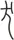

## 肆　惡乎知之──你真的知道誰對誰錯、孰好孰壞嗎？

##### 吾惡能知其辯──你心中好惡的標準是不變的嗎？

> 齧缺問乎王倪曰：「子知物之所同，是乎？」曰：「吾惡乎知之！」「子知子之所不知邪？」曰：「吾惡乎知之！」「然則物無知邪？」曰：「吾惡乎知之！雖然，嘗試言之，庸詎知吾所謂知之非不知邪？庸詎知吾所謂不知之非知邪？」

「齧缺問乎王倪曰」。王倪這個大人物出場了，《莊子．天地》篇提到這樣一段師承關係：在〈逍遙遊〉出現過的讓聖王堯自覺渺小的許由，他的老師是齧缺，齧缺的老師是王倪，王倪的老師則是被衣（註1）。我們來看齧缺、王倪師徒的問答。

徒弟齧缺問王倪老師說：「子知物之所同，是乎？」他說：「老師啊，您知道所有事物的共通之處嗎？」如果是儒家的老師應該會回答：「是的。」然後告訴你「理一分殊」、「物物一太極」，對不對？可是王倪身為莊學典範，他竟然回答說：「我哪知道啊？我不知道。」怎麼會這樣呢？齧缺想：身為老師，回答「不知道」不太妙。而身為學生，老問師尊答不出來的問題好像也不太好意思。齧缺於是就想，乾脆釜底抽薪，搞清楚老師什麼事不知道，以後就別問這些了，免得讓老師出醜。齧缺就問了：「子知子之所不知邪？」，老師啊，那您知道哪些事是您不知道的嗎？結果王倪竟又回答：「我哪知道呢？」如果你的老師接連兩次都這麼答覆你，你可能想：別問他了，他都不知道。

可是齧缺是一個好學生，他最後能當得起許由的老師，一定對學問充滿了熱情，所以又追問了。他想：我的老師不知道，是不是表示其實大家也都不知道啊？他怎麼想都覺得老師不可能不如人。於是他又問了：「然則物無知邪？」老師啊，難道世間萬物都跟您一樣，沒辦法知道嗎？王倪還是回答：「吾惡乎知之！」我哪兒知道呀？天啊，就在齧缺快要徹底崩潰的時候，王倪終於說話了：雖然我真的不太知道，「嘗試言之」，還是讓我試著為你說說吧。莊子或莊學典範人物說話的時候，絕對不是「我告訴你，這我會，我教你，我是行家」這種語氣。王倪一副其實我也是生手，不過我們可以切磋切磋的態度，你聽聽看，若聽過之後覺得不對，可以不要採信。這是一種態度，學莊子學到最後，學到的是面對自己有限人生、有限知識的謙遜態度。

王倪說了什麼呢？非常有意思。所說的內容也解答了之前為什麼都回答不知道。他說：「庸詎知吾所謂知之非不知邪？」「庸」跟「詎」都是「何」的意思，我怎麼知道那些我覺得、我肯定我知道的，不是「不知道」呢？透過媒體、透過畫面對一個事件的報導，我們往往就相信了，可是我的記者朋友告訴我：就算看到畫面也不要相信。我讀碩士班的時候，有一陣子在華視空中大學打工，擔任教學助理。有天節目需要一張總統的圖片，便叫我到資料庫找。走到龐大的資料庫，我這才意識到為什麼就算看到畫面也不要相信。因為隨你剪接、隨你採擷。你在電視機前以為看到的一定是真相，可是你怎麼知道，你所說的知道，不是不知道呢？

「庸詎知吾所謂不知之非知邪？」有時候你說你不知道，可你怎麼知道，你不是已經知道了呢？我前些時候認識了一個射手座的新朋友，想多了解他一點，剛好我有個好朋友的女朋友也是射手座。他們倆從大學相戀，女朋友到哪他就追隨到哪，女朋友到荷蘭，他就跟到荷蘭學建築。「你跟她在一起這麼多年，趕快告訴我，要怎麼跟射手座溝通？」我一問，他就笑了，忽然從一個極為理性睿智的建築師變成一個傻子，一味傻笑。「你女朋友不就是射手座嗎？趕快告訴我射手座喜歡什麼樣的老闆？」我又再追問了一次，結果他兩手一攤，繼續傻笑著說：「我不知道，我哪會知道射手座呢？」我那時候忽然覺得潛入兒女之情柔波裏的他好像白痴喔。可是在他說「我哪會知道？」的時候，我想他心裏其實是知道的，不然怎麼會讓他深愛這麼多年？所以你又怎麼知道，你說你不知道，不是已經知道了？

> 「且吾嘗試問乎女：『民溼寢則腰疾偏死，鰌然乎哉？木處則惴、慄、恂、懼，猨猴然乎哉？三者孰知正處？民食芻豢，麋鹿食薦，蝍且甘帶，鴟鴉耆鼠，四者孰知正味？猨猵狙以為雌，麋與鹿交，鰌與魚游。毛嬙、麗姬，人之所美也。魚見之深入，鳥見之高飛，麋鹿見之決驟，四者孰知天下之正色哉？』」

王倪開始反問齧缺了。「吾嘗試問乎女」，那我問你看看，「民溼寢則腰疾偏死」，人住在潮溼的地方，腰就容易痠痛生病，經年如此可能會病到「偏死」，半身不遂的地步。「鰌然乎哉？」可是泥鰍也會這樣嗎？泥鰍遇水開心極了。前幾年我家淹水，淹水人容易觸電，容易導致一大堆問題，水退前我根本不敢走進我的房子。可是想起我小時候養過的六角恐龍──一種水陸兩棲的蠑螈，要是牠在淹水的房子裏，一定玩得很開心吧？

人要是住在樹上，多半會因為高度而恐懼。「惴、慄、恂、懼」，這四個字看起來艱深複雜，其實都是恐懼的意思。「猨猴然乎哉？」可猴子在樹上生活非常自在，一點兒也不會害怕。王倪就問了：「人、泥鰍跟猴子，到底誰才知道哪兒才是最好的居所呢？」我很喜歡我現在住的房子，因為是照我的心意佈置的。可是有一次，我跟一個也認識我母親的朋友說：「我媽很奇怪，竟然不欣賞我的房子。」她聽了以後笑得很尷尬，說：「我也不喜歡。」她們無法體會我把所有房間都打通住起來有多快活。要是按照一般房子的隔間，在臥房裏就只享有五坪、在廚房享有五坪，但我可以隨時都享有三十多坪。可是她們不懂，只覺可怕，屋子裏怎麼都沒有隔間和門啊，太沒有安全感。

「民食芻豢」，中國古人吃「芻」跟「豢」。「芻」是牛跟羊，「豢」是豬跟狗。現在說到吃狗肉可能覺得不大忍心，但在古代中國確實有吃狗肉的習慣，證據還留在文字裏。燃燒的「燃」，本字是「然而」的「然」，小篆寫作「」，底下是一把火，在右上方的「」是狗，左邊的「」是肉，加起來不就是在燒烤一塊狗肉嗎？人吃牛、羊、豬、狗。麋跟鹿吃草，「薦」是美草。「蝍且」是蜈蚣，蜈蚣愛吃「帶」，小蛇。小蛇對蜈蚣而言體型太大，所以蜈蚣只吃小蛇的眼睛。還有「鴟鴉耆鼠」，貓頭鷹和烏鴉最愛吃老鼠，人類卻覺得把老鼠當主食可怕至極。王倪要問齧缺的是：「四者孰知正味？」你倒說說，人、麋鹿、蜈蚣跟貓頭鷹，誰才知道什麼是真正的美味呢？我姊不愛吃鹹鴨蛋的蛋黃，但我覺得蛋黃比蛋白好吃，年紀小沒在管膽固醇，所以我們姊妹倆常合作吃鹹蛋。那到底是蛋白好吃，還是蛋黃好吃？辯上三天三夜也不知道答案。

「猨猵狙以為雌」，「猵狙」就是一種長得像猴子的水生動物。古書裏說猵狙喜歡跟雌獼猴交朋友。可是「麋與鹿交」，麋就喜歡跟鹿交往。泥鰍則喜歡跟魚兒一起悠游。一起悠游、交朋友、與之親近，講的是同一件事，就是男女交往，就是談戀愛。那人呢？「毛嬙、麗姬，人之所美也」，毛嬙跟麗姬是人心目中的絕世美女，但如果你以為她們到哪都是美女那可就錯了。千萬不要讓毛嬙、麗姬靠近水池，水池裏好多魚，一看到絕世美女走近只會覺得：啊，真是太醜了，那什麼怪物！怎麼沒有鱗片？眼不見為淨，就快速沉到水底去了。這才是「沉魚落雁」這個成語背後的真相。「鳥見之高飛」，禽鳥一看想：妖孽呀，這傢伙怎麼連翅膀、羽毛都沒有，比醜小鴨還醜多了。「麋鹿見之決驟」，麋鹿見了絕世美女就趕快逃跑，心想：這種動物沒毛又沒斑點，走在街上能看嗎？牠覺得真的太醜了，所以跑得非常快。

王倪這段描述非常有意思，他最後問：「猴子、麋鹿、泥鰍跟人類，到底誰才知道什麼是天下真正的絕色？」我在臺大當老師，聽了一大堆學生的祕密，難免會認識幾個交過挺多女朋友的男同學。我以前有個助理，久久就會有不同的女生跑來找他，看起來就像是來找未婚夫的樣子。我看過一兩個，找不到什麼共通點，就偷偷問他說：「你喜歡過的女生，有沒有什麼共同特色？」他說：「老師，妳沒發現嗎？很明顯啊。」我說：「哪裏明顯？我看過兩個，沒看出什麼。」他這才跟我說：「她們都很『膨皮』啊！」「膨皮」就是閩南話形容兩頰多肉的樣子。我教書這麼多年，聽過一個修課學生去整容，把臉頰兩側的肉拿掉，讓臉變小，萬一來日她愛上的男子審美標準像我這個助理那可就慘了，那兩塊肉得補回來才行。每個人喜歡的「正色」，覺得最美的樣子都不同，孰為美、孰為醜，讓人覺得很錯亂。講到這裏，到底住哪好？吃啥好？跟誰談戀愛好？這種事情，坦白講有時候連自己都搞不清楚。我曾在臺北市的街道上遇到那個好久好久以前跟我談過七年戀愛的人，擦肩而過的那一剎那心裏只覺得：「原來年輕的我，喜歡過這樣的人。」即使是同一個人，所喜歡的人的類型也是會變的。莊子筆下的王倪老師非常厲害，他舉的例子都很庶民、很切身，讓人好容易同情共感，好容易產生共鳴。

> 「自我觀之，仁義之端，是非之徒，樊然殽亂，吾惡能知其辯！」齧缺曰：「子不知利害，則至人固不知利害乎？」王倪曰：「至人神矣！大澤焚而不能熱，河漢沍而不能寒，疾雷破山、飄風震海而不能驚。若然者，乘雲氣，騎日月，而遊乎四海之外。死生无變於己，而況利害之端乎！」

忽然間，王倪話鋒一轉：「自我觀之，仁義之端，是非之徒，樊然殽亂，吾惡能知其辯！」在舉了幾個貼近生活的例子後，原來王倪老師接著要說的居然是：什麼叫「仁」？什麼叫「義」？什麼是決定孰「仁」孰「義」的判準？我們是依據怎樣的一把尺衡量人間世的「是」、「非」？在王倪老師看來都是「樊然殽亂」，紛雜、混亂，很麻煩，分不清楚，沒有一定的標準。渺小一人，又哪裏能分辨所有人的對錯呢？你原本也許覺得黑就是黑，白就是白，沒有灰色地帶，但聽過王倪老師舉的例子後，覺得他說得真有道理。天地之大、物類之多、觀點之眾、價值之殊，那麼憑什麼度量一切是、非、對、錯的尺只許拿這一把呢？

但認真的、不斷在疑問─解答中追求生命實相的齧缺不是這麼容易就停止提問的。他質問道：老師啊，「子不知利害」，是您沒有判斷美醜、優劣的能力，不知道什麼是利、什麼是害吧？「則至人固不知利害乎」，倘若是那達到人所能達到之最高境界的人，就會知道吧？我想我們可以體諒齧缺開始有點急了，問了四次的問題，老師都說「我不知道」。如果你們來問問題，老師每次都回答「我哪知道」，你們私底下恐怕也會有意見。那境界更高的人難道也跟您一樣不知道嗎？他的老師王倪回答：「至人神矣」，至人的境界非常神妙。「大澤焚而不能熱」，「大澤」指的是古代的雲夢大澤，到底是什麼樣的乾旱或大火，能讓雲夢大澤都焚燒起來？王倪說：就算這樣的乾旱跟火勢，也熱不著已達到最高境界的「至人」。「河漢沍而不能寒」，「沍」是嚴寒到冰雪凍結，能讓黃河跟長江都結冰的酷寒也凍不著他。我一九八九年第一次到北京，認識了一位氣功師荀雲昆先生，他練能治病的醫功，就是得在冰天雪地裏脫光衣服練，非常地健壯。這可能是至人可以達到的境界。前兩個境界聽起來已經很神奇，可第三個境界也不馬虎。「疾雷破山」，能把整座山都破開的猛烈雷霆，那誰不怕？「飄風振海而不能驚」，看過南亞海嘯畫面的人都會有身歷其境、非常害怕的感覺，可是至人居然也不會驚動害怕。為什麼？我想是對生命看得很通透吧，知道這個形軀是短暫的、是借用的，是總有一天要歸還的。

達到這樣境界的人，「乘雲氣，騎日月」，可以乘著雲氣，騎上日月。這邊有很多種解釋，在道教傳統的宗教性解釋裏把這樣的境界解釋成「出陽神」，靈魂可以到各地遨遊。要是受過西方理性主義洗禮的學者，可能就解釋成他的心靈是這麼地自由。「而遊乎四海之外」，我要特別強調「四海之外」，有沒有注意到〈逍遙遊〉說「何不樹之於无何有之鄉」，在《莊子》內七篇其他篇章還會提到：「遊无何有之鄉」、「遊於无有」、「振於无竟，故寓諸无竟」。莊子到底要在哪個地方遊玩？究竟要遨遊、徜徉於何處？他主要的工夫在哪裏？其實就是「无何有」這三個字，我把它解釋成非感官經驗所得見、得聞、得嗅、得觸摸的「靈魂」。靈魂的提升跟修為，往往缺少外人可以覺察的徵兆，也未必有外在可見的功業成就，一般人是不容易一眼看出來的。

一個人活在人世間，如果他覺得最需要進步的是提升靈魂的話，就能「遊乎塵垢之外」，也就是「遊乎四海之外」了，我是這樣理解莊子的。在莊子的文本裏出現兩種「遊」，一種說「遊乎之外」，表示生命的核心價值不在世俗之中，能澹然於紅塵俗世中的一切。而且能達到「死生无變於己」，安然面對生死的境界。坦白講，今天你修《莊子》，如果我們沒有搭配所謂的體驗課，不練「穴道導引」、不練「緣督以為經」，你未必會因為修《莊子》而更健康、更少病痛；可是面對一樣的病，你心情可以好很多。你看待事物的方式、面對痛苦的方式會有很大的改變。「死生无變於己」，連生死這樣的巨變都可以安然面對，「而況利害之端乎」，何況是區區事物的利害呢？多一點錢、少一點錢又怎樣？得到一個位子、失去一個位子又怎樣？難道你沒花過冤枉錢嗎？難道你沒掉過錢嗎？難道臨終前你真的剛好花到一毛不剩嗎？難道活到今天你所認知的這個世界，坐在所有位子上的人和其座位，一概都是小大相當、名實相符的嗎？如果能看得通透一點，你會覺得很多事情其實不必花時間去在乎。這就是「至人」的驚人境界。王倪說，連生死都不怕的人，你還要跟他談世俗的利害嗎？這是「惡乎知之」這個大段落的第一個故事。

##### 見卵而求時夜──你會不會想太多？

> 瞿鵲子問乎長梧子曰：「吾聞諸夫子：『聖人不從事於務，不就利，不違害；不喜求，不緣道。无謂有謂，有謂无謂，而遊乎塵垢之外。』夫子以為孟浪之言，而我以為妙道之行也。吾子以為奚若？」

「惡乎知之」一開始，我們非常訝異為什麼莊子義界下的至人，學生問他什麼問題，他都不知道？然後慢慢地，他從不知道導向讓我們明白聖人重視的是什麼。接下來進入第二個故事，是瞿鵲子跟長梧子的一段對話。瞿鵲子問長梧子說：我聽孔夫子說過，聖人「不從事於務」。這「務」指的是世俗工作的成就，聖人不把世俗工作的成就當成生命中最重要的追求，可是芸芸眾生多半如此。我們往往透過收入的高低，透過事業成功與否，來衡量我們生命中的每一年是豐收的，或是不夠美好的。

「不就利，不違害」，聖人不只不以世俗工作、成就為人生成敗最重要的指標，也不刻意追求世俗認為的利益。什麼是利益？我想各位生命中會有非常多朋友，包括自己，自己也是自己很重要的朋友。有時候我會透過對自己、對我熟悉的人的觀察，發現當生命遇到很大的疾病或變故時，正是你個性、各方面可以改變或說改善的機會。我也有這樣的朋友，在健康的時候有點驕傲。生病了以後再跟他接觸，我變得非常喜歡這個人，因為他生命中的稜角跟傲氣被病給磨掉了。如果這樣的價值取向來看，生病對他而言未嘗不是一件美好的事。

我昨天到醫院回診，回診讓我覺得自己實在是個非常需要生病的人。因為我一旦慢慢走向健康，睡覺的時間就開始往後移，工作的時間、坐在板凳上的時間會越來越長，鍛鍊、修鍊，不管是「其神凝」或「形如槁木」的時間會越來越短，直到醫生再次對我提出警告，要我注意，我才又乖乖回到原該照護一己身心的位置。

我舉這兩個例子是要讓大家知道，有時候，當你的生命亮起黃燈甚至紅燈，不要覺得那是一場災難，也許它只是一種提醒，一個可以讓你的生命更好的機會。如果一個人的生命是這樣，一個社會或一塊土地、一個國家也是如此。我曾跟我的學生說：自己好好做菜，好好吃。他們都覺得那是老一輩人的看法，不用太理會，外食方便多了。可是我看我的學生，臺灣的食安問題接連爆發後，現在一個個都勤勞了起來，能夠自己簡單做就盡量自己做來吃。當社會出現一些問題，有時候反而是一個轉機。為什麼「不就利，不違害」？因為在一般世俗價值認定不好的狀況下，「置之死地而後生」，才有辦法徹底地反省、脫胎換骨，生活很順遂的時候反而很難做這樣的改變。

「不喜求」，世俗追求的，他不汲汲營營。有時候你會覺得：老師，我跟莊子一樣，我也不汲汲營營，可是我們在人群當中有時候是被推著走的。現在的電影院規模都比較小，我們小時候的電影院很大、觀眾很多，電影散場的時候就會有一種走快走慢由不得自己的感覺。海德格（Martin Heidegger）（註2）說：在人群中，我們常常不是活在「I」，不是活在我們自己；而是活在「they」，活在他者當中，就是這個意思。大家都談戀愛了，一個人在宿舍就好像顯得孤伶伶。大家都考研究所了，只念到大學畢業好像就不太足夠。大家都結婚生子了，沒有伴的還要一直被問是不是同性戀，很困擾。我們在社會上很多行為其實是被推著走的，但是《莊子》裏提到的聖人「不緣道」，「緣」是反訓字，是用來代表跟它相反的意思。「不緣道」，意思就是「不廢道」。沒有一天，甚至於沒有一個時刻放掉他所堅持遵循的「道」。我昨天回診，覺得自己真是可恥，醫生只是發現可能有問題，提醒說：下禮拜再來抽血檢驗。我一聽到這個消息，整個人頓時非常乖巧，隨時注意要「形如槁木」、「其神凝」。可是無病之日在滾滾紅塵當中，常常忘了這些非常重要的事，直到遇到狀況，才驚覺必須把生命的頹勢挽救回來。

「无謂有謂」，「无謂」是什麼話也沒說。一個體道的人，有時候好像什麼都沒說，但他用他所有的作為說明了一切。有些人叨叨絮絮地說了很多，卻不一定發生什麼影響。我如果發一張紙，請各位寫下生命中聽過「最感動的一句話」，或是「你對別人說過的，你自己最滿意的一句話」，可能有一部分的人會說：「好像沒有。」那你這一生聽過的話，莫非只像我在聽我的貓咪叫。雖然我聽不懂貓的語言，可是我從牠的表情、牠的眼神、牠注目的方向，我可以理解牠是叫我開水龍頭或是餵飼料。我們生命中聽過很多人說的話，會不會最後所有的語言都枉然了，跟貓咪的叫聲，或小鳥的吱喳叫也差不多？

我們從莊子心目中體道的聖人典範看到什麼？「遊乎塵垢之外」。世俗人所追求的盡在「塵垢之中」，今天當官了，明天還想當更大的官。今天一旦就職了，便永遠不想退下來。這是世俗的追求，可是聖人要的不是這些。瞿鵲子問長梧子，他說：這種莊子義界下的聖人，「夫子以為孟浪之言，而我以為妙道之行也。吾子以為奚若？」「夫子」是指孔夫子，「孟浪」是輕率無稽之談。孔子覺得這種人既沒有具體的德性描繪，又不見內聖外王之道，哪算聖人？孔子覺得只說聖人「不就利，不違害；不喜求，不緣道」，實在說得太草率了。可瞿鵲子卻跟長梧子說：「我倒認為，這些都是體悟了道的奧妙才能有的作為。不知道長梧子你的看法如何呢？」我們來看長梧子怎麼回答。

> 長梧子曰：「是黃帝之所聽熒也，而丘也何足以知之？且女亦大早計，見卵而求時夜，見彈而求鴞炙。」

長梧子回答說：「也難怪孔子會認為這是輕率之言。」像這樣的聖人境界，「是黃帝之所聽熒也」，就算是黃帝這麼有智慧、發明了這麼多制度、器物的聖君，聽了可能也大惑不解。「熒」是光亮，一明一滅，一閃一閃，在這裏是「惑」，疑惑的意思。「而丘也何足以知之」，孔丘哪能明白呢？讀中國思想史讀到儒家時，總覺得孔子的地位誰能出其右？可是當閱讀先秦典籍的時候，會發現黃帝或者堯在古文獻裏記載的成就其實不亞於孔子，不論在內聖或外王方面都有更具體、更卓越的表現。其實，也難怪儒家會無法了解《莊》學，或說道家這樣一種不同於儒家的價值觀、不同的思想、不同的學說、不同的聖人典範。「且女亦大早計」，之前讓我們最震驚的是說聖人「不就利，不違害」，對於這點，我們會想趨吉避凶乃人之常情，聖人怎麼會有這麼不同的人生取捨呢？長梧子說：其實一般人總是「大早計」，都算計得太早了。怎麼算計呢？「見卵而求時夜」，這個「時」，就是「司」、「主司」，「時夜」就是主司報曉。今天才看到一個雞蛋，你就開始盤算這個雞蛋將來有機會孵出一隻公雞，所以現下鬧鐘壞了不用買，反正即將來臨的公雞可以幫我報時，這真是想太多了！你怎麼知道孵出來的是公雞不是母雞？大家聽這個例子覺得非常可笑，可是在滾滾紅塵中，我們常常這麼可笑而不自知。比方你看到一個人，覺得就是茫茫人海中那個對的人，你就動了心、動了情，開始有些動作、發動一些攻勢。一旦示好的行為沒有得到相應的回報，甚至是像用熱臉去貼人的冷屁股時，你就會非常地難過、自覺非常受傷。這不也是「且女亦大早計」嗎？你怎麼知道你命中註定的人一定是他？可能半年後真正對的人出現了，你會想半年前真是蠢極了，幸好、幸好當時那人沒理我。其實生命中很多痛苦都是因為「大早計」而來。

「見卵而求時夜」，剛剛講看到雞蛋就想要孵出公雞來報曉。「見彈」，今天有個彈弓，就想：晚上不用買菜了，只要去打隻貓頭鷹烤來吃就好了。這也是想太多、想太早了！這種對生命中過度算計的檢討，跟《莊子．應帝王》講的「不將不迎，應而不藏」，不事先揣想，事後也不放任自己持續地慨歎、追悔，整個思想價值是相應合拍的。

##### 以隸相尊──能照料自己，也能關照眾人。

> 「予嘗為女妄言之，女以妄聽之，奚？旁日月，挾宇宙，為其脗合，置其滑涽，以隸相尊。眾人役役，聖人愚芚，參萬歲而一成純，萬物盡然，而以是相蘊。」

莊子藉長梧子之口接著描述的聖人典範，境界實在太驚人了。如果莊子一開口就說：好吧，讓我告訴你，我學說裏面的得道者是什麼樣子，你聽了可能會覺得後面的描述太誇張、很刺耳。可是因為前面講得謙卑，「予嘗為女妄言之」，就讓我試著為你說說吧，你聽聽就好，不用太專注、太認真，我講的也不一定有道理。人有時候很奇怪，對方越這樣講，你越會覺得後面的話可能很重要，就注意聽了。

「奚」，要說什麼？該怎麼說？很難啟齒。長梧子接下來講的境界蠻驚人，「旁日月」。其實孟子文筆好，莊子文筆也好。孟子講「浩然之氣」：「其為氣也至大至剛，以直養而無害，則塞于天地之間。」在閱讀這段文字時，因為文氣太流暢了，也就跟著孟子文句的抑揚頓挫吟誦了起來，彷彿真就感覺到豐沛的浩然之氣充塞在整個宇宙，沒起一點懷疑。可要是孟子文字差一點，你或許就會開始質疑所述內容的真實性。長梧子說的這個境界跟孟子描繪的「浩然之氣」很像，當人的靈魂境界偉大到「旁日月」的程度──平常人手這樣一掛，就只掛在身邊的桌椅或校園裏的一棵樹上吧，可是聖人不一樣，他可能隨便一抱就抱到太陽、月亮，因為魂魄太大了。「挾宇宙」，曹操也不過挾天子令諸侯，但《莊》學的典範人物挾的可是宇宙，好像整個地球都能納於股掌上。這是一個驚人境界的描述，聖人的境界竟是這樣遼闊。接下來講點具體的吧！

「為其脗合」，當你需要幫助的時候，他總是幫得這麼恰到好處，不論幫誰都一樣盡力，沒有分別心。「置其滑涽」，「滑涽」這兩個字是紛亂，你的心一旦紛亂著、執著著，就容易越陷越深。在臺大教書十幾年，自然會遇到幾個願意跟你分享自己生命祕密的學生。我也遇到過幾個很善意、願意把心情跟我分享的孩子。病歷表上被填寫憂鬱症或躁鬱症之類的學生告訴我：「老師，那是一個黑洞。如果往這牛角尖不斷想下去，整個人真的會被吞噬掉。」你或許會問這可憐的孩子：「為什麼不能不要想？」他說：「就是沒辦法。」有個學生，在他自殺失敗的第二天找我談話，告訴我他怎麼樣聽見繩子斷裂的聲音，告訴我明明房子裏只有一個人，在他自殺的那一剎那卻聽到不明人士的對話，挺恐怖的。後來我問他：「你怎麼捨得自殺？你女朋友這麼貌美，跟你這麼好，交往這麼多年。」我跟他提及這世界還是很值得耽戀的種種。他說沒辦法，一旦掉進那個黑洞就會開始胡思亂想，想個沒完，這世界上的一切都留不住他。如果今天換成心理諮商師，可能會開始跟你談那個黑洞。最後告訴你，一定是你小時候有什麼陰影留在心頭，所以要連根拔起，接著開始跟你自小就與之相處的家長對話，彷彿尋繹病根之根。

東方修鍊的方法不同，「先睡心，再睡身」。關機，把你的念頭關機，就是莊子「其神凝」的工夫。所以遇到再混亂的場面，你只要「置其滑涽」，把這個混亂丟到一旁，就會復歸平靜。你說：「老師，我會一直想。」誰讓你想了？把自己的念頭像釘鐵釘一樣釘著，釘在印堂，釘在膻中，釘在丹田。想像你的念頭被一根鐵釘釘在那兒，不能離開，它真的就動不了。當然，如果你想在心情不好的時候增添樂趣，你就想：我是一隻貓，現在一隻老鼠跑過，停在我的眉心（印堂）、胸口（膻中）、臍下四指幅（丹田）處，於是就像貓盯著老鼠一樣緊盯不放，你的注意力也毫不鬆懈地盯著印堂、膻中或丹田，像貓盯住老鼠、子孫緊守著家傳珍貴寶石，因為緊盯住，所以不許移動，所以無法有念頭。這就是「置其滑涽」，莊子教我們把世間是非、紛亂從心上卸下的方法。

「以隸相尊」，隸是奴僕、是小廝。世界上，如果這地方或國家的疆域比較小，稱自己國家時常會加個大字。比方說大日本、大不列顛，其實這些地方都不太大，只有很小的地方會不斷說自己大。同樣地，只有不太偉大的人會一直說自己很偉大。在修鍊的路上，其實人要學的不是高，而是低。低能自省、低能包容。

我剛來臺大教書的時候不太知道怎麼跟學生相處，還去請教過我早年教的學生。我說：「在臺大當老師，有時候不太知道怎麼辦。現在的孩子不太有禮貌，有時候找你聊聊，那樣的措詞、態度，你還真不知道到底他是老師，還是你是老師啊？身為教育工作者，我該制止、糾正他嗎？可是我又蠻享受那種他們把我當朋友的感覺，可是有時候又覺得他們造次、失了基本禮數了。」這個學生給我的回答太有智慧了，他說：「老師，我建議妳好好珍惜他們把妳當朋友的歲月。」我說：「為什麼？我不用管他們造次了嗎？」他說：「不用。老師，因為理所當然妳每年都會比妳的學生老一歲。每長一歲，思想與智慧的成熟度都將與堂前的學生差距越來越遠。所以老師啊，我建議妳好好珍惜他們把妳當朋友的歲月。」我聽了覺得挺有道理的。尤其對一個女人來說，「老」這個字很難讓人無感。我馬上接受他的觀點，樂於接受學生沒大沒小的朋輩相處方式。年紀更長，較懂《莊子》，我才知道以前的矛盾在哪。

我是讀中文系的人，研究所時代修習三禮。我又是臺南人，家裏的倫理、尊卑很明顯。夏天家裏只要有一個男人說：「來吃布丁喔。」我們全家的女人就會一起奔向冰箱，爭取拿布丁這個光榮的任務，送到爺爺、爸爸、哥哥的手中。我們家吃布丁的方式還挺講究，下面有個托盤，盤中還會放個小銀匙。接著所有女人會豎起耳朵，專心聽誰的湯匙在哪一秒鐘「鏘」一聲落在盤子裏，表示吃完了。所有女人又會快速跑到爺爺、爸爸、哥哥的尊前，把空的布丁盒、布丁碟，還有小湯匙一起拿回廚房清理。為了熱心地搶作這些，有時候還不免會互相撞著，非常有趣。

我這樣做了半輩子，當我變成老師，學生到我家，小輩們怎麼就微笑涼快地站、或坐在一邊看著或完全不理會我正在為大家做菜呢？有一天我家要做小小的裝潢，學生居然建議：「老師，你這應該做個吧檯。這樣妳在廚房做菜，做好就放在吧檯，我們直接從客廳接手過來吃，好順呢。」真是生不逢時。怎麼我從小伺候長上到大，等到我為人長輩了，學生竟然把我當成店小二般？來，這是你的開胃菜。來，你的涼水一杯。剛開始我有點不平。可是《莊子》讀久了，變得挺滿意這樣的身分，因為「以隸相尊」。有時候想想，身為一個人不用太計較，反正已經下課了，下課了身分就不再是老師。活在世界上能為別人服務表示四肢健全不是嗎？我喜歡做菜，所以跟別人出去，不管吃燒肉、吃火鍋，都會扮演或燒烤或調理的角色，想保障食物美味，一定得親自動手。別人覺得你很勤勞，可我是樂在其中，心裏想的是，我吃一會兒就站起來動一會兒，這樣怎麼吃都不容易過胖。所以很多時候你只要換個想法就會有不同感受，到底是服務別人的人比較幸福，還是被服務的人比較幸福？

我不斷跟學生強調在這個食安問題彼落此起的時代做菜、自炊的重要，有個學生聽了就笑了，我說：「你笑得好奇怪，不認同老師的說法嗎？」他說：「老師啊，妳說得很有道理啦。一個人會做菜，當然三餐可以吃得很不錯嘛。可是我告訴妳喔，結交一個會做菜的朋友也不錯。」這小孩常跑來我家吃飯，說得我好像真的被佔便宜了。可有一天發現，我雖然吃得跟他一樣多，可是因為我整天忙來忙去、頻繁走動，真的比較不會胖。所以我鼓勵大家，學習《莊子》以後開心地當個小廝，開心地當個伺候別人的人。當別人攤在那兒讓你伺候的時候，你心中會徘徊很多故事。聽說哪一個人的曾祖母今年九十幾歲了還很健康，一問，原來是家裏有片田地，每天都不斷地勞動，老了還是非常健康。習慣「茶來伸手，飯來張口」的人，可能才到中年，看起來就像晚年一樣衰老，且心身因此較缺乏應變、臨危的能力。奉獻生命、服務眾人，「以隸相尊」，把自己當成奴僕、小廝一般，服務眾人，不要覺得自己吃虧，吃虧就是佔便宜。

「眾人役役」，一般人為了身外的追求，庸庸碌碌，日夜勞苦。有人好像很機靈，錢賺很多、很快，甚至反過來譏笑辛苦賺錢的人。我很喜歡看《臺灣真善美》這類的節目，裏面講好多年輕人、父母親，為了讓家人不再過敏，去從事各種蔬果的有機栽培，或開始養無毒蝦。你會聽到他們多辛苦、賠本多少年後，終於第一年轉虧為盈──整年下來收穫十二萬，不再賠錢。我想，有錢人看到這樣的畫面可能覺得這些人真蠢。這麼辛苦，一年居然只收穫十二萬元！而沒有想到在勞動當中，他們可能變得很健康，也產出真正有益於人的實質貢獻。有錢人想：我隨便錢滾錢或者洗錢，隨便就賺他幾百億、幾千億，哪是這些可憐的小老百姓能理解的。可是你真的不知道最後到底誰賺了？誰虧了？「聖人愚芚」，跟很會算計的人相比，勤勤懇懇、本本分分的人就顯得愚蠢。「芚」這個字唸ㄓㄨㄣ，解釋作「無知」。如果唸ㄉㄨㄣˋ，就是「遲鈍」，兩個讀音都可以。聖人顯得很笨，因為整天注意「其神凝」，注意今天的思慮是不是更少？今天的真陽之氣是不是更豐沛、更磅礡？世俗之人覺得拿真陽之氣來秤秤重吧，能值幾個錢啊？聖人的追求顯得很傻。

可是為什麼聖人要追求這些呢？難道聖人不羨慕那些鎂光燈聚焦下的人嗎？不羨慕那些一本萬利的人嗎？「道家者流，蓋出於史官」，當你站在足夠的歷史高度，「參萬歲而一成純」，參透古往今來的盛衰興亡，你就會問：什麼是生命中最珍貴的？最有價值的？到底人生最值得投資的是什麼？

我跟一些朋友組讀書會十餘年，在我生病時，他們總是非常熱情地一陣子就給我寫卡片、送禮物，寄到家來，我非常感動。當我治療到一半的時候，聽到讀書會的另一個朋友也病了。我非常訝異的是她在生病後很快地回到學校，又很快地接了行政職，非常忙碌。後來當我再聽到她的消息，她已經走了。懷想斯人之餘，我警惕自己：今天開始要早睡。我們在這個世界到底要爭什麼？教學評鑑嗎？國科會獎勵嗎？我們究竟在忙什麼？這是一個學者的自問。最後你會發現，到底什麼樣的成長跟收穫是你最覺得有意義的。〈逍遙遊〉講「其神凝」的時候，我說生命中的逆境像重訓中的槓片，能讓人變得更堅強。一旦掌握《莊子》之學所領悟的道理，在跟萬事萬物交接互動的過程中，都在錘鍊這樣的人生目標。

「而以是相蘊」，我們就在所有的遭逢中不斷地積蓄、長養自己的生命。所以你會看到一種迥異於世俗的價值，如果你還沒進入其中，可能會覺得非常空泛，覺得怎麼能放下那麼真實的世間成就，來做這麼虛無的追求？如果你這麼想，一定還沒開始每天從事「其神凝」、「形如槁木」或者「緣督以為經」的練習，專注於自我提升。當你每天都重視身心的修鍊，也許只是從五分鐘、十五分鐘開始慢慢增加、累積，你漸漸會對生命中這兩種不同方向的追求有相當清楚的、不同的感覺與體悟。

##### 覺後知夢──夢裏的哭泣、狂喜若是多餘，那現在呢？是否猶自執迷而不覺。

> 「予惡乎知說生之非惑邪？予惡乎知惡死之非弱喪而不知歸者邪？麗之姬，艾封人之子也。晉國之始得之也，涕泣沾襟；及其至於王所，與王同筐牀，食芻豢，而後悔其泣也。予惡乎知夫死者不悔其始之蘄生乎！」

人世間的利害，有什麼比活著還重要？人死了，再多的財富，再輝煌的事業，再多的嬌妻美眷又如何？黃元吉《樂育堂語錄》提到：「黑漆棺中，財產難容些子；黃泉路上，妻孥又屬誰人？」可莊子說：「予惡乎知說生之非惑邪？」我怎麼知道，想要活著這件事，究竟是不是茫昧的迷惑？千萬不要誤會莊子是鼓勵大家去嘗試死亡，其實莊子這麼說一如「鐘擺原理」，這個世界貪生怕死的人多，可貪生怕死不一定有助於不死，因為怕死的焦慮會讓心變得非常不平靜，可能反而因此死得快。所以你越怕死，莊子就越要告訴你死亡可能不是那麼可怕，讓你不要害怕。莊子因此說：你我哪知道很想活著這件事不是一種迷惑呢？哪知道很怕死這件事，會不會其實就像是「弱喪而不知歸」？就像是年輕的時候離開故鄉，年老了居然還不知道回家。會不會有一天人真死了，其實只是一種回家的感覺？

當你開始練「形如槁木」，練到比較放鬆了，身體不只不痠痛，覺得變輕靈了，每天快要入睡的那一剎那會有很特別的感覺，因為身體感覺很輕靈，你不太能分辨那是即將睡著還是死亡，好像不再感受到這個形軀的存在。我們很難接受這樣的觀念，一般人聽到朋友死，不會覺得：「好棒喔！他回家了。」還是會覺得很遺憾，他就這樣走了。我上次路過新竹的時候，一直給一個病友打電話，卻都沒有人接，那時我那麼想看到她，可還沒看到，她就這樣走了，還是會難過。莊子刻意舉了下面這個故事，讓我們對這樣的悲傷，覺得應該有放下的可能。

「麗之姬」，以前在麗戎之國，有一個非常美麗的女子。她是「艾封人之子」，這個「封」是典封疆土，她父親被冊封在「艾」這個領地上，她是地方領導人的女兒。晉獻公跟秦穆公一起去攻打艾，打下之後便開始分贓，得到的寶物共有玉環兩枚、美女一位。秦穆公選兩枚玉環，這個人不好色，但好寶物，晉獻公就領了這個美女回家。這美女不是別人，是「艾」這地方的領導人的女兒，一位公主。不管她爹是酋長還是小國之君，在那個地方的地位是不容小覷的，如今成為俘虜，你可以想像她有多難過。「晉國之始得之也，涕泣沾襟」，晉國剛得到這位美女的時候，她哭到鼻涕跟眼淚交糅，連拿個手巾的心情都沒有，整個袖子都弄糊了。沒想到「及其至於王所」，被俘虜之後在王宮的生活，「與王同筐牀」，原來不是當奴婢，是當妃子。「筐牀」後代注解說就是「安床」，非常好睡的大床，住得不錯。飲食水平則是「食芻豢」。讀過三《禮》就知道，中國古代一般百姓要吃到三牲非常困難，通常是在一年中重要的祭祀、特殊的節日才可能吃到。可嫁給晉獻公就不同了，宮中的日常生活即可食「芻豢」，「芻」是牛羊，「豢」是豬狗。當然一個女人也不是這麼現實的，不會只求好床、好食物，晉獻公可能也蠻體貼的吧。這時候她就後悔了，覺得：我當初被俘虜的時候居然還哭呢，應該放鞭炮的。無需「眾裏尋他千百度」，一個好男人就這樣不請自來地把我虜來了，而我就這麼不費吹灰之力地找到好對象了，真是幸運啊，所以她很開心。

莊子藉由這個具體的故事讓我們對死亡有不同的感覺。「予惡乎知夫死者不悔其始之蘄生乎」，我們現在那麼害怕死亡，說不定死後覺得逍遙著呢，反而後悔當初為何那麼想要活著，就像麗姬後悔當時的哭泣一樣。活著的時候整天為了體重算計，現在永遠這麼輕靈，不管怎麼都「形如槁木」，多舒服。

其實生活中我常有這樣的經驗，可能今天覺得自己真是倒楣透了，可是第二天卻覺得前一天倒楣的自己真是幸運。比方說我要去談一個案子，其實對方原先是不太想答應的，覺得這個案子實在太麻煩了，不想接，對方在電話裏也好像已經委婉表示拒絕。可剛巧正式去談的那天我身體狀況挺糟的，對方看我一臉蒼白，可能擔心再拒絕我就昏倒了，竟然就答應了。我離開的時候覺得：今天氣色欠佳真是一件太美好的事。前一刻、前一天還覺得狀況不太好，第二天、此刻卻覺得太感謝了，還好我昨天狀況不太好。舉這些例子，只是為了讓各位了解，可能你今天覺得很悲傷的事，明天會覺得非常美好。

我在臺大看最多的悲傷情節就是「分手」。男女朋友吵架，多的是把臉色從蘋果臉哭成灰牆臉，好像世界末日到了。或是告白失敗，就覺得自己人生只能這樣了。可過半年真命天子天女出現了，他因此笑著說：「幸好去年的那個女孩沒眼光，沒理我。」那麼為什麼我們在遇到災難的當下都覺得陷到無底洞裏，而不知道那樣的深淵其實可能正通往另一個《愛麗絲夢遊仙境》的仙境。如果在每一個逆境中你都認定「禍兮福之所倚，福兮禍之所伏」，其實人生也就沒有什麼好悲傷了。

> 夢飲酒者旦而哭泣；夢哭泣者旦而田獵。方其夢也，不知其夢也。夢之中又占其夢，覺而後知其夢也。且有大覺，而後知此其大夢也。而愚者自以為覺，竊竊然知之。

莊子講完「麗之姬」這個短篇後，又舉了一些例子。「夢飲酒者旦而哭泣」，有的人在夢裏暢快喝酒，但白天醒來才發現真實的生活是這麼教人悲傷。還有另一種相反的例子，在夢裏是非常悲傷的，「旦而田獵」，但白天醒來卻非常開心地出門打獵。你有沒有作過非常倒楣的夢，醒來的時候覺得還好是夢，非常開心？有時候夢境對自己也可以是個提醒。我前些天作了一個可怕的夢，夢裏我拿著真實生活中買的一把梳子梳頭，一梳所有的頭髮都掉了，真是可怕。我在夢裏就告訴自己，真是不要命，都已經死過一次了，從鬼門關前回來還敢半夜兩、三點睡。我在夢裏一直教訓自己：難怪頭髮掉光，活該。醒來的時候發現頭髮還在，好開心。那一天我再次立下要慢慢變早睡的志向。

「方其夢也，不知其夢也」，可我們在夢中的時候都不知道只是在夢中，所以這麼刻骨銘心地哭過，這麼得意洋洋地笑過。「夢之中又占其夢」，因為我們不知道這一切都只是夢，所以很在意幾歲買房子、房子有多大？幾歲談戀愛、對象好不好？打算要在這個世界活上千秋萬歲似的。如果我們想這只是短暫停留、只是一段旅程，就比較能夠接受莊子所講的，生命中真有比向外追逐更重要的事。要不，「夢之中又占其夢」，你在夢裏面，又深度執著於夢中的吉凶，夢裏還去占夢。直到醒來才知道，真真正正只是夢。

有時候我也覺得自己太在乎、太執著於一些美好的事。記得有一次作夢，覺得太美好了，在夢裏居然這麼想：不能只是夢，必須是真的。為了證明它是真的，夢中的我舉起食指啃咬，越咬越用力，在夢中發現它真的會痛，可見這不是夢。我開心極了，醒來才發現原來在夢中咬手指也會疼痛。這不就像是真實人生的寫照嗎？我生病之後，有一回拔了一顆智齒，那顆智齒跟我的牙床纏鬥許久──或者應該說，那顆智齒跟我的牙醫纏鬥許久。我記得他拿了一把可怕的鉗子，鉗住我的智齒開始旋轉，每次旋轉，我的頭就跟著搖晃。我的智齒拔了兩個小時才拔下來，我痛苦極了，後來還吃了好久的消炎藥。因為實在太痛苦了，我居然就把那顆牙留了下來，浸在一白瓷小缽水裏，每天看著覺得挺有意思，自問怎麼有顆這麼大的牙？像動物的牙，很有趣。每天做菜的時候還給它換水，久了以後它成了個好玩的東西，就不丟了。每次換水我看到佔空間的它又覺得自己真無聊，鉛筆用完都不丟，就這樣短短的擺在抽屜裏一罐又一罐，現在又搞了一顆掉了的牙，到底在做什麼？另方面又覺得它可能有一天有用，就沒把它丟掉。一直到前陣子，看到這顆智齒，我忽然有一種很特別的感覺。我看著它，不再覺得它是我，因為它不就是一顆拔掉的牙嗎？保存痛苦拔牙經歷的一顆牙。那會不會有一天我看自己的身體就像看這顆牙一樣，已經跟我不相干了？這樣講就有哲學意涵了。

「且有大覺，而後知此其大夢也」，莊子說：有誰能知道這樣的人生只是一場夢呢？只有徹底覺醒的人才知道，世間種種不過是一場過眼大夢。可是誰能有這樣的領會呢？一般人都自認聰明，別人賺好久才賺兩萬，我進帳一下就兩千萬、兩億、兩百億。看到新聞伴隨選舉而往來的金錢流動，忽然覺得千萬富翁、億萬富翁又算什麼？兆、千億好像都可以在轉手之間，能夠這樣過生活的人可能覺得自己很聰明吧？「竊竊然知之」，「竊竊」是察察私語。這些人會偷偷告訴你一個祕密，哪支股票一買，十天後就要大漲價；哪塊土地一買，十四天後工業用地就轉變成建築用地，可以蓋房子當住宅賣了。他們覺得自己有智慧極了，洋洋得意。當然這可能涉及違法，不能大聲公告，可是免不了要跟幾個體己小聲炫耀一番。

> 「君乎，牧乎，固哉！丘也與女，皆夢也；予謂女夢，亦夢也。是其言也，其名為弔詭。萬世之後，而一遇大聖知其解者，是旦暮遇之也！」

莊子接著說：「君乎？」覺得自己是君王很尊貴嗎？因為很尊貴，可以享有特權，財富就滾滾而來是嗎？「牧乎」，有人的工作是牧養牛馬，覺得自己很卑賤、永遠翻不了身。在現代社會裏，可能有很多人覺得自己註定既不快樂也沒希望，覺得這輩子好像是白過了，活得太辛苦，更別提享受，連基本的安適都沒有。可莊子說：「固哉！」這都是固陋的見識啊。回到我們一開始講的，莊子覺得我們遇到所有的風、所有的水都是考驗。你通過一回考驗，變強了，阻力就變助力了，那一天你一定會感謝你曾經遇到的那些考驗。

「丘也與女，皆夢也」，最後長梧子就跟瞿鵲子說：在我看來，覺得那些關於聖人的描述是輕率之言、無稽之談的孔丘，是在一場夢中；而瞿鵲子你認為《莊》學典範裏的聖人是真的體悟最高妙道理的人，有這種感受的你也是在一場夢中。長梧子告訴瞿鵲子，「予謂女夢，亦夢也」，包括現在對你說「你跟孔子都在夢中」的我，其實也在一場夢中。這些話真是太難解了，但如果這麼真實的人生、捏了會痛的人生居然只是夢、是暫時的，不是千秋萬世，那究竟什麼才是真的呢？

「是其言也，其名為弔詭」，「弔」就是「至」，極其詭異，沒有人能懂。所以說「萬世之後」，一萬個三十年後，「一遇大聖知其解者，是旦暮遇之也！」假設能遇到一個偉大的聖者，居然能知道我今天提問的一切答案，那真是千秋萬世裏、茫茫人海中最最可貴的相逢。或許就像白居易的〈答微之〉：「君寫我詩盈寺壁，我題君句滿屏風。與君相遇知何處？兩葉浮萍大海中。」你可以去花市買兩葉浮萍，拿到醉月湖邊，一葉從這頭放下，另一葉從對岸那頭放下，看兩葉浮萍能不能相逢。你說：「老師，這太強人所難了。」就會明白，不過是醉月湖中兩葉浮萍的相逢都這麼難，何況白居易寫的「兩葉浮萍大海中」？我覺得在古文獻裏面，形容相遇跟「兩葉浮萍大海中」一樣艱難、同樣可貴的，就是「旦暮遇之」這四個字了。

「萬世之後，而一遇大聖知其解者，是旦暮遇之也」，就像兩人在一閃而過的清晨，稍縱即逝的黃昏，擦肩而過。我曾經問我的學生，如果在椰林道上，你可以選擇遇見一個你最想遇見的人，會是誰？好多學生的答案令我吃驚，女生都要遇見金城武，男生則提供了很多我本來不熟悉的名字，像茱麗葉畢諾許（Juliette Binoche）。有學生反問我：「那老師想遇見誰啊？」我愣了半晌：「遇見莊子吧。」學生聽了就笑了。

「老師，遇見莊子，妳能認得嗎？」

「能。」

「那莊子認得妳嗎？」

「嗯，認得。」

「那你們相逢是什麼樣的場面啊？」

「就我看到他，他看到我呀。」

「然後呢？」

「那一瞬在原地固定不動，定住了。」

「然後呢？」

「然後擦肩而過。」

學生沒辦法了解，為什麼不是走向前去聊一會兒天？我覺得有一種會心真的很難透過語言來傳達。我有個非常好的朋友很喜歡爬山，她常跟她最愛的人一起去爬山。她對我描述過一種境界：兩個人一起去爬山的時候是不說話的，因為一切盡在不言中。念文科的人聽到這裏，就覺得有一種非常浪漫的美感。但莊子到底想跟誰相逢呢？這對話太迷人了，他寫下這段話的時候，所有的後來者、學者、千百年後的讀者都會中計，每個人讀到這句話都會潸然淚下，覺得自己就是莊子筆下的那位解人，「知其解者」。可每個人解出來的莊子都不一樣，不知道誰是對的。當你覺得你就是他的解人，這感覺真好。天涯知己已經夠感人了，何況是「萬世之後」的「知其解者」？

##### 惡能正之──誰是教你心服口服的仲裁者？

> 我們都有跟別人吵架或辯論的經驗，我記得我還是研究生的時候，有一次一個同學打電話給我，談著談著感覺就快要吵架了。於是我說：「不好意思，你稍候一下，你家有傳真機嗎？」他說：「有的。」於是我影印了這一頁傳真過去，他看了就笑了，我們就不爭辯了。到底是怎麼樣一段文字呢？

既使我與若辯矣，若勝我，我不若勝，若果是也？我果非也邪？我勝若，若不吾勝，我果是也？而果非也邪？其或是也？其或非也邪？其俱是也？其俱非也邪？我與若不能相知也。

「既使我與若辯矣」。我們都有這樣的經驗，好聽點是辯論，難聽點就是吵架。在吵架的過程中，我們總是想著真理越辯越明，所以吵贏後會有得意的感覺。我還記得第一次有這種得意的感覺是在小一、小二的時候，我跟班上公認的大惡霸講論道理，居然辯贏了，那天回家超開心的，一定要在吃晚餐的時候好好表揚自己一番，沒想到父母沒什麼讚許的表情，我就又再訴說一遍。後來，只記得父親跟我說：「希望我教出來的女兒和別人發生爭執的時候，能先看到自己的缺點，跟人家認錯。哪怕是對方錯九分，你只錯一分，也要為自己錯的那一分向對方認錯。」我問：「那，他錯的九分呢？」父親說：「那是他的事，不是你的事。」我那天並沒有懂得什麼人間的道理，只懂以後吵架贏了不必回來炫耀，爸媽不喜歡聽。可是後來讀《莊子》，好像瞭解了什麼。這樣的辯論到底有沒有意義？

「既使我與若辯矣」，即使我們來辯論好了。「若」就是「你」。你贏了我，「我不若勝」，我辯不過你。可能是你口才好，你兇，你講話大聲，所以辯贏，難道你就一定是對的？我就真錯了嗎？換個立場，我贏了你，就算你贏不了我，難道我就是對的嗎？「而果非也邪？」這個「而」，也是「你」，你就是錯的嗎？對錯真的很難說，因為每個人對每件事情的定義或標準都不一樣。「其或是也」，會不會我們其中有一人是對的？「其或非也邪」，也就是另一個人是錯的。還有一種可能，「其俱是也」，我們都對？或者，「其俱非也邪」，我們都錯了？

我很注意一位當代文人，林徽因，她和她的情人或她的丈夫，我都非常關心。國中時我第一次在報紙上看到林徽因的照片，覺得這名女子很特別，就開始追蹤她的故事。蒐集多年，曾經在無聊的時候為她的情史編年。其中最精彩的是有一天她的丈夫梁思成下班回來，林徽因跟梁思成說：「思成，我要告訴你一件事，我愛上一個人。」那個人就是他們當時的鄰居，著名哲學家金岳霖。想像一下，你已經結婚了，辛苦工作下班後，老婆迫不及待地跑來告訴你，她愛上另一個人。你的本能反應會是什麼？是一巴掌打過去？會很生氣？還是會非常難過？梁思成聽了很是難過，他想了一整晚。你們猜他是不是在想：「這女人居然在我出差的時候，愛上了住在咱家後棟的金岳霖，這什麼兄弟啊？我供他住宿，他竟然看上我老婆！」不，他想的不是這個，如果是，這愛情故事哪裏值得歌頌、典藏。他想的是：「徽因，到底是跟著我，還是跟著金岳霖比較幸福？」想了一整晚，梁思成覺得雖然自己跟林徽因有共同的興趣和嗜好，都熱衷建築。可是金岳霖這人幽默風趣，而林徽因總是多愁善感些，也許她跟老金在一起會更幸福吧。天亮了，林徽因一覺醒來，梁思成便跟她說：「徽因，妳是自由的。我覺得金岳霖是更適合妳的，我願意成全你們。」林徽因聽了挺感動地跑去找金岳霖。金岳霖聽了梁思成給的答案後，對林徽因說：「我覺得思成是真愛妳的，我不能讓妳離開這樣一個真愛妳的人。」所以金岳霖就退出了。我覺得這個故事在哪個時代都教人震撼。大家都知道林徽因跟徐志摩，少人注意林徽因跟金岳霖。金岳霖後來終身未娶，有人說因為他太愛林徽因了，愛到什麼地步，愛到可以成全別人所愛。我非常喜歡這個故事。金岳霖跟林徽因、梁思成是一輩子的好朋友，每一次只要他們夫妻吵架，就會找老金來仲裁。但要我是梁思成才不找老金仲裁，就怕他怎麼看都是林徽因有理。金岳霖仲裁以後，總是會講一些話讓他們夫妻言歸於好，這是挺動人的一個故事。

這個故事的背後，我要說的是，我們在跟別人吵架的時候，難免會去想到底誰對、誰錯？於是常就為了一件小小的事情吵得不可開交。我年輕的時候談戀愛也很會吵，我跟對方正是別人口中最合適的兩個星座，分明感情挺好，可旁人聽我們說話都有點像吵架。吵架到底誰有道理？他永遠覺得是他，我時常覺得是我。後來我有了應對之道，不知道跟喜歡《莊子》有沒有關係。

「請問，你打算分手了嗎？」我問。

「我們只是吵架不是嗎？」

「你說這件事，我們到底會不會分手？」我又問。

「不會分手，只是吵架，聽不懂嗎？」

「那為什麼還要生氣？如果沒有要分手，為什麼要生氣？」

「為什麼不分手就不能生氣？」

「如果不分手，最後總是會言歸於好，那為什麼不趕快言歸於好，節省一點生氣的時間，多一點開心的時間？」

對方剛開始覺得我不正常，可是後來也慢慢被我同化了。好像快要吵架我就又問：「有沒有要分手啊？」沒有要分手，那就這一秒鐘，馬上言歸於好。

「我與若不能相知也」，看來單靠我們兩個不能明白誰對誰錯，要找公正無偏的第三者來裁決才行。這樣的經驗我們可能都有，你受了委屈，就告訴另一個人。別人聽了覺得：「哎呀，璧名，我了解妳的委屈。如果我是妳也會很難過的。」你會覺得：嗯，他跟我看法一致，果然是對方理虧。可莊子說不是這樣的。

> 則人固受其黮闇，吾誰使正之！使同乎若者正之？既與若同矣，惡能正之！使同乎我者正之？既同乎我矣，惡能正之！使異乎我與若者正之？既異乎我與若矣，惡能正之！使同乎我與若者正之？既同乎我與若矣，惡能正之！然則我與若與人俱不能相知也，而待彼也邪？

「則人固受其黮闇，吾誰使正之！」只有兩個人的時候，我們覺得好像茫昧不明，那找個公正人士來仲裁好了。這個「正」字在〈齊物論〉前面的段落也提過：「正色」，你覺得最好的對象；「正味」，你覺得最好吃的東西；「正處」，你覺得最棒的房子。這些都是會改變的。「正色」、「正味」、「正處」的「正」，講的是世俗價值；而「吾誰使正之」的「正」，講的則是「是非」，是價值判斷的問題。那麼，找一個跟你價值認定、是非標準一樣的人來裁定。莊子卻說：怎麼可以找觀點跟你一樣的人作和事佬呢，既然跟你是一樣的，又怎能公正判斷？那另一方也希望找個跟他的價值觀一樣的和事佬啊。若這個人無法中立，便不能找他來仲裁。不然「使異乎我與若者正之」，那就找一個價值觀跟你不一樣，也跟我不一樣的人來仲裁，最後找來的人說：別爭了，兩個都錯。既然意見跟你我都不同了，那找這樣的人也沒用。不然，找另一種人，比較有包容性的人，「使同乎我與若者正之」，一定會有一種人會說：「你是對的，他也是對的。」兩個爭論不休的人乍聽都覺得非常體己。但這樣也不對，找第三者來仲裁，就是希望他能判定誰是對的，誰是錯的，如果他說兩人都有理，那也不需要找他來了。「然則我與若與人」，既然你、我、仲裁者，三個人「俱不能相知也」，都不能知道究竟誰對誰錯。還有一個辦法，找第四人來。可還是算了吧，第三個人都不能知道了，找第四個人來仲裁，變成偶數，要是爭論雙方各得一票怎麼辦？我們的爭執究竟要怎樣才有可能斷定誰是誰非呢？

##### 寓諸無境──還有比議論是非更重要的事。

> 何謂和之以天倪？曰：「是不是，然不然。是若果是也？則是之異乎不是也亦無辯；然若果然也？則然之異乎不然也亦無辯。化聲之相待。若其不相待，和之以天倪，因之以曼衍，所以窮年也。忘年、忘義，振於無竟，故寓諸無竟。」

莊子說：「何謂和之以天倪？」如何在最自然的分際裏，調和各執一詞的雙方？當你有認定的是非標準的時候，就覺得一定要把是與非爭辯得清清楚楚。我有這樣的經驗，好朋友忽然不再連絡，因為一點無奈、一點誤會還有一點算不上爭執的爭執。一年後，我們重逢，重逢的感覺非常溫暖，因為覺得屬於我們的席並不是散了，我們又重逢了。還有必要談一年前的事嗎？根本就沒必要。那如果沒必要，當初為什麼要在意、為什麼要失聯？所以，往後一想跟朋友爭辯就自問：「我們要絕交嗎？」如果沒有要絕交，那現在就可以把在意的、煩憂的事從心上卸下了。《聖經》說：「不可含怒到日落。」含怒到日落還太久了，我們相愛又能有幾年呢？為什麼要這樣爭辯不休呢？太不實際了。怎麼樣才能在自然的分際裏調和？莊子說「是不是」，很多事情，在當下我們很容易看到別人的缺點，很容易看到自己的委屈。可是學《莊子》以後，換個立場來看，對於原本覺得對方不對的，你因此能「是」，這個「是」當動詞，就是去肯定那原本你認為「不是」的，看到他值得讚美、值得鼓勵的部分。「然不然」，你原本不以為然的，能找到對方其實也有道理的地方。「是若果是也」，你的心會有餘地去想，自己覺得對的那件事真的一定是對的嗎？如果不一定，「則是之異乎不是也亦無辯」，那你堅持對的跟他覺得錯的，是是非非，也就沒有太大的區別了。

「然若果然也？則然之異乎不然也亦無辯」，你認同的就一定對嗎？如果不一定的話，那它跟你所不認同的也就無所分別了。我們看到窗上的剪影，看上去好像是一個男人拿個刀子，就猜想這莫非是武二郎要殺潘金蓮嗎？可是如果你到現場打開燈瞧見真實的情況才知是男人很諂媚地送他愛的女子一根髮簪。我們常常因為看到的片段、看到的光線、視角不一樣，對一件事就有完全不同的認知。如果我們能承認人不是完美的、不是全知的，自己可能會看錯、可能會聽錯，就不會在一個僵持不下的局面裏如此堅持。

我們生命中最難接受的就是跟自己不同立場的人。還記得剛到臺大教書的時候，跟我相熟的社團學生總會問我：「老師，妳選舉投誰啊？」我那時很傻，就告訴他們了。之後他們覺得我是異類，會譏笑我，給我貼個標籤，什麼六八九之類的。其實有時候想想，你覺得跟你投的不一樣的人就是傻子，是因為沒看清楚事實才投給那個人，但如果兩邊的人都這麼想，到底是誰沒看清楚呢？還有，我們是真心希望別人都跟自己一樣嗎？如果你的世界是可以在虛擬世界裏先調好程式再開始你的一天，你會希望今天遇到的每一個人想法都跟你一樣嗎？想像一下如果真的每個人想法都一樣，老師、上司問問題的時候，同學、同仁們會同時跟你一起舉手。請老師延期考試或家中有事懇請老板允你一人提早下班的時候，同學、同仁們竟跟你一起發聲，做出完全一樣的動作跟聲音。真有這樣的日子，你可能過三天就覺得無聊透頂。但矛盾的是，當我們發現別人跟自己不一樣的時候又會不以為然。莊子要我們了解：「化聲之相待。」聲音為什麼會有變化？就是因為有不同的聲音相對而生，是非對錯之辯也正是因為有不同的觀點相襯才成立。一旦不再對立，「和之以天倪」，放下那個對方只要跟你不一樣就非吵起來、非對立不可的想法，在天然的分際裏調和。你便會了解，不同的價值觀就像春夏秋冬四季變化那樣地自然。「因之以曼衍」，「曼衍」是可以無窮無盡推擴。你怎麼樣適應春天？又是怎麼樣對待秋天？是添一件薄外套嗎？那夏天呢？煮鍋冬瓜茶嗎？你慢慢會知道怎樣去應對，所以都能順應包容，體諒四季更迭、殊異物候，這麼悠遊地走完一生。你徹底明白人就是有所不同，所以能夠包容、體諒。但能體諒人並不表示沒有是非，而是你能在這處境裏，不讓這個事件、那個人，變成你心裏的不愉快、執著或牽掛。

最後能達到什麼樣的境界呢？「忘年」，多數人對於年輕都是嚮往、憧憬的。我現在的年齡看我所有的學生都覺得都好看，有次導生會，我跟導生拍了張照片，回家以後反覆看，不禁懷疑是不是全中文系最美、最帥的剛好都成我的導生了？當我笑對照片覺得他們怎麼都那麼好看的時候領悟到一點：因為我老了。有一天，昔日學生生小孩，她曾是我的助理，很熟，我就到坐月子中心看她，嬰兒可就更美好了。人們憧憬年少的歲月，眷戀、執著於美好的形貌，但如果生命中有著比外貌更重要許多的追求，你就會日漸放下這些執著。

「忘義」，很多人讀了《莊子》後，做事之前會多了「到底要不要做」的考量。比方說系上課餘的表演、活動，到底要不要為了這個表演而熬夜？上《莊子》老師都說要以心身保養為優先，可是同學會討厭你沒有身為系上一份子的合群感。這個世界有一些是是非非，但當你把提升生命境界當成最重要的一件事，外在流言耳語的是非評議，你就比較不在意了。

我面對同學的時候時常會想，學生會不會覺得難以理解：為什麼在這與人競爭猶恐不及的時代還要講提升心身、身體修鍊？我想先問女性朋友，如果妳將來有個談戀愛的對象，妳希望他是肩膀非常寬闊，能夠讓妳依靠，能為妳避風遮雨；還是弱不禁風，如一片虛垂薄幕，一靠便倒？再問問男性朋友，你希望遇到什麼挫折，都有女朋友的肩膀可以讓你靠嗎？聽起來就怪怪的吧。在這個時代聽來好像有點性別歧視的味道。東方不講男女平等，講「陰陽調和」。有人喜歡做菜，有人喜歡洗碗，不需要所有人都做一樣的事情。

講提升身心能力，身體方面很容易理解，接著設想心靈。你想跟一個非常有包容心的人在一起，跟他商量任何事情他都重視：怎麼樣你會最逍遙、最安心、最健康。還是希望對方跟你說：「你以前做的工作，一個月可以交給我十萬，為什麼想換成一個月只能交給我三萬的工作？」沒有人希望自己變成工具或奴隸，日夜只為增添貢品而努力。要是你比較希望另一半能為你的心靈跟身體著想，希望他有厚實的肩膀、寬闊的胸膛、寬闊的心靈。那麼你就要先陶養自己，讓自己也變成這樣的人，不要覺得自己不知道為什麼要為這樣的目標而努力。難道你們都只希望別人心胸寬闊，但自己可以很小氣，是這樣嗎？一旦「得其環中」、「照之於天」，樹立這般人生目標的道理，很容易明白。「忘年、忘義」，變得愈來愈不在意外貌，越來越不在意自己耳目執著的是非，或是別人耳目、口水裏的是非。

「振於無竟」，這個「振」，王叔岷先生引用的注解是「止」的意思。生命停憩在「無竟」，不在意對外物的追逐，將生命棲止於一般人看不到的地方。那是個什麼樣的地方？當你在「其神凝」的時候別人不知道。當你雜念變少的時候別人也看不出來。你是一個心胸非常寬闊、很大器的人，還是一個錙銖必較，千秋萬載都記得別人錯誤，自己的好處也牢牢記得的人？這些特質與生命追求若沒有近距離相處是不容易看到的。所謂的「無竟」，是把整個生命的重點投注在生命陶養、投注在內在心靈。根據日本學者湯淺泰雄的說法，東方修鍊裏所有的身體訓練都是為了幫助心靈達到更高的境界。身體與心靈有一個共同邁進的目標，把生命寄託、寄寓在「無竟」，修養一般人看不見的內在心靈。

〈齊物論〉從「形如槁木」、「心如死灰」，到「樹之於无何有之鄉」、「振於無竟，故寓諸無竟」，對於莊子的追求，我們應該已經有一定的掌握了。

> 罔兩問景曰：「曩子行，今子止；曩子坐，今子起。何其無持操與？」景曰：「吾有待而然者邪？吾所待又有待而然者邪？吾待蛇蚹蜩翼邪？惡識所以然！惡識所以不然！」

接著是〈齊物論〉「惡乎知之」部分的最後一段。〈逍遙遊〉說：「彼且惡乎待哉！」我們可能會疑惑，如何才能無待？誰能無待呀？你今天要吃飯才能活下去，不就是有待於食物？為了上學不要遲到，所以搭計程車，不就是有待於計程車嗎？莊子如果遇到這樣的質疑，會怎麼回答？年輕的時候我打辯論，在辯論場上一定要預先準備盾牌，去抵禦所有可能會攻擊你的矛。別人會如何揣想質疑，所以莊子就先備好「罔兩問景」這段寓言故事。什麼叫「罔兩」？在大太陽下注意看自己的影子，影子外圍還有淡淡一圈影子，那就是「罔兩」，影外微陰，也就是影子的影子。罔兩問影子說：「曩子行」，「曩」是往昔、從前，之前你還在走路，「今子止」，現在怎麼停下來了？「曩子坐」，之前你坐著，「今子起」，現在怎麼站起來了？為什麼你的行為舉止沒有固定的規範？相較於儒家，《莊子》真是太自由了，他沒有提出很具體的行為準則。好多學者、注家，包括當代的錢賓四先生都覺得，沒有讀過儒家經典並不合適讀《莊子》，因為《莊子》有太多思想源自對儒家思想的反省，如果沒有好好讀過儒家經典，只看了《莊子》便以為掌握莊學全貌，很可能已失根而仍不自知。我非常同意這樣的說法。我們知道儒家最喜歡講天經地義的常道，這一段顯然是莊子對於不可動搖的天之經與地之義、不分時地均需恪守的言行規範提出一些質疑。

學過《禮》就知道，儒家對日常生活中的一切行為舉止都有一套固定的規範。孔夫子說「席不正，不坐」、「（肉）割不正，不食」。我讀研究所的時代，國文系所的研究生對「禮」講究得不得了，只要到餐廳吃飯，一定知道老師會坐在面對門、背牆壁的位子。「主人執醬」，餐桌上如果有醬油瓶，只有飯局主人或待會兒打算出錢的人才能幫大家斟醬油。儒家的世界裏，這些規矩鉅細靡遺。

如果你還不清楚，回去讀一下《禮記．曲禮》，我當年讀博士班專書考試選考的就是《禮記》，因為我的碩士論文指導老師是研究《三禮》的周何老師。我讀〈曲禮〉，覺得最有趣、印象最深刻的一段是：為人兒女經過爸媽的房間必須小跑步，因為不能偷聽爸媽聊天。我以前備考的時候覺得古人規矩還真多，如果細讀過這樣的儒家經典，就會知道莊子為什麼要講「何其無持操與」或「何其無特操與」了，行為舉止好像沒有固定的規範，總是變來變去。跟儒家相比，莊子的規矩實在太少，只講求「其神凝」、「形如槁木」、「虛室生白」等心身操作的基本原則，自然可能會被很講規矩的人質疑。

影子的影子就問了：「你怎麼變來變去沒有固定規範啊？」影子回答：「吾有待而然者邪？」我這算是有待嗎？我沒有期待一個人走到陽光下，製造出影子啊！「吾所待又有待而然者邪？」而我憑藉來產生影子的人，又可曾期待著陽光或者燭光投照在他身上？沒有啊！一切都是順其自然的。

「吾待蛇蚹蜩翼邪」，我可曾等待過？就像蛇未曾等待牠身上、肚子上具備讓牠得以爬動的橫鱗。蛇心中有上帝的概念嗎？牠說過：大神啊，一定要記得給我生橫鱗，這樣我才能往前爬嗎？並沒有，牠一出生，肚子上自然就有橫鱗了，就像蟬出生就有翅膀一樣，都是順其自然。「惡識所以然」，有時候我們不知道事情為什麼會這樣，「惡識所以不然」，也不知道事情為什麼不是這樣。學《莊子》以後，盡人事而後聽天命。你覺得什麼好，便告訴覺得可能有益於他的人，接不接受，對方是自由的，而最後結果如何，你都能心平接受。而不是說，我給你這麼好的建議，你怎麼不接受啊？不要有這樣的執著。你只要盡力，盡力之後，一切就是自由的了。因為歸根反本、盡心盡力之餘，一切都只能順其自然。

「惡乎知之」這個大段落結束了，它開始在王倪老師的「四問四不知」，從覺得這個老師好像很無能，到最後發現他其實是要收攝到生命最根本、最根本的地方。

◆　◆　◆

這個段落結束，提供兩個問題供各位思考。

第一，一天二十四小時，一輩子兩萬餘天當中，你可曾想過，什麼是你長久堅持、持續投入的？有沒有留意過，你所堅持跟投入的事情（當然也可以是愛一個人），它是怎麼樣影響你的心身能力？是讓你越來越好？還是它越好，你就越糟？

第二，你習慣用什麼樣的態度來面對變局？

面對變局，你真的要以自己身心為最重要的考量。莊子筆下這些達到生命理想典範的至人是怎麼樣面對變局的？是非常儒家的、「不信春風喚不回」的聲嘶力竭、勉力為之？還是時時刻刻致力保持處變不驚、順其自然？如果你整天都注意你的心，讓它保持舒暢、不要有多餘的念頭，覺得不開心了就讓念頭關機，當然就容易心平氣和、保身全生。

所以莊子要強調的是一種異於儒家傳統的價值，價值觀不一樣，看待一件事自然有完全不同的看法。生活的背後是一種哲學，哲學的觀照是一種生活，我們在這個有點累人的時代，讀《莊子》是有必要的，因為我們可以讓自己的心靈多休息，多蓄積生命的能量，不要像松鼠跑鐵籠一樣浪費很多力氣，思慮不斷耗散生活卻常仍在原地打轉。這絕對不只是《莊子》的道理，《黃帝內經》中說：「思想無窮，所願不得。」思慮太多會導致津液匱乏。要讓自己的津液不匱乏當然可以吃補藥，可是你更可以減少思慮，不花一分錢便有更好的效果。所以丹道稱真陽之氣為「大丹」、「大藥」，因為丹藥就在自己的生命當中。當你去主宰你心靈的時候，你的免疫系統會增強，就像一個強大的藥廠在你的體內開始重新正常運行。你會變得更有精神，更能好好運用短暫的一生，去做你更想做的事。

> （註1）《莊子．天地》：「堯之師曰許由，許由之師曰齧缺，齧缺之師曰王倪，王倪之師曰被衣。」
> 
> （註2）德國哲學家，二十世紀最重要的哲學家之一。