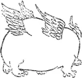

## 壹　莊子「渾沌」意象的語意實踐──生命的開始與極致境界

我們的《莊子》課程分成三條路線進行。第一條路線是經典章句的解讀，逐字逐句講解《莊子》內七篇；第二條路線是「體驗古典」，希望古書在每一位讀者的心目中不只是記載於紙片上的學問，而是像陶淵明、李白、白居易、蘇東坡一樣，讓《莊子》跟生命結合；第三條路線是《莊子》專題，例如大家很關心該怎麼談感情？有很多感情問題，莊子怎麼處理？我不能請大家把整本《莊子》拿來跳著翻，那太零碎了，所以就把我已經研究過的專題挑出來談。

以上三部分，一個是閱讀經典的、一個是生活的、一個是比較學術的，因為不知道在座各位未來會走上哪一條路徑。臺灣大學楊泮池校長主張深碗式的學習，因此，我們不是把課程簡單化，變成如綜藝節目般的淺碟，而是嘗試作比較深刻的探索。這三條路線並進，應該能對《莊子》有一定程度的掌握。

在「北冥有魚」、「堯讓天下」之後，要講的專題是「莊子『渾沌』意象的語意實踐」。這個大專題下又包含了幾個小子題，這是當你進入《莊子》身心修鍊之學的實際操作層面時，一系列很重要的課題。

##### 傳統經典中的聖「嬰」現象──嬰兒是生命的理想典範。

身為中文學門的學者、讀者，要先介紹傳統經典中一個很特別的現象，我姑且稱它為「傳統經典中的聖『嬰』現象」。因為我發現傳統經典裏面，先秦儒、道經典居然不約而同地都把「嬰兒」、「赤子」、「孺子」當成理想的心身生命典範。先看《孟子》：

> 孟子曰：「人之所不學而能者，其良能也。所不慮而知者，其良知也。孩提之童，無不知愛其親者，及其長也，無不知敬其兄也。」（《孟子．盡心上》）
> 
> 孟子曰：「大人者，不失其赤子之心者也。」（《孟子．離婁下》）

孟子把「孩提之童」跟「赤子」當成典範來說。為什麼？因為剛出生、還紅通通抱在媽媽懷裏的孩提之童已具備了「不學而能」的「良能」，跟「不慮而知」的「良知」，無需透過學習、思索即天生擁有。孟子說：如果我們長大成人後，依然能懷抱這樣一顆天生本有的「赤子之心」，那就配稱為儒家人格理想典範的「君子」或者「大人」。

再看《老子》：

> 載營魄抱一，能無離乎？專氣致柔，能嬰兒乎？（《老子．十章》）
> 
> 眾人熙熙，如享太牢、如春登臺。我獨泊兮其未兆，如嬰兒之未孩。（《老子．二十章》）
> 
> 知其雄，守其雌，為天下谿。為天下谿，常德不離，復歸於嬰兒。（《老子．二十八章》）
> 
> 含德之厚，比於赤子。……骨弱筋柔而握固。未知牝牡之合而全作，精之至也。終日號而不嗄，和之至也。（《老子．五十五章》）

老子多次以「能嬰兒乎」、「如嬰兒」、「復歸於嬰兒」、「比於赤子」表達對歸返「嬰兒」心身境界的嚮往與追求。可惜了，我們要是一出生就致力維持那初來時的狀態，今天境界就跟老子相仿了。不過也無需抱憾太早，我們來看老子要學習、要歸返的究竟是嬰兒具備的何等能力？老子說：「專氣致柔」，有人念：「摶（ㄊㄨㄢˊ）氣致柔」。不管是專一心志或意念，使體內真陽之氣能摶聚在一起，慢慢地擴充，以至筋骨、肌肉都能放鬆，而比一般人「柔」，這樣的境界狀態，可以比擬、模仿的那個對象其實就是嬰兒。

「泊兮其未兆」，當你還在母親腹中，陰陽尚未分明的時候，「常德不離」，什麼樣的天賦德性就一直跟著你？「骨弱筋柔而握固」，若有機會被那力氣不小一下抓住你的小手握住，抓抓嬰兒的小手，再握握自己的手，你會很清楚地感受到嬰兒的肌腱、筋、骨都是比較Q彈柔軟的。「精之至也」，嬰兒一哭就哭個沒完，可奇怪為什麼嗓子都不會啞、也不會喘。這麼完美的精、氣、神狀態，是老子所豔羡、想致力歸返的。

再講《莊子》，《老》、《莊》的文本總有些近似。《莊子》的典範「色若孺子」、「能兒子乎」，這個「兒子」就是嬰兒。為什麼〈大宗師〉中得道的女偊能「色若孺子」呢？這樣的描述代表聞道者的容色就跟嬰兒一樣。莊子也提到嬰兒終日嚎啕大哭聲音都不會啞，這就是體內精氣、陰陽和諧至極的身體狀態。《莊子．庚桑楚》說：

> 「（衛生之經）能兒子乎？兒子終日嗥而嗌不嗄，和之至也；終日握而手不掜，共其德也；終日視而目不瞚，偏不在外也。行不知所之，居不知所為，與物委蛇，而同其波。是衛生之經已。」
> 
> 「（至人之德）『能兒子乎？』兒子動不知所為，行不知所之，身若槁木之枝而心若死灰。」

嬰兒手一抓就把人抓緊了，這是他的「德」，這是什麼樣的德呢？他整天看著這個世界，眼睛也不會眨，因為他所豔羡、所追求的「偏不在外」，不在外面。所以莊子談「至人之德」講到「能兒子乎？」怎樣叫嬰兒？「身若槁木之枝而心若死灰」，這就跟〈齊物論〉得道的南郭子綦一樣啊！同樣是周身輕靈放鬆、沒有負面情緒，是最理想的身心情況。當女生開始需要化妝才能見人的時候，就會羡慕像嬰兒一樣的肌膚，只是可能不曾深入細想，嬰兒般的肌膚是要怎樣的心靈工夫與身體技術才能共構成就。

不只儒家跟老莊，今本《列子》也說：

> 人自生至終，大化有四：嬰孩也、少壯也、老耄也、死亡也。其在嬰孩，氣專志一，和之至也；物不傷焉，德莫加焉。其在少壯，則血氣飄溢，欲慮充起，物所攻焉，德故衰焉。其在老耄，則欲慮柔焉，體將休焉，物莫先焉。雖未及嬰孩之全，方於少壯，間矣。其在死亡也，則之於息焉，反其極矣。（《列子．天瑞》）

「其在嬰孩」、「和之至也」，誰能像嬰孩一樣完美、完整呢？「氣專志一」，嬰兒心志專一，不會分神。嬰孩的氣十分飽滿，這就是為什麼外物傷害不了嬰孩。有機會的話去摸摸嬰孩的四肢，即便是在仲秋漸涼的天氣，四肢依然是溫暖的。可是你碰觸那些身體虛一點、米飯魚肉吃得少少、冰品水果吃多一點的同學，秋天一到，四肢末梢就都涼了。

再看到《呂氏春秋》，嬰兒仍被視為非常理想的典範：

> 三月嬰兒，軒冕在前，弗知欲也，斧鉞在後，弗知惡也，慈母之愛諭焉，誠也。故誠有誠乃合於情，精有精乃通於天。（《呂氏春秋．審應覽》）

「三月嬰兒」，「誠有誠乃合於情」。世上有誰比嬰兒更誠懇？成人世界有人敢一覺得不舒服便開始哇哇大哭的嗎？嬰兒何其誠懇啊，自然而然地合乎人間摯情。「精有精乃通於天」，你看那嬰兒的眼睛總是濕潤潤的，沒有乾眼症，不會嘴乾、痔瘡，因為津液非常充足。神精氣足，這是一種外在世界的清靈之氣很容易與其體內真陽之氣合一的狀態。從上引諸例可以看出，中國傳統經典中有把嬰兒當成人之典範的普遍現象。

##### 解開「渾沌」密碼──人是什麼狀態，在嬰兒之前？在出生之前？

嬰兒的歲月，是從剪斷與母親臍帶接連的一剎那開始的。如果人初生時的嬰兒狀態在傳統儒道各家的認知中已是這麼完美，我們不禁要想，剪斷臍帶之前、嬰兒在成為嬰兒之前，又是什麼樣的境況？這就是我們今天要進入的兩個字：「渾沌」。像解開達文西密碼一樣，我們要解開「渾沌」的密碼。

在很漫長的歲月裏，我讀《莊子》，對「渾沌」兩個字沒想太多。那時只覺是教導人們五官不要往外探尋，就這樣吧。可是很意外地，後來因為生病以後想要好好活著，更重視自己的身心修鍊，開始把鍊功的重要經典一部一部重新閱讀，這下發現「渾沌」這二字不得了，它其實有非常深刻的意涵。

###### 一、從《莊子》寓言看「渾沌」

「渾沌」的解碼活動要先從《莊子》文本開始。《莊子》內七篇最後一篇〈應帝王〉結束在一則短短的寓言：

> 南海之帝為儵，北海之帝為忽，中央之地為渾沌。儵與忽時相與遇於渾沌之地，渾沌待之甚善。儵與忽謀報渾沌之德，曰：「人皆有七竅以視聽食息，此獨无有，嘗試鑿之。」日鑿一竅，七日而渾沌死。

為什麼「南海之帝」、「北海之帝」跟「中央之地」不同，是用皇帝的「帝」？什麼是「帝」？如果沒有人文社會的建構，世界上就不會有總統、帝王存在。但「中央之『地』」是蒼茫大地，並非人為的建構，是亙古以來就存在的。這段話告訴我們：南方大海的帝王叫「儵」，「儵」的意思是行動迅速。北海之帝叫「忽」，想必動作也挺敏捷。那麼中央之地為什麼叫「渾沌」？敢情是因為他沒有眼睛、鼻子、耳朵、嘴巴，才被叫做「渾沌」吧。

儵與忽這兩位帝王，每次約會的時候都想找個好地方，而剛巧距離他倆最中間的位置就是渾沌，於是就借用渾沌的場地來約會。久而久之他們就想：渾沌這麼好，免費提供場地招待，該好好報答他才是。就如我們送禮物總想對方缺什麼便送什麼，儵、忽就商量：「人皆有七竅以視聽食息」，大家都有眼睛、鼻子、嘴巴，可以吃、喝、看、聽、還可以玩，渾沌都沒有，實在太可憐了，咱們就送七竅給他吧。於是儵、忽就合作，「嘗試鑿之，日鑿一竅」，每天都幫渾沌開鑿一個孔竅。七天後，寓言故事的結局很驚人：「七日而渾沌死」，渾沌被鑿開、擁有了七竅，於是乎就死了。

在探究渾沌是誰之前，我們要循線來了解一下。「人皆有七竅以視聽食息」，但搞死渾沌的兇手，卻正是七竅。我們把這樣的論述和《老子》文本合參：

> 五色令人目盲，五音令人耳聾，五味令人口爽，馳騁畋獵令人心發狂，難得之貨令人行妨。是以聖人為腹不為目，故去彼取此。（《老子．十二章》）

「五色令人目盲」，我有這樣的經驗跟大家分享。我在念小學的時候，一次過年期間，電視上播放一部好看的卡通，是改編的《西遊記》，裏面的孫悟空有一個好可愛的女朋友。這卡通很長，每天連播數小時。我每天就盯著看，看到後來眼睛愈發累了，覺得電視實在太亮，但還是想看，就拿一方薄薄的紗布手帕擋在眼睛前，透過薄紗繼續執迷孫悟空與雪地女友的淒美愛情。那是我第一次知道再這樣看下去，眼睛真有可能瞎。

「五音令人耳聾」，有一段好長的歲月我喜歡耳機。別人告訴我有款耳機能讓你聽到來自天堂的聲音，我買了以後常常戴著聽音樂，幾個月下來覺得怎麼耳膜有點疼？從那天開始我不敢再頻繁使用擺進耳朵裏的耳道式耳機。

「五味令人口爽」，「爽」就是「失」，失去味覺的判斷。因為一次機緣到四川，我嘗到代表中國在世界比賽得到亞軍的一桌宴席。等我回到臺北，母親問：「聽說妳在梓潼吃到一桌全世界亞軍的宴席是嗎？品嘗了些什麼？」那一剎那我努力追憶，卻發現連一道也記不起來。母親問：「吃四十幾道，怎麼連一樣也記不住？怎麼可能？」可我真的忘了，我只記得另一餐去吃了簡單的農家飯，嘗了蒜苔還有好多記憶明晰的菜肴，可怎麼反而最精緻工巧又澎湃豐盛的一餐我卻全給忘了。因為滋味太豐富了，舌頭居然忘了該當記得的味道。

「馳騁畋獵令人心發狂」，這年頭每個人活動的空間通常很小，我的學生都少有機會在臺大操場馳騁遨遊，通常是畋獵在電玩的世界裏。我們看新聞，不時看到哪個小孩因為玩電玩性情大變、行為乖張，媽媽怎樣教訓他，之後母子怎樣失和變成社會事件，敢情馳騁畋獵真的可以讓人心發狂。

「難得之貨令人行妨」，有時候我們太想得到什麼卻得不到，就覺得綁手綁腳。

聖人不會放縱感官追逐以上的欲望，「聖人為腹不為目」，我想這個「腹」不是肚子，應該不是吃飽的意思，指的會不會是肚臍以下四指幅的「關元穴」，煉丹所守的丹田呢？

難道老莊是要人消弭人世間的欲望嗎？儒家在《禮記．禮運》說：「飲食男女，人之大欲。」如果一個哲學思想要人斷絕所有的欲望，那也就不必傳授或閱讀了，除非每個人都打算出家，老莊要我們斷絕的不是欲望。自然本能的欲望當然還是存在，肚子餓了就吃，看到心動的人就提筆寫一封情書，飲食男女如常。應該說，道家強調的是要改變我們使用感官的習慣。

###### 二、「渾沌」的考證與詮釋

讓我們繼續追蹤什麼是渾沌。在我考察的過程中，發現有人用畫的：

我看到的當下有點傻了，不禁問了它一聲：「嘿！你真的是渾沌嗎？」讀中文系研究傳統文化的人還是從文字典籍下手吧。尋繹《莊子集成初編》、《續編》，翻閱一百多家的注釋，看看歷代注家怎麼詮釋渾沌，有些說得挺有道理。晉代郭象說，渾沌沒有孔竅，應該是比喻自然。宋代林希逸認為，渾沌應該象徵人的元氣。明代郭良翰說，位居中央的渾沌之地，在人身上是在心的下面、腎的上面、胃的前面，「是丹田虛空之所，非有形竅可見」，並非有形可見的竅穴，我們推測郭良翰講的可能是中丹田。清代方以智也從人身來詮解：「儵，表南心之炎火識王；忽，表北腎之命門情君。」認為作為「南海之帝」的「儵」，在南、屬火，乃是心識的主宰；作為「北海之帝」的「忽」，在北、屬水，為腎間情欲之君。那代表中央之土的渾沌又是什麼？明代朱得之說渾沌：「皆以況道之全體本來具足。」清代王夫之說渾沌「無明而無不明」。大家看了這麼多注家的文字詮釋，應該跟我一樣好像懂了，卻又不太懂。於是我想採取另一種研究進路──一種有別於傳統單在文字上訓詁詮釋的進路。有沒有可能透過身體的默會，用具身認知，來了解什麼叫渾沌？

全世界現在有非常多學門都會去探究什麼是生手？什麼是專家？專家跟生手有什麼差別？一個老鳥記者跟菜鳥記者，他們的知識能力到底有什麼不同？我把這樣一個「專家與生手」的研究方法與研究架構拿來探究《莊子》，想以這樣的角度探究歷代哲學家、思想家、修鍊者，他們有沒有可能在實際的身心操作、身體修鍊中去體會、實踐渾沌。

在研究的過程中我逐漸意識到，這真的是一個可以成立的命題。《莊子．應帝王》中，「渾沌」這個角色可能只能說是個意象、一個象徵。可是在後代確實成為可以讓人操練、實踐的內涵，可視為「渾沌」象徵、意象的語意實踐。這就是這個專題系列所要探究的主題。

◆　◆　◆

這專題系列的第一個主題，是：「莊子『渾沌』意象的語意實踐：生命的原初與終極境界」。當你藉由古人以具身認知的心身操作，掌握住什麼是渾沌、為何要渾沌與如何渾沌之後，你會了解，原來在中國修鍊傳統的觀念裏面，渾沌是每一個生命的開始，也是人經過修鍊，擴充神、精、氣的生命潛能後可以到達的極致境界。

##### 體驗「渾沌」──人人皆能達到的境界。

清代黃元吉寫的《樂育堂語錄》是一本挺晚出的書，也並非專門詮釋《莊子》的注解，而是一本單純談心身修鍊的書。可是許多鍊功家覺得這本書至為重要，當我為了身心修鍊而細讀之後，非常訝異地發現書裏有很多關鍵性的詞彙完全承襲衍繹自《莊子》。比如作者就用「渾淪物事」描述人受生之初父精母血媾成一團的渾沌狀態：

> 原人受生之初，父精母血，媾成一團，此時是個渾淪物事，並無氣息往來，只是個中微有一縷熱意，與母臍腹相聯。自脫胎而後，剪斷臍帶，即另起呼吸直從口鼻出入，而天地一點靈陽之氣，只落於中丹田。凡息一起，胎息即隔，一點元氣不能住於中者，自離母腹時已然矣。雖然，莫謂竟無也。人能一心靜定，屏除幻妄，迴光返炤於印堂鼻竅，自然漸漸凝定，從氣海而上至泥丸，旋復降自中田，何莫非此胎息為之哉？

讀來是不是挺有渾沌的感覺？當中只有「一縷熱意」，你在母親肚子裏的時候，有一縷熱意就這樣透過臍帶與母親相連。而就當你剪斷臍帶、與母體告別後，原本通同於天地靈陽之氣、運行遍於周身的「胎息」，就不再像在母親腹中那樣充盈完滿了。不完滿並非沒有，只要你一息尚在、仍舊存活於天地之間，你的胎息，也就是你的真陽之氣就還是存在。只是人們多半只留意口鼻呼吸，使得身體中那一點靈陽之氣難被察覺、不作擴充。由此我們知道，渾沌在心身修鍊傳統中、心身操作的進程裏，指的就是「受生之初」、「同於太空」的元氣狀態。《樂育堂語錄》又說，原來在長大之前，我們每一個人都有這樣一股渾淪磅礴之氣，主宰這個氣的神、當時的意識狀態是「不識不知」的。在後代心身修鍊的經典裏面我們非常清楚地看到，「渾沌」好像就是指受生之初、同於太空的神、氣還有意識的狀態。

《樂育堂語錄》並詳細描述人在受生之初、受胎之始渾沌狀態的氣血運作實況：

> 夫後天陰陽者何？即人身受胎之始，借父精母血而生者。到子時坎中有一陽之氣，運行於一身內外，午時離中有一陰之氣，周流於六腑官骸，二氣迭運，無有窒機，故日見其長。及至成人，多思慮以傷神，好淫蕩以損精，精神衰敗，此一身內外陰陽不復運行矣。……（至人）垂簾塞兌，息慮忘機，默默回光，返照於丹田一竅之中，以採取真陽之氣，烹煉至陰之精。……坎中之真陽，生於活子時，由是動以採之，上升下降，活午時到，離中真陰，生於其際，由是靜以養之，收于玄玄一竅。

「受胎之始」，是出生之前，還沒有從母親肚子裏鑽出來之前的樣態。中醫與東方修鍊都非常重視時辰的影響，在子時，一陽真氣會運行周身，學過中醫的同學聽了就知道這指的是固衛體表、抵禦風寒的衛氣。各位將來如果有機會讀《黃帝內經》、讀《傷寒論》，就會知道什麼是滋養臟腑的營氣、什麼是固衛體表的衛氣了。到了午時，一陰之氣開始「周流於六腑官骸」，一陰之氣講的是滋養五臟六腑的營氣。「二氣迭運，無有窒機，故日見其長」，陰陽二氣就這樣規律交迭、運行不輟，受生的胚胎因而日益茁長。

可是隨著日漸長大成人，人們多了思慮或是淫慾，精氣便慢慢虧損衰敗。若想把消散亡失的精氣再鍊回來，自然也要配合子時跟午時的時辰去修鍊。今天這個專題主要探討什麼是「渾沌」，操作的事情，在下一個主題再細說。

那出生之後呢？人出生後，在漫長的歲月中有很多追求、有很多競爭、有很多攀比，我們的心、精、氣就慢慢失去原來的樣態。如果因為修了《莊子》，看到歷代讀《莊子》的人不管是《樂育堂語錄》作者黃元吉，還是讀中文系的人最愛的蘇東坡，想達到東坡詩中「是身如虛空，萬物皆我儲」的境界，那就要開始努力了。怎麼樣努力？靜也要練，動也要練。清醒時刻都要練，連睡覺也在練。《樂育堂語錄》解釋了之所以能透過修鍊返還受生之初渾沌狀態的原理：

> 靜合地體之凝，動合天行之氣。其呼也，我之氣通乎天之氣，其吸也，天之氣入於我之氣。致中和，天地位，萬物育，豈有他哉？亦求諸而已。

「靜合地體之凝，動合天行之氣」，唯有心、神、精、氣都處於理想的狀態之下，自然界的清和之氣才能跟體內的真陽之氣相合而擴充。因此一旦告別未出生前的渾沌歲月後，就得要求自己的言行、動靜要合於天地之理了。

如果這樣日以繼夜注心修鍊，最後能達到的境界是：

> 果能以神入氣，煉息歸神，則清氣自升，濁氣自降，而一身天地自然清寧。到得天清地寧之候，瞥見清空一氣，日迴環於一身上下內外之間，而非第胎息發現已也。尤要知此個胎息，非等尋常，是父母未生前一點元氣，父母既生後一段真靈，性得之而有體，心得之而有用，在天為樞，在地為軸，在人為歸根復命之原。人欲希賢希聖希天，舍此胎息，無以為造作之地也。

透過「以神入氣，煉息歸神」的修鍊，體內「清氣自升，濁氣自降」，清靈之氣日漸升發長養、不斷擴充，濁滯之氣就會日漸消退減少。如此一來，「清空一氣，日迴環於一身上下內外之間」，天地清空之氣自然入於體內、周流運行一身上下內外，自身之氣逐漸與天地清和之氣渾然為一。此時身上所具已經不只是當初「胎息發現」，而是自身體氣已全幅昇華、轉化成為真陽之氣。在道書裏面我們看到，從胎息時期遺留下來、現在仍留少部分存在體內的真陽之氣，透過道家的擴充工夫讓它迴環一身。這就是歷代修鍊者、研讀並體會《老》《莊》者很想達到的天人合一的聖賢境界。

如果你過去閱讀的《老》《莊》注解比較偏向玄理派的話，聽到這裏會感覺有點迷惘：太修鍊了！太不哲學了！這時候就要讓大家對照合參一下。「清空一氣，日迴環於一身上下內外之間」這樣的描繪，不是很像《莊子‧知北遊》的「通天下一氣耳」嗎？不是很像〈逍遙遊〉的「之人也，將旁礡萬物以為一」嗎？甚至連儒家的孟子也談「我善養吾浩然之氣」、「其為氣也至大至剛，以直養而無害，則塞于天地之間」、「是集義所生者，非義襲而取之也。行有不慊於心則餒矣」。《孟子》書中摹寫直接受心神狀態影響的氣可以透過擴充、集義的工夫，讓它充塞於天地之間。這與莊子筆下「旁礡萬物以為一」的氣，情狀相彷，我們不禁要問，這些不約而同出自東方修鍊傳統裏的敘述，會不會其實是狀寫一個自古存在、傳承久遠的境界？

##### 「渾沌」的真偽──不是昏昏沉沉，而是心如虛室般清朗、寧定，幾乎忘卻形體。

再看道書辨析「混沌一覺」有真有假。不要誤以為今天腦袋昏沉不清就是渾沌，也不要覺得今天背了好多書、解了好多題，腦子運用得很靈活就是覺醒。到底什麼是「混沌真覺」？《樂育堂語錄》說：

> 雖然混沌一覺，有真亦有偽。如今之人，昏迷一吓，即以為混沌；知識忽起，即以為一覺，此皆認賊作子，斷難有成。惟一無所有中，忽然天機發動，清清朗朗，虛虛活活，方纔算真混沌真覺。不然未有不以昏迷為混沌，知識為一覺也。

這段話有四個字很重要──「一無所有」中，才是「混沌真覺」，且應是清清朗朗、活活潑潑的。什麼叫「一無所有」？如果把「一無所有」放在《莊》學脈絡中來理解，應該就是《莊子．齊物論》的「心如死灰」，再也沒有負面情緒，就像不再燃燒的灰燼般寂靜寧定。我們很難買到一本小說從頭到尾都沒有負面情緒，因為那樣未能鏡現真實世界的小說可能就沒人要看了，人要達到「心如死灰」的境界是不容易的。進一步還要邁向《莊子．人間世》所謂「虛室生白」的境界，不只沒有負面情緒，連念頭也減到最少，這時候心靈這間屋子就自然充滿了明亮光輝。這種情況就像打掃房子、把垃圾都搬出去後，就會覺得家裏亮了起來，不是燈的瓦數增強了，而是障礙物少了。

《樂育堂語錄》裏描述了非常接近渾沌的樣態：「息息歸根」、「我身渾如太虛，直若無有身形者」，就像穿上了《哈利波特》裏的隱形斗篷一樣，好像沒有可見的肉身了，但你依然存在。這時「此身在氣機包裹中，如春蠶作繭一般」，我想起第一次感受到氣與勁的經驗，那時我就是用蠶絲來形容那種感覺。在我乖乖打拳的歲月裏，可能有一天特認真，打特多時辰，打到狀況最好的時候，確實有一種整個人非常透明，且並不僅只臍下四指幅丹田處有乒乓球大小如絲氣繭的感覺。這種感覺非常短暫、非常稀有，因為我是個武盲，道行還很差。但我大概能了解如絲氣繭逐年擴充至周身後「在氣機包裹中，如春蠶作繭」，大約會是什麼樣態，因為可能曾經體會到萬一吧。

「無有身形」、「氣機包裹」所描述的境況正與《莊子》書中對得道者身體感的描述相通。「無有身形」正通同於〈齊物論〉裏說的「嗒焉似喪其耦」，「嗒」是解體，好像失掉肉身，不就是「無有身形」嗎？「又若此身在氣機包裹中」，這句話就跟前面提過的「通天下一氣」、「旁礡萬物以為一」，甚至孟子說的「以直養而無害，則塞于天地之間」相通。讀中文系多年，沈潛諸子多年，喜歡思想史多年，不禁捫心自問：我擴充了嗎？集義了嗎？開始感受浩然之氣了嗎？

現在知道、了解什麼叫「渾沌」了，它既是生命一開始自然本有的狀態，也是經過修鍊後可以達到的極致境界。透過後世修鍊者的描述，我們依稀彷彿知道什麼是「渾沌」。

##### 操練「渾沌」──擴充每一個人天生具備的身心潛質。

這時候就要問，為什麼要渾沌？操練渾沌好孤單。現在大家流行打籃球、抓寶可夢，要是你說：「我要去渾沌了。」沒人聽得懂。為什麼我要練一個在當代這麼冷門的工夫？今天就用《樂育堂語錄》這本書來理解古人怎麼樣修鍊、為什麼修鍊《莊子》。《樂育堂語錄》提到：「天地人」是「一氣相貫注」的，透過氣溝通連結為一整體。可是「天地無為」，天地沒辦法作為，「為之機在乎人」，只有人可以主動作為。講到這就有點悲傷，人是萬物之靈，只有人能讓地球、大自然維持最美好、甚至臻至更美好的樣態。可是呢，人類的文明現在到處留下一堆又一堆像山、像島嶼一樣龐大的垃圾與污染。「三才者，天地人」，人雖然與天地並稱三才，但由於具備了主動作為的能力，實為「天地之主」，如果人不做那麼多負面的事，而能自覺地去擔當大任成為天地的主人，去開發、擴充「人各一天」，每一個人天生就有的心身潛質，去體現身為人的靈性和主體性，由此開展隨心身一併升進的家庭、專業、志業，就是一種非常積極而有意義的行為。至於為什麼要練？

> 務要煉出胎息，色身方有主宰。……此息是父母未生前，一點太極，既生後一點元陽，性依此氣以為主，命得此氣而不壞，在天為天樞，在地為地軸，在人為北斗。天、地必有樞、軸，而後可以長存；人身有此北斗，而後可以長生，此氣誠元氣也，所謂真陽一氣之動，即此胎息所積累也。（《樂育堂語錄》）

「務要煉出胎息，色身方有主宰」，原來只有選擇致力修鍊天生本有的「胎息」、「元陽」、「元氣」、「真陽一氣」，才能真正主宰我們的人生。你說：「不會啊，就算我都沒練，每天的人生也都還是由我自己主宰的，課是我選的，今天要不要來上也是我決定的。」但那是你今天沒生病，如果像我一樣，曾經經歷過從床舖的中間爬到床緣需要十五分鐘才能辦到的體況，請問你要怎麼主宰你的色身？我一位同事說他近日在趕論文，我問：「你這幾天熬夜了？」「沒有，我眼睛現在不行了，現在一天絕對不能用眼超過兩個小時。」人要到一定的年齡、有一定的遭遇，才知道什麼叫心有餘而力不足。如果你想永遠當自己的主人，那你真的就要慢慢地積累你的胎息、你的真陽之氣。

講到「色身方有主宰」，你乍看覺得陌生，可是在〈齊物論〉就曾提到「真宰」、「真君」。講到積累胎息，你可能也感陌生，但我們在〈逍遙遊〉已經讀過姑射神人「旁礡萬物以為一」了。為什麼要探究渾沌之道？為什麼要擴充我們每一個人天生就有的一口真氣？《樂育堂語錄》解釋：

> 惟至人窮究造化妙義，識得生死根源於此。混沌忽然有覺，立地把持，不許他放蕩無歸，但只一暈靈光，洞炤當空，惺惺常存，炯炯不昧。初不知有所覺，並不知有所炤，更不知有所把持。斯為時至神知，知幾其神。由此日運陽火，夜退陰符，包裹此太極無極之真諦。久久神充氣盛，頓成大覺金仙，永不生滅。勿謂此一覺，非我仙家根本，而別求一妙術也。

修鍊的目的，就是為了把持「生死根源」，做到「神充氣盛」。我們每個人每天面對求學、工作，都想用最好的精神、體力來應對，從事這樣的修鍊會比較容易做到。所謂「把持」生死根源，不就是真的去「君」、「宰」自己的生命嗎？「神充氣盛」，不就是「旁礡萬物以為一」嗎？那麼真氣的擴充是怎麼辦到的？

> 至人明得金丹大道，係清靈之氣結成。而清靈之氣又不自來歸，必假我身中真陰真陽，然後可以招攝得來。（《樂育堂語錄》）

你們讀過這麼多的中國經典，一定會發現東方有一個元素是西方哲學或科學所缺少的，那就是「氣」。《周易．乾．文言》裏的一句話是「氣」最重要的原則和道理――「同聲相應，同氣相求」，性質相同之氣將自然匯聚。如果你全身多是穢濁之氣，心又亂得很，那即便到空氣再好的地方，能吸收獲取的也有限。中國修鍊傳統認為，當你的「真陰真陽」之氣越來越充足，天地間的「清靈之氣」才能「招攝得來」，匯聚於己身，日漸充盛。

##### 操作「渾沌」──收回外逐注意力，專注感知內在，使神、氣合一。

要怎樣操作、實踐「渾沌」？

> 渾渾淪淪，混混沌沌。……為將此心安放在虛無窟子，若有知，若無知，若有想，若無想。
> 
> 外接天根，內接地軸，綿綿密密，于臍腹之間一竅開時，而周身毛竅，無處不開，此即所謂胎息。（《樂育堂語錄》）

簡單地說，要操作渾沌，首先要將注意力收攝歸返「虛無窟子」我們於是可以把「將此心安放在虛無窟子」同〈齊物論〉說的「真宰」、「真君」，和〈逍遙遊〉「其神凝」的「凝」字，以及〈人間世〉的「徇耳目內通」作非常契合的連結。心該專注在哪裏？把雙耳雙眼所有外逐的感官跟注意力從外在世界收回，將心專注、安放於一處，觀看、感知內在的自己。這樣的活動做久了，就慢慢可以體會「綿綿密密，于臍腹之間一竅開時」，在臍下四指幅的關元穴，也就是下丹田的位置，感受到綿綿密密的氣。這是鍊氣、養氣最容易感受到氣的部位。這有沒有可能就是莊子講「其神凝」卻未加著墨的具體神凝之所？這個問題留待我們第二個專題「『神凝』與『一志』」再來詳談。

聽到這裏，你可能會問：「我們真的可以用這麼晚才出現的一本書來詮釋《莊子》嗎？不管黃元吉到底是元朝人還是清朝人，就算他如傳說中活了幾百歲，跟莊子的時代還是隔得太遠了吧？」

在〈大宗師〉的傳承敘述裏，我們會了解《莊子》書中的許多內容不是莊子一人獨創發明的，很多是早在其前就口耳相傳、綿延久遠的。（註1）聞一多先生跟我的老師張亨先生的研究，明明白白地告訴我們在莊子之前可能早就有「古道教」的存在。所以，會不會有這樣一個修鍊傳統，從莊子之前到莊子之後，從古到今一脈相承？神闕穴跟關元穴這兩個穴道的名字，可能可以證明這樣的假說。

這兩個穴道的名字讓我們知道「其神凝」、「虛無窟子」的所在，雖然不可見，卻又有具體實存之所。穴道本身是看不到的，但我們可以透過骨骼、透過肌肉找到它的位置。神闕穴，就是肚臍，心神從此離開母體，留下一個缺口，所以叫做「神闕」。關元穴則位在肚臍以下距離四根手指寬的地方，元氣蘊藏於此，所以要關好，不能向外傾洩，因此叫做「關元」穴。我們從穴道的名字似乎可以證明，早在三百六十個穴道的名稱備見於《黃帝內經》（成書於戰國至西漢）之初，可能就已經有了這樣一套修鍊傳統或生命觀念。

那麼要如何做到「渾沌」？

> 混混沌沌中，而知覺常存，不過主宰不動而已矣。既混沌中，而有知覺之心，又要明得神氣打成一片，如痴如醉一般。若明覺一起，先天元氣即為後天陰識所遮，又隱而不見矣。太上云：恍恍惚惚，其中有物，是可見恍惚而得之，即當恍惚而待之，如酒醉之人一樣，方不將神氣打成兩橛。神氣既已混合如此，運動河車上下往來，庶無處不是太和元氣。（《樂育堂語錄》）

「混混沌沌中，而知覺常存，不過主宰不動」，有意識地專注，把對外的注意力與執著全部收回，內返己身。這時候，整個世界只剩下呼吸的聲音。你並不是在控制呼吸，只是傾聽著自己自然呼吸的聲音。「神氣打成一片」，「神」指的是注意力，收回注意力、傾聽自己的呼吸，你的注意力就跟你的呼吸打成一片了，最終會達到「神氣混合」的境界。一開始練習操作，會覺得怎麼可能全無思慮、完全不想身外之事？但只要持之以恆，就會在每日的練習中感受到慢慢積累的專注。這樣透過知覺主宰不動去達到神氣混合境界的論述，在《莊子》中也會發現相當契近的語言。〈齊物論〉中強調「真宰」、「真君」，肯定心神靈魂可以是生命的真正主宰，因此〈逍遙遊〉中的姑射神人「其神凝」，將注意力凝聚觀照己身，而〈人間世〉的「徇耳目內通」同樣指出應將雙耳、雙眼等感官原本外逐的注意力從外在世界收回，專注感知自身內心。

這樣的操作可以做到何等境地呢？《樂育堂語錄》指出：

> 又曰：「人身渾與天地一氣，除却有我之私，皆是天也。」天豈遠乎哉！欲到此地位，須心空無物，性空似水，至於忘物、忘人、忘我，纔有此太和一氣。學者，欲與太虛同體，必使內想不出，外想不入，即出入息，一齊化為光明。

真陽之氣的逐日積累，正是通往「人身渾與天地一氣」，自身之氣與天地之氣渾然一體的境界。而唯有「內想不出，外想不入」，漸漸做到沒必要思考時完全沒有念慮、如水般澄澈的狀態，「忘物、忘人、忘我」，不記罣到彷彿忘記外物、人我的存在，才能夠「與太虛同體」，體氣和順、穢濁寒濕之氣漸少，真陽之氣漸多，終至與天地清和之氣渾然為一，「一齊化為光明」。道書中這種「人身渾與天地一氣」的敘述，恰好與《莊子．逍遙遊》「之人也，將旁礴萬物以為一」之說相容互通。而「忘物、忘人、忘我」、「內想不出，外想不入」等工夫，又與《莊子》中反覆論及的「忘」的工夫相呼應。

太極拳從學習第一式「起勢」開始，老師就會告訴你，打拳的時候，腦子裏最好什麼都別想。也因此你會發現，打拳是最容易讓你察覺你的執著在哪裏、牽掛在哪裏的活動，因為你會清楚知道有哪些該忘記的執著卻還牽掛著。我們可以在《莊子》的文脈中看到「忘」這個工夫原則不斷反覆出現，〈刻意〉篇說：達到最高境界的人「无不忘也」，這世界上沒有什麼事是他無法忘掉、放下的，也就是他不再執著些什麼了；可是雖什麼都不執著，卻反而因此能擁有全部，「无不有也」。

〈田子方〉篇說：「雖忘乎故吾」，雖然莊子不斷地叫你忘、叫你不要執著，可是「吾有不忘者存」，還是有不應忘記的事。那個「不忘」就是：注意自身的負面情緒是否已慢慢減少？我今天做到「心如死灰」了嗎？對於出現在我眼前的那個我一直喜歡著的人，至今我是不是依舊很執著呢？面對我不喜歡的人，我是否還是看了就生厭呢？我方才有沒有做到「用心若鏡」？此刻有沒有「照之於天」、「得其環中」或「安之若命」呢？自問今日我有沒有將「心齋」當作最重要的功課呢？莊子要我們「不忘」的，就是永遠要牢記著這些愛護、長養自身心靈亟需操作的事。

但是要忘掉的可多了，從「忘年、忘義」（〈齊物論〉）、「忘仁義、忘禮樂」（〈大宗師〉）、「與其譽堯而非桀也，不如兩忘而化其道」（〈大宗師〉），到「知忘是非，心之適也」（〈達生〉）、「倫與物忘」（〈在宥〉）、「忘乎物」（〈天地〉）、「相呴以濕，相濡以沫，不如相忘於江湖」（〈大宗師〉）。莊子要我們對年壽、仁義、禮樂、是非、外物、情感都不要過度執著，因為過度執著會影響內心的平和。〈天運〉篇還提到，你要真的做到心懷敬愛地孝順父母，還要能「忘親」，心靈並不因此牽掛、攪擾，然後進一步「使親忘我」，讓爹娘對我們也不要過度牽掛、執著，接著還要能「兼忘天下」，讓自己對天地間的事物盡力之後，便不再掛懷得失，最後要做到「使天下兼忘我」，就算你有機會貢獻天下、為天下做些什麼，也不要讓眾人覺得是你的功勞。

莊子提出這麼多要「忘」、要拋卻執著的事物，就連最親愛的人也不可過度執著，甚至對自身也要做到「形有所忘」。《莊子．德充符》說：「德有所長，而形有所忘」，隨著內在德性的長養，對形貌等實質精神內涵之外的執著就會日漸減少，最終達到〈大宗師〉的「墮枝體」、「黜聰明」，忘卻四肢形軀以及聰明智識的「坐忘」境界。以我為例，雖然我也是女人，但發現自己隨年歲漸增，每長一歲、每多學莊子一年，好像慢慢變得愈來愈不在乎外表了，慢慢做到所有會影響心情跟健康的漂亮都不要了。在臺大教書那麼多年，總是會有一種學生帶著靦腆又慧黠的笑容出現在你眼前，然後問你：「老師，我是你教過的學生裏挺聰明的嗎？」我回答「是」，不聰明怎麼考得上臺大呢？可第二句她又追問：「那是最聰明的嗎？」這樣就太執著了，得忘掉自己的聰明才行！

我作過幾年的重訓，相較於西方訓練能愈發明確感受到自己身體的每一塊肌肉存在，東方的修鍊則以愈發輕靈、忘掉身體的一切為目標，這樣的追求跟西方的身體訓練目標著實不同。修鍊過程中，慢慢感覺到自己沒有手指、沒有手掌、沒有手腕，沒有小臂、手肘，沒有大臂、肩膀，沒有脊椎骨，沒有身體，最終造境是「忘己」（〈天地〉）、「忘汝神氣，墮汝形骸」（〈天地〉）、「忘其肝膽」（〈達生〉）、「忘身」（〈山木〉）、「忘形」（〈讓王〉）的境界。

除了「忘」這個字，莊子也用「喪」、「外」、「遺」等語彙來說明這個解消執著的工夫。〈人間世〉描述這個工夫的具體步驟：首先要「无聽之以耳」，關上耳朵，不要放任感官的注意力向外追逐，要內返己身，注意自己的心是不是平和。「无聽之以心」，當對外在的注意力少了，你便會聽見自己的呼吸，這時候你還很清楚地好像在傾聽著、注意著什麼，可是最後連這種注意都會變成自然而然，不用刻意注意就隨時都在注意了。最後真陽之氣充足，甚至可以達到更高的「聽之以氣」境界，可以透過「氣」來聽、來感應。

##### 「渾沌」之境的身體與心靈感受──忘卻形體、忘卻身處在具體的空間，周身真氣充盈。

我們知道在《莊子》書中身、心修鍊是一體的。當你將「忘」、「喪」、「外」、「遺」的工夫做到盡頭的時候，你的心靈肯定已經達到幾乎或完全沒有負面情緒的境界。即便在上課的此時也能隨時分一些注意力內返觀照己身，像我道行還不夠，是在講到這一點的時候忽然意識到：「欸？注意力離開丹田了。」馬上提醒自己將注意力放回丹田。你從事生活日用每一件事的時候，最好都仍然留一點注意力擺在自身。這時你的心靈不只「心如死灰」、沒有負面情緒，最後甚至連多餘的、心不在焉的念慮也沒有，這就是「虛室」的境界了。我們都有這樣的經驗，整理乾淨了，房間就亮了，莊子則用「生白」（〈人間世〉）、「葆光」（〈齊物論〉）描述念慮淨空後，心靈盈滿明亮光輝的樣態。

一旦晉入渾沌之境，自身之氣就能跟天地之氣往來無礙、融通一片，《樂育堂語錄》對如是境界的身體感有詳盡的描繪：

> 人欲成不生不滅之神，與太空同無始終，可不虛其心、恬其神，而仍持血氣流行之氣可乎？吾前云玄關一竅，實在神冥氣合，恍恍乎入於無何有之鄉、清虛玄朗之境。此時心空似水，意冷於冰，神靜如岳，氣行如泉，而初不自知也。惟其不知有神，不知有氣，幷不知有空，所以與太空之空同。功修至此，動靜同夫造化，呼吸本乎氣機，皆由吾身真陰真陽合而為一之氣，所以與天地靈陽之氣，一出一入，往來不停，以彼此混合，團成一區，空而不有，實而不著也。

在追求渾沌的路上，我們「虛心」、「恬神」，使心神達到虛空恬靜的狀態，最後將達到「神冥氣合」，精神與一身內外的元氣渾合一體，進入所謂「入於無何有之鄉」的狀態。此時你根本不覺得自己是置身在一個具體的空間裏，就像蘇東坡在〈贈袁陟〉這首詩中描述的：「是身如虛空，萬物皆我儲。」這時「心空似水，意冷於冰」，你的心是空的、沒有念慮，像水一樣空靜澄澈。你的意念如結冰般靜止不動，你不會還記掛：「欸，今天十月幾號呀？百貨公司週年慶還剩幾天啊？滿五千送五百的活動是不是快要結束了？」沒有這種往外追逐的意念。「神靜如岳」，你的精神、你的眼光、你的注意力不再是外逐的，它安靜下來了，像山岳一樣沉靜。只有當你的心、意、神達到這般境界的時候，氣才能達到最和順、充沛的狀態，所謂「氣行如泉」，像泉水一樣汩汩湧動。你體內的真陽之氣就這樣慢慢茁壯、積累。如果你非常認真操練這樣的工夫，古代的經典告訴我們：在七天到一百天之間就會有非常明顯的效果。你的「真陰」、「真陽」之氣充沛了，就能與「天地靈陽之氣」溝通往來，彼此融通為一個不可分的整體，這不就很像「渾沌」嗎？

《樂育堂語錄》又說：「神氣有一分交合，自有一分混沌，有十分交合，自有十分混沌」，我們在第二個專題會具體講能通往渾沌的「其神凝」工夫，你如果下課後決定每天都來操作「其神凝」十五分鐘，然後再慢慢從十五分鐘增加到二十分鐘，日積月累，最後會進步到你的神跟氣時時刻刻都是交合的「混沌景象」。從「有一分混沌」逐漸進步到「有十分混沌」，然後就會變成全身、周身都充盈真氣的混沌景象。那是一個怎麼樣的景象呢？「果到神氣大交，自然渾渾淪淪，外不知有人天，內不知有神氣，宛如雲霧中騰空而起，無有渣滓間隔，適與天地人物，渾化而為一氣也。」這段文字描述的就是「混沌」兩個字在身心修鍊當中被體現的樣態，不再意識到有自我、外物、心神、精氣的分別與存在。這樣的描述，或者東坡的「是身如虛空，萬物皆我儲」，都很近似〈逍遙遊〉姑射神人的「旁礡萬物以為一」，同樣描繪出人身之氣與天地之氣溝通無礙、渾化合一的境界。

◆　◆　◆

最後作一個簡單的複習。左表上方是《莊子》的語言，下方是後人讀《莊》，體現《莊子》、實踐《莊子》留下的紀錄，是一種具身認知的語言。

「渾沌」操作指南

《莊子》

《樂育堂語錄》

真宰、真君（〈齊物論〉）

把持生死根源，知覺常存、主宰、不動

忘／喪／外／遺  
无聽之以耳、无聽之以心（〈人間世〉）

心空不想  
內想不出，外想不入

徇耳目內通（〈人間世〉）  
其神凝（〈逍遙遊〉）

心安放在臍腹之間一竅  
意冷、神靜

通天下一氣耳（〈知北遊〉）

神充氣盛  
神氣交合  
神氣混合  
招攝得來  
迴環一身上下內外之間

嗒焉似喪其耦（〈齊物論〉）

若無有身形者

旁礡萬物以為一（〈逍遙遊〉）

混沌之義／渾沌景象／人身渾與天地一氣／  
與天地靈陽之氣彼此混合團成一區

道書說要「把持生死根源，知覺常存」、「主宰」、「不動」，這不就是莊子講的「真宰」、「真君」嗎？當你開始有意識地觀照自己，注意自己的心、自己的情緒，會發現剛開始很難，因為你的注意力還在外面，因為你總怕手機有簡訊傳進來，沒在第一時間回覆；怕你在意的人找你，你沒法馬上跑進電話亭換上超人裝衝出去拯救她。所以你要慢慢學習，將注意力收攝內返自身，同時學習怎麼樣深情地愛一個人，但不陷溺、不執著。

莊子說要做到「忘」、「喪」、「外」、「遺」，「无聽之以耳」、「无聽之以心」，這不就是後世修鍊者所體現的「心空不想」、「內想不出，外想不入」嗎？要不想很難，因為人執著的事物非常多。一旦真的慢慢做到了、執著減少了，那你的注意力就朝內走了。就像〈人間世〉說的「徇耳目內通」，將雙耳、雙眼那些感官外逐的注意力從外在世界收回，專注於傾聽、觀看、感知自己的內心、自己的氣、自己的精。〈逍遙遊〉說「其神凝」，道書說「心安放在臍腹之間一竅」、說「意冷」、說「神靜」，你一定發現這些敘述都非常地契合而相近。

所以後代修鍊者講的「神充氣盛」、「神氣交合」、「神氣混合」、「招攝得來」的「迴環一身上下內外之間」的氣，不就是《莊子．知北遊》講的「通天下一氣耳」嗎？這樣的身心修鍊進程中，可以通往一個非常高的境界，「若無有身形者」，也就是〈齊物論〉南郭子綦的「嗒焉似喪其耦」，好像不再擁有這個供心神寓居的形軀。

最後，達到所謂的「渾沌景象」、「渾沌」境界，這時「人身渾與天地一氣」、「與天地靈陽之氣彼此混合團成一區」，正實現了姑射神人的「旁礡萬物以為一」、與天地之氣渾然為一的生命境界。

如果過去我們只是在紙面上讀《莊子》，沒有把它拿來跟自我生命、身心結合，那《莊子》就是《莊子》，你就是你。可是如果你覺得這些學問是我們在當代依然可以用身心承載、實踐的學問，那也許我們可以依循後代一些修鍊者修鍊《莊子》的足跡，尋訪、探索那很可能接近《莊子》真意的真意。

> （註1）《莊子．大宗師》：「南伯子葵曰：『子獨惡乎聞之？』曰：『聞之副墨之子，副墨之子聞諸洛誦之孫，洛誦之孫聞之瞻明，瞻明聞之聶許，聶許聞之需役，需役聞之於謳，於謳聞之玄冥，玄冥聞之參寥，參寥聞之疑始。』」南伯子葵請教女偊如何得知「『參日而後能外天下』→『七日而後能外物』→『九日而後能外生』→『朝徹』→『見獨』→『无古今』→『入於不死不生』」的求道過程，在女偊回應的傳承系譜（副墨之子―洛誦之孫—瞻明—聶許—需役—於謳等），無論是姑隱其名、抑或是虛構人物的稱謂，不外是意在強調只有親自致知，前修後學才能體現授受而傳遞不絕，可見《莊》學係屬具身認知、默會之知。