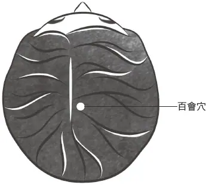
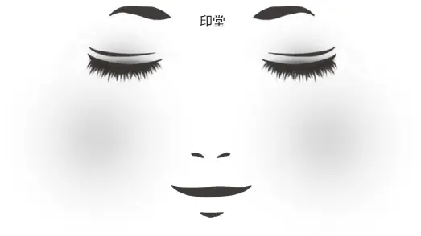

## 貳　「神凝」與「一志」──歸返「渾沌」的入手與究竟

在進入今天「體驗古典」的課程以前，先回顧一下體驗古典的主題：「莊子『渾沌』意象的語意實踐」，想探究歷代哲學家、思想家、修鍊者如何在身心的操作中、身體的修鍊中去體會、實踐「渾沌」。這個主題又分成兩個子題，前面已經談過第一個專題「莊子『渾沌』意象的語意實踐：生命的原初與終極境界」，當我們從具身認知、默會之知的研究取向進入，發現「渾沌」可以是《莊》學義界下生命的美好開始與人人具備的潛質，且是《莊》學義界下的終極境界，是人透過修鍊可以達到的最高身心境界。

更重要的是古典的實際操作，也就是現在要進入的第二個專題：「『其神凝』與『若一志』」，講簡單點就是「神凝」與「一志」，是《莊》學歸返「渾沌」的入手與究竟，「入手」就是入手工夫、基本功，「究竟」是即使你達到最高境界的時候，依然要做到、實踐的工夫。

##### 什麼是「其神凝」──精神、靈魂、眼神的凝聚與安定。

〈逍遙遊〉是這樣說的：「其神凝，使物不疵癘而年穀熟。」神人只要精神一凝聚，居然就能讓作物不受病害、稻穀豐收。要了解這句話，先從探討“What”開始，到底什麼是「神凝」？了解以後才能操作。透過《莊子集成初編》、《續編》，很容易從歷代注家的注釋得到解答：宋代林希逸說「神」是「精神」，即“spirit”；清代的陸樹芝則說是「身中之神靈」，也就是“soul”；清代黃元吉《樂育堂語錄》指出人的「神」表現為「兩目之光」，是目光。我們都聽過閉目養神、垂簾養神，在中國古人心目中，一個人精神、靈魂的狀態如何，是可以透過其人眼睛的神色狀態看得很清楚的。

知道什麼是「神」，接下來得明白什麼是「凝」。唐代成玄英解釋「凝」就是「靜」，安靜。我們的精神、靈魂、眼神要怎麼安靜呢？明代釋德清與清代高秋月都以「定」詮釋「凝」。當精神、眼神能夠凝聚、安定的時候，這時候不只表示其心靈安定，外在世界也會受到正面的影響，甚至能感應影響作物，令五穀豐收，「使物不疵癘而年穀熟」的描述就是這麼來的。

很多受過西方理性主義洗禮的學者認為姑射神人章只是莊子穿插的一小段神話，但清代注家周拱辰主張「此皆神人實事，非寓言也」。民國初年的學者蔣錫昌甚至認為神人的工夫全在「其神凝」三個字，可見「神凝」有可能是《莊》學裏一個具體可行的工夫，一個可以真實達到的境界。如果今天要講莊子學問的「方」，「敢問其方」的「方」，或者「實」，境界之實，都不外乎「其神凝」這三個字。為什麼之前講〈逍遙遊〉要不斷凸顯「其神凝」的重要？因為它是一個具體的工夫。它不只如民國時的劉武所說是修道的「著手處」，更被明代朱得之認為是「養神之極」，既是入手工夫，也是工夫的極致。

我研究《莊子》到今天，才回想起童年是多麼地不懂事。我常說我在學拳，但也不算，是很混地學。不只一次聽父親告訴學生：「你如果真想把太極拳鍊成的話，就在夜裏打拳，打到有一天覺得整個身體消失在夜色裏，你就鍊成了。」我在一旁聽，心裏淺淺地笑，這怎麼可能是祕訣嘛？當你不覺得這是能否鍊成的關鍵、是祕訣，就不會去注意此等身體的感受。直到我走上《莊子》的學術研究之路，研究「嗒焉似喪其耦」、「形如槁木」，覺察原來身體輕靈到盡頭會像乾掉的木材、像形神解體般丟掉身體，我才驚覺那一句話是真傳哪！某日我聽父親對一個特別乖巧認真的學生又說了：「你要進步得快，就整天把注意力都擺在丹田（註1）吧！」我心想：這好像不是多重要的工夫。直到有天我做這方面的研究，做到盡頭才發現：天哪，這是武林第一祕訣！但跟我原先想的都不一樣，武盲總以為要傳授踏雪無痕、草上飛那樣的高招才是祕訣。大家不要覺得工夫太簡單就不重要，其實是非常重要的。中國傳統武術深受道家思想影響，武術強調的心靈課程也非常像。「神凝」是入手，也是最高、究竟。清代煉丹家黃元吉在《樂育堂語錄》也提到：「煉丹者，第一在凝神。」丹道修煉最重要的工夫就是「凝神」。

到底一個人做到「其神凝」的時候心靈會呈現什麼樣態？身體會是什麼樣態？注家告訴我們，〈齊物論〉裏說的「形固可使如槁木，而心固可使如死灰」，就是做到「其神凝」會擁有的心身狀態。

我們在讀《莊子》的時候很容易被一道道篇章的藩籬界限阻隔，這是〈逍遙遊〉、那是〈齊物論〉、這是姑射神人、那是南郭子綦。可是站在具身認知、工夫習練的立場，它們不該是獨立並列，理應是彼此連動的有機整體。今天你如果做到「其神凝」，心靈放鬆了，身體就跟著放鬆，這樣一來也就更不容易有負面情緒了。彼此其實是同一門體道工夫跟體道境界不同面向的描述。

##### 操作「其神凝」的目的──靜定心神，以凝聚磅礡真氣。

知道什麼叫「其神凝」之後，接下來就要問“Why”，為什麼要操作「其神凝」這樣的工夫？參加熱舞社或打籃球不是更時尚的活動嗎？透過歷代的注解可以閱讀到一些重要訊息。明代陳治安提到「神凝則氣聚」，原來把注意力集中在身體的某個地方，精神狀態做到沒有負面情緒、沒有念慮的當下，你的氣才能凝聚，真氣才不會渙散，這是「御氣」、「氣聚」非常重要、絕對必要的操作原則。一定要先做到「神凝」工夫，氣才能充沛，才能進一步達到真氣磅礡的充盛狀態。

講得具體一點，注家周拱辰說：「神凝而我有真水焉，有真火焉。」所謂「真水」指的是人體五臟內所藏之「精」，「真火」講的則是「真陽之氣」，如果精神能凝聚，身體才會開始蓄積所謂的陰精與真陽之氣。丹田有了真陽之氣，慢慢地擴充到打通小、大周天，才能進一步超越身體形軀輪廓的界限，達到「贊天地之化育，輔萬物之自然」以及〈逍遙遊〉「旁礡萬物以為一」的境界，也才能獲致「使物不疵癘而年穀熟」的效驗。

常有人覺得姑射神人這一段很美，但就像欣賞完一段美文，便這麼翻過去了。可明代注家朱得之說：「竊謂經中窮神極化之妙，備見此章，而聞者以為狂而不信，豈止一肩吾而已哉。」我們很容易忽略「其神凝」這三個字，覺得人愛胡思亂想什麼就胡思亂想什麼、想煩惱就煩惱、想生氣就生氣、要悲傷就悲傷不好嗎？為什麼要「其神凝」、「心如死灰」？原來是因為有御氣、聚氣，甚至於「贊天地之化育」之效的緣故。

聽了這麼多，也許你還是一點也不想操練「其神凝」，那先讓你們知道後果。《樂育堂語錄》從負面來寫：「神不凝，則散」，神不凝聚精神就會渙散，這樣的經驗我們都有。「散則遊思妄想迭出」，精神渙散就會東想西想，任憑思慮到處遊走。「淫心邪念」，也可能出現壞的念頭。根據《莊子》歷代注家或後代道書裏實際操作「其神凝」的修鍊經驗是「倘有動時」，若是負面情緒動了，或者念頭不太正派，「即為真氣之累」，真氣就會虧損、渙散了。簡言之，就在你選擇修習神凝與否的當下，心神靜定與否影響的絕不只是你的工作效率，更直接決定你體內氣息的充足或潰散。

##### 「神凝」要旨──觀照自身，無思無慮。

接著談“How”，要怎麼操作「神凝」？《菜根譚》說：「達人觀物外之物，思身後之身。」傳統文化裏提出「遊外物」的祖師爺正是莊子。《莊子．外物》篇說到「遊外物」，講的就是「塵垢之外」。我們都知道什麼叫「物」，就是我們在滾滾紅塵中追求的東西包括容貌、房產、名位、金錢……等所謂「五子登科」的一切，那些外在的追求。為什麼要「遊外物」？因為你重視心力、心地、心境要超越這一切外在事物才可能做到「其神凝」。如果還患得患失或汲汲營營地想著：那女子，要是我不告白會不會被搶走？這工作，我不去應徵試試會不會吃虧？這iPhone，我不趕快去預訂會不會落伍？當你還執著牽掛於外在世界的一切，怎麼有辦法把自己的念慮止住、靜定自己的心呢？所以要做到神凝的第一步，就是得把心靈的探照燈從向外追求調整成向內，這是第一要務。那麼，我們該怎麼面對「物」？陳治安指出，面對「物」，並不是要與之隔離，只是不要那麼執著。「胸中未嘗有物」、「一物不存」，不掛在心上，不胡思亂想，活在當下就對了。

知道怎麼待「物」後，要「凝神令靜」，讓自己的精神安靜下來。什麼叫做精神安靜下來？就是「無思無慮」，不要有多餘的思慮。你可能覺得這太難了，我剛開始操作的時候也覺得難，懷疑自己真有可能做到沒有念頭嗎？但如果你學神凝像學開車一樣專注認真，就一定能做到。經過一段時間的操練之後，你會慢慢發現，其實要一兩分鐘沒有念慮很容易，當然，更長時間保持沒有念慮的難度較高，要更有定力、更專注才行。並非一開始就要你做到無思無慮，可以從不要執著於外物開始做起，就好像「浮雲之過太虛，毫不留戀，了不介意」，學習放下對外物的執著，不要有讓你心慌、讓你糾葛的執著在意。

神凝之後，怎麼御氣？這時候就可以深刻感受為什麼心神是「君主之官」了。不是別有鍊氣之法，是只要做到「守中」，也就是「其神凝」，就夠了。《孟子》也說：「志壹則動氣，氣壹則動志。」人的心神跟氣彼此密切影響，心一旦能靜定下來，氣就不會因心亂而跟著散亂。「守中」又該怎麼守？透過後世一些身心技術探索者的操作經驗，像《樂育堂語錄》裏就提到：「將眼耳目口鼻一切神光，會萃中宮，不令一絲外入外出。」要把眼耳目口鼻一切感官的注意力集中在身體裏，沒有一絲外洩。正如《莊子．人間世》也叫我們「徇耳目內通」，將眼耳等感官的注意力從外界收回，向內去觀照自己的心。

講完「靜」後講「定」。要如何定？定在哪裏呢？《樂育堂語錄》有一段話：

> 吾再示生一個採煉法程。《易》曰：「寂然不動，感而遂通。」生等于元氣未見時，不妨以神光下照，將此神火去感動水府所陷之金，久久自然水中火發，而真金出鑛矣。此感而彼應，其機有捷於影響者。故古人教後學，於寂然不動中，無可採取，教以神光下炤之法。

後世丹家用《周易》「寂然不動，感而遂通」來說明凝神鍊氣之法。在氣尚未集聚的初步階段，要「徇耳目內通」，將注意力內返觀照，「神光下炤」，注意感知位於眉心的上丹田、胸口膻中穴（註2）的中丹田或肚臍之下四指幅的下丹田。在東方論「氣」的範疇中，最重要的原理是「同聲相應，同氣相求」，當你凝神，把注意力擺在所謂的「氣穴一處」、「歸根復命之竅」，將注意力放在肚臍之下四指幅的下丹田，或者位於眉心的上丹田、位於胸口膻中穴的中丹田。只要「徇耳目內通」，將注意力內返通向那一個竅穴，這就是神凝了。習慣如此，氣機自然因「同聲相應，同氣相求」而感應發動。

這麼簡單的工夫，它很重要嗎？好像很重要。《樂育堂語錄》裏說，這麼多煉丹的瑣事是「一言可盡」、是「一貫之道」、是「真聖心法」──只要做到「其神凝」三個字就夠了，說起來是這麼簡單，可是要時時刻刻都做到又是這麼地困難。

再講仔細一點，《樂育堂語錄》又說：

> 至於靜處煉命，又是何說，靜亦非不動之謂，乃無事而未應酬之謂也。我能於無事之際，無論行住坐臥，總將一個神光下炤於丹田之處，務使神抱住氣，意係住息，神氣戀戀，兩不相離。如此聚而不散，融會一團，悠揚活潑，往來於丹田之中。如此日積月累，自然真氣沖沖，包固一身內外，而河車之路通矣。

生活當中總有閒閒沒事的時候：我不必上課不必教書的時候、散步的時候、等車的時候，或者是一人獨處泡茶、做菜的時候，所謂「靜處煉命」，在沒事、無需跟人應酬時，怎麼樣才算做到「其神凝」呢？就是這八個字：「神抱住氣，意係住息」。如果你跟我一樣做過這樣的操練，會發現當你沒有負面情緒、心裏一片平和，然後將注意力安定在眉心、膻中、丹田的其中一點，這個時候，你心真的靜下來了。你會發現天地之間還有一樣東西存在，就是你的呼吸，此刻你只聽到呼吸的聲音，這時候你的注意力會很自然地好像在觀察你的呼吸一樣。因為你的注意力放在丹田，你的呼吸也就這樣不斷地呼到丹田，然後吸，又再呼到丹田，在無事、未應酬時就這麼做。

##### 以「神凝」御氣──體內真陽之氣增長，袪除體內陰滯之氣，使身心更加輕靈。

現在我們扣緊神凝的「御氣」效應來講，透過後代一些身心修鍊者的經驗，可以把「神」跟「氣」的關係講得更仔細些。什麼叫「真陽之氣」？當你做到神凝，沒有負面情緒，沒有多餘的念慮，一切安靜下來，唯一活動著的只有呼吸，你觀察著它。容我再強調一次，是觀察而不是控制呼吸，太過注意就會變成控制，若沒辦法稍事注意而不控制、影響，就先不要注意呼吸，只把注意力放在眉心、膻中或下腹丹田的任何一點就好。日久嫻習，你就會理解什麼是「神息相依」，《樂育堂語錄》說：「神依氣而凝，氣戀神而住」，神氣不離、渾然一體，這時候你體內的真陽之氣就會開始逐日累積增長。

為什麼能這樣御氣呢？這是什麼樣的狀態？過去做過「神凝」的修鍊者解釋說：

> 夫人一身之中，雖是神氣為之運用，要不若兩目之神光，烱烱不昧，惺惺長存。故昔人謂一身皆是陰，惟有目光猶屬陽，須常常收攝，微微下照，則精、氣、神自會合一家。到得丹田氣壯，直上泥丸，遍九宮，注黃庭，自然陰氣消盡，而陽氣常存，猶之太空日照，雲露自消歸無有。（《樂育堂語錄》）

我們全身一身都屬陰，只有兩目之光屬於陽，屬於陽的兩目之光才能在「同聲相應，同氣相求」的原理下感召積累真陽之氣。這樣聽或許你一時難以接受，全身怎麼會都是陰呢？如果你有傳統醫學典籍的閱讀經驗就很容易瞭解。《傷寒論》談六經辨證，所有的疾病從哪兒開始談？太陽中風、傷寒。外面一陣風、寒進入你的體表、你的皮毛，但你的護衛之氣不足，於是它就順著孫絡、絡、經深入體內，客留在你的臟腑，可能就這麼到手太陰肺經、到足太陽膀胱經、到足陽明胃經、足少陽膽經、足厥陰肝經去了。各經絡臟腑的疾病都可能是從外在的風、寒、濕客留皮毛肌表開始的，風、寒、濕到了體內有時候會發炎，或者說產生熱象，風、寒、濕、暑各種客氣就留滯在身體裏，讓你這裏不舒服、那裏氣血不順暢。吃藥的目的之一就是為了把體內多餘的風、寒、濕排掉，風寒之邪還在皮表的就要用汗法排掉，水太多了就要把水利掉。如上所述，傳統醫學說複雜也複雜，說簡單也很簡單。吃藥當然是一種方法，但置身這樣紛亂的、有不少食安問題的時代，許多藥材也有農藥或重金屬殘留的問題。有時候人群聚在密閉的空調空間裏面，光是呼吸都會彼此傳播病毒。在如此容易相互傳染的現代社會中，我們真的需要一些鍛鍊才能抵禦。如果我們操作「其神凝」的工夫，兩個眼睛就像太陽一樣，想像目光注視著你的丹田，就能像「太空日照」一般，日漸把身體多餘的雲露陰氣祛除消盡。

因此我最喜歡的生活是下課後到醉月湖邊打拳鍊功，如果有一點輕微感冒，那再帶一碗藥，吃藥加上導引鍛鍊才容易讓滯留經絡甚至臟腑的疾病好得快速、好得徹底。一旦你全身再無病氣、客氣，只留下正氣與真陽之氣，冬天當然就不會怕冷；另一方面因為陰血充足、津液充足，夏天也就不會怕熱。它背後的原理其實就是這樣。

「真陽之氣」到底是什麼？我之前在臉書看到中國醫藥大學幾位教授在討論一臺可以拍出人體經絡狀態的俄羅斯相機，拍到的說是靈魂嗎？真陽之氣會不會是類似靈魂這般超越現象的存在呢？從古書裏頭好像嗅到這樣的訊息。

> 念有一毫之不止，息不能定。息有一毫之未定，命非有（案：「有」當作「由」）我……近日用功，雖氣息能調，然未歸於虛極靜篤，則玄牝之門，猶不能現象。惟於日夜之際，不論有事無事，處變處常，時時以晨光直注下田，將神氣二者收斂於玄玄一竅之中。始則一呼一吸，猶覺粗壯；久則覺其微細，則少靜矣；又久則覺其若有若無，則更定矣。迨至氣息純返於神，全無氣息之可窺，斯時方為大定大靜，煉丹則有藥可採。（《樂育堂語錄》）

「念有一毫之不止，息不能定。」如前所述，念慮跟氣息的關係是非常密切的，因為念慮能定下來，定在「玄牝之門」，丹田裏你原本感受不到的真陽之氣才能逐日積聚變多，你也才日益感受得到氣的存在。這樣的修鍊會影響你的呼吸粗細，傳統醫學典籍中常見胃腸如果不好，呼吸聲會比平常粗糙一些、大聲一些，鼻孔的味道也會比平常不好聞一些的記載。那相應的，如果我們從事神凝或導引修鍊，呼吸也會因為這樣越來越細，身體臭味越來越稀薄，所謂的「臭皮囊」就逐日轉變成「香皮囊」了。

它不是迷信，透過傳統醫學就能夠理解，發現人真的可以像爬樓梯一樣一級一級走上去，從病人變成沒有病的平人，再從平人變成身心狀態更加輕靈康健的賢、聖、至、真人，是能夠越來越好的。學《莊子》其實比學中醫還容易收效，因為能夠指引讀《莊》者抓住身心健康的大本大原，現在講的「神凝」就是一項非常重要的工夫。它的原理是以神御氣，比方當你「頭目昏暈」的時候就把注意力擺在頭頂正中的泥丸穴（註3），你的氣就跟著往上提了，本來頭部氣血混亂不清明導致頭昏眼花，藉此可以恢復正常的狀態。這就是中國傳統經典描述神跟氣之間的密切關連，神息相依、神氣相依。

講得更明白一點，《樂育堂語錄》提到：

> 總之得藥結丹，火為要矣。火即神，神即我，修道之主帥也。下閉既凝神下田，上閉即凝神上田。……蓋此時金氣雖升泥丸，要知此氣從至陰濁穢之中煆出，雖名真陽，其實夾雜欲火者多，既上泥丸，無非神火猛烹，追逐之力，為之上騰其中，渣滓尚未能淘汰得淨，煆煉得清，於此不凝神一刻，則陽氣不真，安得收歸爐內而成丹。

「火即神」，神就很像我們講一個人的心神、靈魂之神。這個火不是火大的、負面情緒的、灼燒身心的凡俗之火，而是真火，是真陽之氣，是一個人的神，也就是「真宰」、「真君」，生命的真正主宰。原來真陽之氣講到最後是在講人的靈魂。今天我把注意力往下，凝神在下丹田；往上，凝神在上丹田，直到你能專一不雜，沒有任何負面情緒、沒有念慮，你體內所有濁穢之氣便會因為真陽之氣的誕生、充盛而慢慢排除，也可能在發一陣汗之後身體就輕靈許多。於是得到這樣的結論：如果不能「凝神一刻」，致力掃除念慮、將注意力置於丹田，你的體內陽氣終究無法逐日逐月逐年轉化為真陽之氣，「則陽氣不真」。

古人為什麼要我們凝神在這幾個地方？我有幾年修行印度瑜伽的經驗，他們所謂人的the third eye、第三隻眼，就位在人的眉心印堂（註4），正是中國傳統修鍊可以凝神的地方之一。這些凝神部位代表的意義是什麼？《樂育堂語錄》這樣解釋：

> 人身還有緊要之處，如山根、玄膺二竅，皆是通精氣往來要道。人能存想山根，則真氣自然上下，復歸黃庭舊處。人能觀炤玄膺，則真津自然攝提而上。爾等每行一次，此二穴不可忽也。古云：「玄膺氣管受精符」，又曰：「玄膺一竅生死岸」，又古云：「山根是人初生命蒂。」吾人開督閉任，通氣往來，即是此竅；苟能存神於茲，自可長生不老，卻病延年。

「存想山根」，山根（註5）在兩眼之間、鼻梁起始凹陷處，鼻子是山，根指最低的地方。注意力放在這個地方，真氣就會自然上下運行。如果把注意力擺在「玄膺」，就是兩個乳頭之間的膻中穴，你的津液就能「攝提而上」，滋養身體上部。總而言之，所有凝神的點都是基於一種經絡的、氣的身體觀，有別於當代解剖學的身體認知，以經絡、穴位為溝通、疏通精氣往來的要道。

有人聽了線上課程就提醒我說，女子好像不能把注意力守在丹田，因為有生理期的關係，煉丹適合將注意力守在膻中。其實每個人的體況都非常特殊、不盡相同。我以前讓學生作凝神作業，讓學生試驗自己將注意力放在印堂、膻中、丹田或者山根，感覺哪一個最安適，內心最容易靜定、念慮最少，之後就凝神在那裏。當我把注意力放在印堂時，最容易在丹田感受到氣，但很多人跟我不一樣，經驗告訴我這是因人而異的，從自身的操作體驗中，每個人都能找到最合適自己的凝神之點。

##### 如何操作「神凝」而御氣──注意力時刻內守。

了解神為什麼可以御氣、知道What跟Why之後，我們接著就談How，更具體地闡明怎麼操作、怎麼御氣？《樂育堂語錄》以譬喻說明操持「神凝」的工夫法門：

> 學者下手之初，必要先將此心放得活活潑潑……外盜天地之元陽，久之神自凝而息自調，只覺丹田一點神息，渾浩流轉，似有如無。我於此守之炤之，有如貓之捕鼠，兔之逢鷹，一心顧諟，不許外遊，自然外感內應，覺天地之元氣，流行於一身內外，而無有休息也。性功到此，命功自易焉。

這段話對我鍊功的影響很大。我們操作神凝的時候通常很快便能感受到「丹田一點神息」，古人說只要七天到一百天。年輕人最容易感受到真陽之氣，因為真陽之氣還很豐沛，但也最難，因為年輕人很難將心定下來，看到美女、帥哥走過，怕不快表示就被搶走了。老人想要鍊成很難，也很容易。因為體衰，真陽之氣較難匯聚。但也因為參透鏡花水月，外在世界的執著少了，很容易就專注在自己的內心。每個人都有各自的艱難與容易之處，不要以為自己是最困難的。

我很多學生在修《莊子》的一年中，做「其神凝」的工夫，做到隨時感覺丹田，丹田就有氣，這種同學每一屆都有幾個。可是怎樣持守才是困難的。剛開始丹田有氣的時候容易非常高興，但不知道它為什麼出現？又為什麼離你而去？感覺一離去你又變回凡夫俗子了。於是古人告訴我們持守的方法。這方法有飼養寵物經驗的人特別容易理解，叫做「貓之捕鼠」。有天，我所有的貓整排都側著頭、對著窗外，不久以後，四、五隻貓同時畫出極為相似的弧線，彷彿搭配舞蹈節奏，動作也太整齊了。我循著牠們注目的方向看，原來有一隻小鳥，貓兒們的目光就非常專注地追著鳥兒跑。就是這樣的感覺，要像貓緊盯著鳥兒、老鼠一樣，有種「絕不放過」的意志力。只有一種情況下貓會放棄，就是小鳥已經超越牠們視線可及之處、飛走了，可丹田就在你肚臍以下四指幅的地方，不會飛走，所以你永遠要將注意力放在那裏，「一心顧諟，不許外遊」，全神貫注於該處，絕不飄忽遊走。我後來用我自己的譬喻告訴學生，想像你的念頭被釘子釘在印堂、膻中或丹田，不許動、無法動。一動，才會有念頭；不動，就無法有念頭。

「守之炤之」，什麼叫「守之」？《莊子．大宗師》中得道的女偊告訴我們：「吾猶守而告之」，「守之」的內容就是女偊所持守的、片刻不離的、體現在她生命中的道。「炤之」則與〈人間世〉談的「徇耳目內通」相通，同樣要將雙耳、雙眼等感官外逐的注意力從外在世界收回，向內專注於傾聽、觀看、感知自身內心。

我們每天可在一個時辰中，將目光、注意力「回光返炤」，收攝觀照於前面提過的任何一個精血往來要道的竅穴：

> 又聞古人云：「真一之氣，視無形、聽無聲」，如之何而能凝結，以成忝米之珠哉？聖人以法追攝，採取于一時辰內，法即回光返炤，以我去感，彼自相應者是也。（《樂育堂語錄》）

有些特別喜歡《莊子》的同學寒暑假想好好練一練。反正閒來無事，上網、逛網拍、打電動浪費時間，還不如就一天挑一個時辰「回光返炤」，把你的眼神完全投炤在精血往來的其中一個要穴。可一天十二時辰中只一時辰操持夠嗎？《樂育堂語錄》說：學習者可以繼續修鍊，直到臻至「無一時一刻或離」的境界。不是真用眼睛去注視，而是時時刻刻留意著神凝的位置。我每一次心裏跟自己說：最近好像忙了點，鍊功的時間不夠。只要這個念頭一出來，馬上會有另一個聲音教育自己：誰叫妳不時時刻刻「其神凝」？如果能做到，再忙都能隨時鍊功。

很多同學會問怎麼操作？如果還是不知道，有一個辦法能讓你很容易了解：看看你們家有什麼值錢的東西，把媽媽像紅豆大的寶石拿出來，貼在肚臍下四指的地方，去感覺它屬於你、絕不能搞丟，你自然會隨時注意著它。或者說有個重要的東西，像錢包，放在離你兩步遠的地方，你會一直在注意它、注意有沒有人動它，就是這種感覺。它不必在你正眼下，你不必低頭看，不是要你真的用眼睛去注視，可是你時時刻刻留意，「朝夕無閒」。另一種階段更高了，是即便你「有事應酬」，也能做到「神凝」：

> 到有事應酬，我惟即事應事，因事而施，稱量為予，務令神氣之相交者，仍然無異於其初。斷不使外邊客氣，奪吾身之主氣。其工不過些些微微，以一點神光覺炤之，不使氣離神、神離氣，即止念矣。不然一念起而隨止之，一念滅而隨滅之，起滅無常，將有止之不勝止者。似此之不止，更甚於克制私欲之功多矣。

比如我現在雖然正在上課，卻還是要分些微的精神，「以一點神光覺炤之」，注意著丹田。

在跟外在世界交接的時候，最要注意的就是不讓自己生氣。所以生命中一定要結交幾個熟讀《莊子》的朋友。拿你遇到的人間俗務請教他，他會告訴你：「啊，那件事情啊，倘若你還不能決定，就跟對方說：『你請稍候，我想想再告訴你。』你只要注意一件事，絕對不要動心，絕對不要動怒。」這樣的朋友是非常珍貴的。於是你在應對事物時只是「即事應事，因事而施，稱量為予」，就當下發生的事採取相應的適當措施，不因過度執著而攪擾、操勞心身。「務令神氣之相交者，仍然無異於其初」，務必使神氣在應接外在事物的時候，還能像無事時一樣操持「神凝」工夫，保持神氣交融的狀態，無所損傷、持續長養真陽之氣。如果「有事應酬」的時候也能這樣，就做到《莊子．應帝王》講的「用心若鏡」，應接外在人、事、物時讓心像一面鏡子，只如實映照，沒有偏私、執著，不起波瀾，因而不會損傷自己的心身。如果有一面鏡子，外人立在鏡前照它，鏡面居然會起波瀾，那是妖鏡了吧？所以我們說「用心若鏡」，不因外界攪擾動心。

不管有事、無事，不論「行為動作語默」，隨時都要「此心了炤」、「一念收攝」、「神能收斂」、「一心不二」。聽起來好像很困難，可是理論卻非常地簡單。為能更具體說明在日常生活中如何操作，以下節錄《樂育堂語錄》中有助操作的段落，讓大家更容易明白：

> 總之，始而稍稍垂頭以顧諟，繼而微微申腰以緝熙，終而至於天機活潑，氣節崚峋，即是長生之訣也。吾見生形氣衰頹，精神疲憊，教之如後生小子，實實了炤於丹田一寸之間，則恐用力太勞，反為不妥。故示以活潑之觀法，無論隨時隨地，俱可做得。然而坐有坐法，睡有睡法。坐法吾且不說，至於睡法：未睡身，先睡心，舉凡一切事為，已就床榻，思之何益？而且枉勞其心，惟有收攝神光，以頭微微曲照入於一竅之中，自然神與氣交而熟睡，火與水濟而安閒。至於行也，湏將神光照在兩三步遠，有如清風拂拂，緩步而行，不使累身可矣。若住立於何處，須知卓立不搖，如松柏之挺持，不拘束，不放曠，斯住之法得矣。

你隨時有個注意力放在丹田。講得更具體一點，睡覺之前要「未睡身，先睡心」，讓心靈先入睡，什麼也不想，當然也沒有負面情緒。心靈都睡了，還能胡思亂想嗎？躺下去之後，「舉凡一切事為，已就床榻，思之何益？而且枉勞其心」，不再想、不再牽掛思索日間的事務而勞累耗損心力，使心安靜寧定。這時只要收攝你的神光，把注意力微微照在「一竅之中」――丹田，神、氣自然而然和諧交融，就此入睡了。在座有同學第二年聽我的《莊子》課，聽說他去年照這樣做，入睡後都睡得特好。今天初次聽到的同學，今晚開始就可以依此方式好好入睡了。

那平時走路的時候要如何凝神呢？你可能會懷疑，走路的時候注意力放丹田，難道不怕被車撞嗎？事實上，走路的時候眼神應放在「兩三步遠」，面前兩三步外的地方，悠徐舒緩地行走，這樣一方面能觀照路況、同時又非常容易就可以把注意力放在丹田。今天要來上的是《莊子》，前來上課的路上怎能不把注意力放在丹田呢？待會上課心不夠靜怎麼辦？

站的時候，就像〈養生主〉說的「緣督以為經」，把與生俱來的「身體中心線」、沿著脊椎上行的「督脈」垂直於地面，以此作為日常行、住、坐、臥的準繩，隨時保持這條線的筆直，不駝背、不彎腰、不側傾。這句話講得象徵一點、譬喻一點，就是站得像松柏般地挺直。「不拘束」，不緊張；「不放曠」，也不鬆散、駝背。這就是人站立時最重要的原則。難怪有人說，就算都學《莊子》，但學成每個人都不一樣。因為《莊子》是心法，我們還是有不同的睡姿、不同的穿著。但我們都知道怎麼樣讓心靈最平和，心神最安靜、最寧定。

◆　◆　◆

我們在〈人間世〉中會談到「一志」，讓自己的心志專一，這邊非常簡單地把我從《莊子集成初編》、《續編》整理出來的「一志」注解簡略帶過，因為跟「神凝」的意思完全一樣。

##### 什麼是「一志」？為什麼要「一志」？──當心神內守沒有雜念、思慮虛空澄澈，自身真氣便得以擴充。

「一志」，晉代郭象說是「去異端而任獨」，不要再想東想西，心神要專一。部分注家則解釋為無二心、無雜念，思慮非常地澄澈。「志者，心之所之也」、「一志，純一不雜」，這不跟「神凝」完全一樣嗎？宋代呂惠卿、清代吳峻則指出「一志」就是應盡量做到「無思無為」，無思慮。部分注家則以「用志不紛」、「一其心之所之」解釋「一志」，心志凝聚專一，這不就是「其神凝」嗎？由此可見歷代對《莊子》的詮釋如果正確，一定可以貫穿內七篇的各個段落，而且彼此之間是通透、通達，能相互支援詮釋的。

為什麼古人說要「一志」？歷代注家的解釋跟「神凝」的理由很像。民國曹受坤說：「故欲養氣，必先一其心之所之」，為了養氣所以要先一志。明代陳詳道說：「一志所以全氣」，一志是為了養氣、全氣。又說：「一志所以合氣」，透過「一志」的工夫，就能與外在清陽之氣合而為一，使自身真氣得以擴充。

透過歷代注家的詮釋，我們發現「神凝」跟「一志」的效果完全一樣。相反的，如果不能做到「一志」，就會擾亂自身之氣的和諧狀態。清代注家王夫之指出：

> 心齋之要無他，虛而已矣。氣者，生氣也，即皞天之和氣也。參之以心知，而氣為心使，心入氣以礙其和，于是乎不虛。然心本無知也，故嬰兒無知，而不可謂無心。心含氣以善吾生，而不與天下相搆，則長葆其天光，而至虛者至一也。

如果沒有「一志」，反而「參之以心知」，很多念慮縈繞的話，就會「心入氣以礙其和」，一旦有念慮、有想法，心不再虛空澄澈，而像是塞滿蓬草、雜草般堵塞不通，你的氣就跟著亂了。其實這是一樣的描述，只是從正反兩端論述，角度不同而已。

##### 如何操作「一志」──注意力時刻凝聚在精氣往來的要穴。

古人教我們怎麼操作「若一志」的「一志」？其實也跟「神凝」完全一樣。《樂育堂語錄》說「意若寒灰」，使心就像已經冷卻的灰燼般不再起火燃燒，不再放任念慮追逐外在的事物。此外：

> 然欲採外來靈氣，務先空其心，絕無翳障，而後天地元氣得以入之。

要「採外來靈氣」，一定要「先空其心」，先做到「心齋」、「心如死灰」，當心靈能臻於無負面情緒、無念慮的虛空心境，才能使天地之間的「靈氣」、「元氣」不受阻礙地匯聚於自身。唯有做到「心中無物」、「一心無二」，沒有念慮了，同時「返觀內炤」，隨時將注意力凝聚在精氣往來的要穴，才能慢慢體會到你天生本有的「真陽之氣」。真陽之氣逐漸累積，最後能「旁礡萬物以為一」，達到神人所體現的最高境界。

《樂育堂語錄》用人體的動作生動描繪「一志」的操作：

> 天根何以躡，以意躡之也。一意注於天根，如足踏實地，卓然自立，是以謂之躡。躡乎此，乃識人之為人，其根在是。月窟何以探，以心探之也。一心照乎月窟，如手摩囊物，顯然可指，是以謂之探。

「躡」就是踩踏，是放輕腳步行走。想像你的念頭，踮著腳尖輕輕地站立在印堂、山根、泥丸、膻中或丹田任一竅穴上，注意保持念頭就這麼輕輕地站著，或念頭像手輕輕地觸摸著。讓我們來試試看，請大家先坐直，「緣督以為經」。將眼睛閉起來，把念頭放在印堂，或放在山根也可以。你感覺到你的念頭踮著腳尖輕輕地站著，然後再把你的注意力放在頭頂泥丸，再把注意力放在肚臍以下四指幅的丹田位置，讓念頭就這樣輕輕地站在一個地方，這便是神凝的功法。由於氣與意念是無形的存在，所以在講操作的時候往往需要透過非常多具體的意象去描摹，才容易使人理解。

《樂育堂語錄》並指出：

> 煉心二字，是千真萬勝，總總一個法門……古人用功，必先牢拴意馬，緊鎖心猿……只須一念把持，自可造於渾渾淪淪、無思無慮之天。縱有時念起心動，亦是物感而動，非無故自動。如此動心，心無其心，雖日應萬端，亦真心也；否則，心有其心，雖靜坐寂炤，亦妄心也。

「古人用功，必先牢拴意馬，緊鎖心猿」，不論你在做什麼，任何時刻都要注意做到「神凝」，不放任心神外逐。你甚至可以在做任何運動時「其神凝」。多年前我班上很認真操作「其神凝」的一個男孩在參加營隊時看到一個女孩，事後問我：「老師啊，某某某是不是妳的學生？」我說：「是啊。她真是可愛，你也喜歡她是嗎？」「喔，不是啦，我只是注意到，全場的人都駝腰駝背，只有我跟她兩個從頭到尾『緣督以為經』，一看就覺得是老師的學生。」由此可知，練習神凝的同時是不會影響到你從事任何活動的。

當你整天都在注意「其神凝」的時候就會發現，有時候真的忍不住會想到什麼事情，注意力就跑掉了。這時就提醒自己：「牢拴意馬，緊鎖心猿」。我們都視「心猿意馬」為一負面表述的詞彙，殊不知只要你心不在「焉」（印堂），心不在「焉」（膻中），心不在「焉」（丹田），就可說是心猿意馬了，所以要把心收回來。「只須一念把持，自可造於渾渾淪淪」，只要能維持心念專一不搖，不久你的丹田可能就感受真陽之氣、邁向通往渾沌造境之路了。

剛剛講到的男同學是乒乓球校隊。有一次出去比賽，正好那是屬於「六氣之辯」的一天，風浪很大。球打到一半他眼鏡掉了，鏡片還掉出鏡框，不難想像那是什麼窘境。上半場他因這意外一路潰敗。休息的空檔，他把眼鏡片裝好，眼鏡戴上的那一剎那他想：「反正今天這場比賽看來已經毀了，不如來練習神凝吧。」後來他整個下半場只在注意其神凝，最後逆轉勝，這是一個真實的故事。

這其實也沒什麼，一點都不迷信，因為當一個人心靈最平和、澄澈的時候，腦子當然也最清楚、反應最敏捷。我們活在滾滾紅塵中的一天，當然還是會有心動、多念頭的時候，有時「念起心動」、「物感而動」，是因為外在世界有事，所以你要去處理、去應接。可是「非無故自動」，並不是要你外面沒事卻自己惹事，讓自己心情不好、覺得很衰或歎時局不好、生不逢時。我們心靈的最終追求是「空洞如故」，如此的心靈才能做到「靈覺如常」，用常常虛空的心靈來「養其神明」，擴充精神境界。

◆　◆　◆

當我們用以上不管是後代的丹道修鍊者、身心技術操作者，或者《莊子集成初編》、《續編》，乃至於道藏文獻，來探究莊子教我們的「神凝」到底是什麼的時候，我們會不會犯了一個以今證古、曲解原意的錯誤呢？身為學者，一定要有不斷內省的自覺。

##### 從古道教、莊子到後世丹道修煉──還原莊子可能的修鍊原貌。

在學術圈裏有兩位前賢，一位是聞一多先生，他說過：「我常疑心這哲學或玄學的道家想必有一個前身。」這個前身「很可能是某種富有神秘思想的原始宗教。」聞一多先生稱這樣一個古代宗教為「古道教」，他的研究告訴我們「哲學中的先秦道家，就是這樣從古道教分泌出來的一種質素。」其實莊子並無意讓他的學說變成宗教，因為他不談生前死後的世界，不講天堂，不談地獄，莊子只告訴我們活在返本全真的當下。如果莊子之前有一個古道教，那可能莊子只留下身為一個人能應用在一生當中，有益心靈、身體、人生的心靈技術跟身體技術，讓我們不管是面對任何時代的風浪或是混亂，都能操持一己心身。

這樣的說法為我的老師張亨先生所繼承，他認為聞一多先生所謂的古道教，應該相近於當代學者講的「薩滿教」（shamanism）。在古代似乎有一種能溝通天、地、人的角色存在於世。按照聞一多先生或張亨老師的說法，在莊子出現之前，中國就已經有古道教的存在。

我們不能重起莊子於地下，只能透過閱讀經典來了解莊子。如果我們接受古道教下啟莊子，乃至於後代的丹道修煉及注疏家的觀點。我們相信可能有一種一脈相傳的身心技術，透過口授心傳，從莊子之前、莊子、莊子之後、丹道、歷代注家，就這樣綿延不絕地流傳下來。如果這個說法可以成立的話，那我們今天用這些後代的修鍊去探究《莊子》這部書中生手怎麼經由學習、實踐變成專家？這些操練的方法從何而來？說不定不是牽強附會，而是經由這一脈相承的具身認知，去拼湊還原當年莊子修鍊的原貌。

為什麼「其神凝」很重要？清代注家王夫之在解《莊》的時候，就點出儒道之辨所在：

> 物之災祥，穀之豐凶，非人之所能為也，天也。胼胝黧黑，疲役其身，以天下為事，於是乎有所利必有受其疵者矣；有所貸，必有受其饑者矣。井田之流為耕戰，〈月令〉之濫為刑名，張小而大之，以己所見之天德王道，彊愚賤而使遵。遏大而小之，以萬物不一之情，徇一意以為法。於是激物之不平而違天之則，致天下之怒如烈火，而導天下以狂馳如洪流。既以傷人，還以自傷夫。

王夫之把「神人之遊」和「堯舜治迹」對勘，他提到有一種學說、一個家派，總是「疲役其身，以天下為事」，我們已經讀完〈逍遙遊〉跟〈齊物論〉了，看到這幾句就大概知道所指的，就是儒家。

《孟子》說：「生，亦我所欲也；義，亦我所欲也。二者不可得兼，舍生而取義者也。」儒家追求修身、齊家、治國、平天下，很想有所利於天下。可事實上大家都得利了嗎？大家都心平氣和、安居樂業了嗎？可能有人「受其疵」，可能有人「受其饑」，原因何在？王夫之說：「張小而大之，以己所見之天德王道，彊愚賤而使遵。」他認為儒家以一己之意為法度，要所有人照著一個標準做，用強行規範來約束千差萬別的百姓眾生、萬事萬物。於是「激物之不平而違天之則」，違逆了天生自然的人情事理，而激起人、事、物的逆反悖亂，最後導致傷人自傷的惡果。例如井田制的流於耕戰，〈月令〉的濫為刑名。如同牟宗三先生提到的「周文疲弊」現象，西周制定的禮樂制度，原初的精神時至東周泰半多已僵化、喪失。先秦時代的儒家同樣留下非常多的時代課題。

那誰來幫我們解決？王夫之接著說：

> 豈知神人之遊四海，任自然以逍遙乎！神人之神凝而已爾！凝則遊乎至小而大存焉，遊乎至大而小不遺焉。物之小大，各如其分，則己固無事，而人我兩無所傷。

說莊子提出的「神人之遊」只有一個最重要的工夫──「其神凝」。這個工夫有什麼好處？「凝則遊乎至小而大存焉，遊乎至大而小不遺焉。」我們看《莊》學的典範人物操作「其神凝」，或者各位在操作「其神凝」的時候，會覺得這好像只是一個治內之學吧？但這看似治內之學最終卻好像能獲致得治天下的效果，不管是〈逍遙遊〉的「其神凝，使物不疵癘而年穀熟」、「之人也，將旁礡萬物以為一」，還是〈齊物論〉的「旁日月，挾宇宙」，生命足以充塞天地、倚傍日月，把整個宇宙納入懷抱，東坡因此說「是身如虛空，萬物皆我儲」，這將來講到〈德充符〉、〈應帝王〉各位就會更明白了。實踐這樣的工夫，不會離棄、犧牲任何一物天生自然的性情分位，重視每一個個體間的差異，因此能讓人我皆免於傷害。並贈予每一個不同的個體一個共同的心法、身法，讓每個人都可以在完全不同的生活、不同的人生旅途中去操作、實踐它。

王夫之最後明白地告訴我們：「視堯舜之治迹，一堯舜之塵垢粃糠也。非堯舜之神所存也，所存者，神之凝而已矣。」莊子之所以會譬喻儒家所崇敬的典範人物堯、舜只不過是姑射神人身上拍下來的塵垢、碎屑，是因為堯舜還不能把「其神凝」的「神」，當成生命中最重要的工夫鵠的。「心神」、「精神」似乎很難範限在西方生理學講的生理現象裏，中國古代則把它歸在靈魂一類。透過這樣一段論述，你就知道「其神凝」，安定我們的心神、「真宰」、「真君」，對我們的心身生命有多麼重要。

所以儒、道之間最重要的工夫差別就在「其神凝」這三個字。這也是為什麼我們上完〈逍遙遊〉、南郭子綦，就要進入「其神凝」專題。只有做到「其神凝」，才能「形如槁木」、才能「心如死灰」。這些工夫的每一個面向都共同構成一個有機的整體，只要一一去鍛鍊自己，就可以在生活中感受到身體真的越來越輕靈、越來越「形如槁木」；心靈負面情緒越來越少、越來越「心如死灰」。

這是我們閱讀《莊子》時不能忽略的一個面向，許多在莊子以後出生的人，無論是寫下〈形影神〉的陶淵明也好，李白也好、白居易也好、蘇東坡也好，他們在閱讀《莊子》這部經典的時候，都與自己的生命不斷對話、切磋、內化，甚至與之合一交融。我們今天學《莊子》，也可以選擇具備古人這樣的精神。方法其實很簡單，沒有人聽了還不會，一聽就會。可是要時時刻刻徹底做到，非常困難。很簡單，又很困難。也因此很具挑戰性。說不準在這教神凝的我與聽神凝的你，兩相比較，誰可以在一天中操練更長的時間、實踐得更好。我們能在生活中實踐它，這是這個思想最珍貴的地方。

> （註1）丹田：即肚臍下三寸（四指幅）「關元穴」。
> 
> （註2）膻中：兩個乳頭連線的中點。
> 
> （註3）泥丸：即頭頂正中央的「百會穴」。
> 
> （註4）印堂：兩眉中心。
> 
> （註5）山根：兩眼之間、鼻梁起始凹陷處。