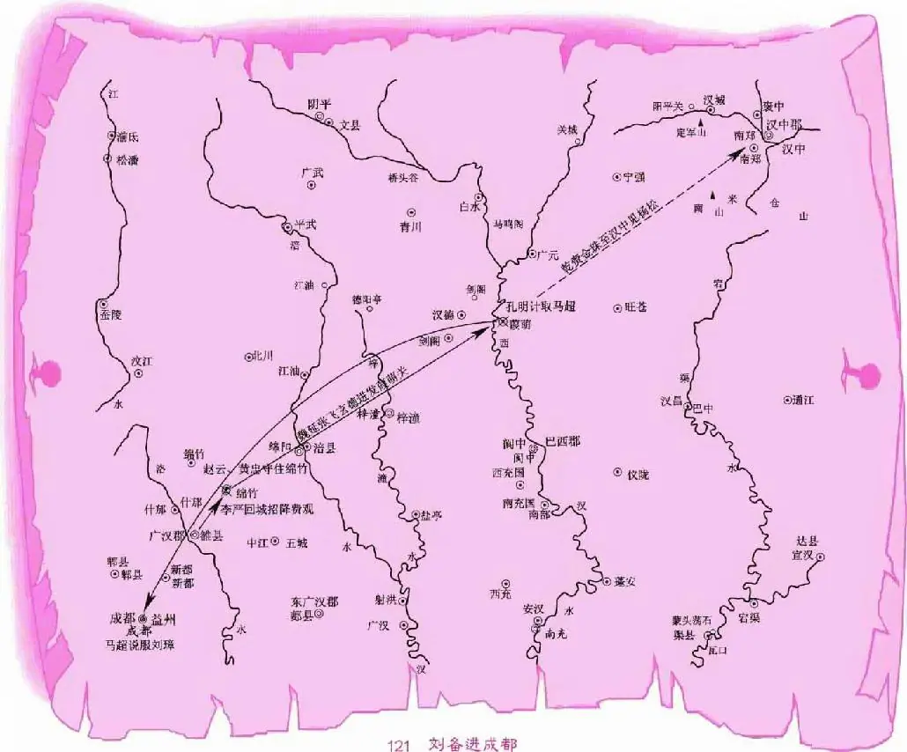

#   
第六十五回　馬超大戰葭萌關  
　　　　　　劉備自領益州牧  
  

卻說閻圃正勸張魯勿助劉璋，只見馬超挺身出曰：「超感主公之恩，無可上報。願領一軍攻取葭萌關，生擒劉備。務要劉璋割二十州奉還主公。」張魯大喜，先遣黃權從小路而回，隨即點兵二萬與馬超。此時龐德臥病不能行，留於漢中，張魯令楊柏監軍。超與弟馬岱選日起程。

卻說玄德軍馬在雒城。法正所差下書人回報說：「鄭度勸劉璋盡燒野谷，並各處倉廩，率巴西之民，避於涪水西，深溝高壘而不戰。」玄德、孔明聞之，皆大驚曰：「若用此言，吾勢危矣！」法正笑曰：「主公勿憂。此計雖毒，劉璋必不能用也。」不一日，人傳劉璋不肯遷動百姓，不從鄭度之言。玄德聞之，方始寬心。孔明曰：「可速進兵取綿竹。如得此處，成都易取矣。」遂遣黃忠、魏延領兵前進。費觀聽知玄德兵來，差李嚴出迎。嚴領三千兵也，各佈陣完。黃忠出馬，與李嚴戰四五十合，不分勝敗。孔明在陣中教鳴金收軍。黃忠回陣，問曰：「正待要擒李嚴，軍師何故收兵？」孔明曰：「吾已見李嚴武藝，不可力取。來日再戰，汝可詐敗，引入山峪，出奇兵以勝之。」黃忠領計。次日，李嚴再引兵來，黃忠又出戰，不十合詐敗，引兵便走。李嚴趕來，迤邐趕入出峪，猛然省悟。急待回來，前面魏延引兵擺開。孔明自在山頭，喚曰：「公如不降，兩下已伏強弩，欲與吾龐士元報仇矣。」李嚴慌下馬卸甲投降。軍士不曾傷害一人。孔明引李嚴見玄德。玄德待之甚厚。嚴曰：「費觀雖是劉益州親戚，與某甚密，當往說之。」玄德即命李嚴回城招降費觀。嚴入綿竹城，對費觀贊玄德如此仁德；今若不降，必有大禍。觀從其言，開門投降。玄德遂入綿竹，商議分兵取成都。

忽流星馬急報，言：「孟達、霍峻守葭萌關，今被東川張魯遣馬超與楊柏、馬岱領兵攻打甚急，救遲則關隘休矣。」玄德大驚。孔明曰：「須是張、趙二將，方可與敵。」玄德曰：「子龍引兵在外未回。翼德已在此，可急遣之。」孔明曰：「主公且勿言，容亮激之。」

卻說張飛聞馬超攻關，大叫而入曰：「辭了哥哥，便去戰馬超也！」孔明佯作不聞，對玄德曰：「今馬超侵犯關隘，無人可敵，除非往荊州取關雲長來，方可與敵。」張飛曰：「軍師何故小覷吾！吾曾獨拒曹操百萬之兵，豈愁馬超一匹夫乎！」孔明曰：「翼德拒水斷橋，此因曹操不知虛實耳。若知虛實，將軍豈得無事？今馬超之勇，天下皆知，渭橋六戰，殺得曹操割須棄袍，幾乎喪命，非等閒之比。雲長且未必可勝。」飛曰：「我只今便去，如勝不得馬超，甘當軍令！」孔明曰：「既爾肯寫文書，便為先鋒。請主公親自去一遭。留亮守綿竹。待子龍來，卻作商議。」魏延曰：「某亦願往。」孔明令魏延帶五百哨馬先行，張飛第二，玄德後隊，望葭萌關進發。

魏延哨馬先到關下，正遇楊柏。魏延與楊柏交戰，不十合，楊柏敗走。魏延要奪張飛頭功，乘勢趕去。前面一軍擺開，為首乃是馬岱。魏延只道是馬超，舞刀躍馬迎之。與岱戰不十合，岱敗走。延趕去，被岱回身一箭，中了魏延左臂。延急回馬走。馬岱趕到關前，只見一將喊聲如雷，從關上飛奔至面前。原來是張飛初到關上，聽得關前廝殺，便來看時，正見魏延中箭，因驟馬下關，救了魏延。飛喝馬岱曰：「汝是何人？先通姓名，然後廝殺！」馬岱曰：「吾乃西涼馬岱是也。」張飛曰：「你原來不是馬超，快回去！非吾對手！只令馬超那廝自來，說道燕人張飛在此！」馬岱大怒曰：「汝焉敢小覷我！」挺槍躍馬，直取張飛。戰不十合，馬岱敗走。張飛欲待追趕，關上一騎馬到來，叫：「兄弟且休去！」飛回視之，原來是玄德到來。飛遂不趕，一同上關。玄德曰：「恐怕你性躁，故我隨後趕來到此。既然勝了馬岱，且歇一宵，來日戰馬超。」

次日天明，關下鼓聲大震，馬超兵到。玄德在關上看時，門旗影裡，馬超縱騎持槍而出，獅盔獸帶，銀甲白袍：一來結束非凡，二者人才出眾。玄德嘆曰：「人言‘錦馬超’，名不虛傳！」張飛便要下關。玄德急止之曰：「且休出戰。先當避其銳氣。」關下馬超單搦張飛出馬，關上張飛恨不得平吞馬超，三五番皆被玄德擋住。看看午後，玄德望見馬超陣上人馬皆倦，遂選五百騎，跟著張飛，衝下關來。馬超見張飛軍到，把槍望後一招，約退軍有一箭之地。張飛軍馬一齊扎住；關上軍馬，陸續下來。張飛挺槍出馬，大呼：「認得燕人張翼德麼！」馬超曰：「吾家屢世公侯，豈識村野匹夫！」張飛大怒。兩馬齊出，二槍並舉。約戰百餘合，不分勝負。玄德觀之，嘆曰：「真虎將也！」恐張飛有失，急鳴金收軍。兩將各回。張飛回到陣中，略歇馬片時，不用頭盔，只裹包巾上馬，又出陣前搦馬超廝殺。超又出。兩個再戰。玄德恐張飛有失，自披掛下關，直至陣前。看張飛與馬超又鬥百餘合，兩個精神倍加。玄德教鳴金收軍。二將分開，各回本陣。是日天色已晚，玄德謂張飛曰：「馬超英勇，不可輕敵，且退上關。來日再戰。」張飛殺得性起，哪裡肯休？大叫曰：「誓死不回！」玄德曰：「今日天晚，不可戰矣。」飛曰：「多點火把，安排夜戰！」馬超亦換了馬，再出陣前，大叫曰：「張飛！敢夜戰麼？」張飛性起，問玄德換了座下馬，搶出陣來，叫曰：「我捉你不得，誓不上關！」超曰：「我勝你不得，誓不回寨！」兩軍吶喊，點起千百火把，照耀如同白日。兩將又向陣前鏖戰。到二十餘合，馬超撥回馬便走。張飛大叫曰：「走哪裡去！」原來馬超見贏不得張飛，心生一計：詐敗佯輸，賺張飛趕來，暗掣銅錘在手，扭回身覷著張飛便打將來。張飛見馬超走，心中也提防，比及銅錘打來時，張飛一閃，從耳朵邊過去。張飛便勒回馬走時，馬超卻又趕來。張飛帶住馬，拈弓搭箭，回射馬超，超卻閃過。二將各自回陣。玄德自於陣前叫曰：「吾以仁義待人，不施譎詐。馬孟起，你收兵歇息，我不乘勢趕你。」馬超聞言，親自斷後，諸軍漸退。玄德亦收軍上關。

次日，張飛又欲下關戰馬超。人報軍師來到。玄德接著孔明，孔明曰：「亮聞孟起，世之虎將，若與翼德死戰，必有一傷。故令子龍、漢升守住綿竹，我星夜來此。可用條小計，令馬超歸降主公。」玄德曰：「吾見馬超英勇，甚愛之。如何可得？」孔明曰：「亮聞東川張魯，欲自立為‘漢寧王’。手下謀士楊松，極貪賄賂。主公可差人從小路徑投漢中，先用金銀結好楊松，後進書與張魯雲：‘吾與劉璋爭西川，是與汝報仇。不可聽信離間之語。事定之後，保汝為漢寧王。’令其撤回馬超兵。待其來撤時，便可用計招降馬超矣。」玄德大喜，即時修書，差孫乾齎金珠從小路徑至漢中，先來見楊松，說知此事，送了金珠。鬆大喜，先引孫乾見張魯，陳言方便。魯曰：「玄德只是左將軍，如何保得我為漢寧王？」楊松曰：「他是大漢皇叔，正合保奏。」張魯大喜，便差人教馬超罷兵。孫乾只在楊松家聽回信。

不一日，使者回報：「馬超言：未成功，不可退兵。」張魯又遣人去喚，又不肯回。一連三次不至。楊松曰：「此人素無信行<a id="note-ref-c-1-1" href="#footnote-a-1-1">注释1</a>，不肯罷兵，其意必反。」遂使人流言云：「馬超意欲奪西川，自為蜀主，與父報仇，不肯臣於漢中。」張魯聞之，問計於楊松。鬆曰：「一面差人去說與馬超：‘汝既欲成功，與汝一月限，要依我三件事。若依得，便有賞；否則必誅：一要取西川，二要劉璋首級，三要退荊州兵。三件事不成，可獻頭來。’一面教張衛點軍守把關隘，防馬超兵變。」魯從之，差人到馬超寨中，說這三件事。超大驚曰：「如何變得恁的！」乃與馬岱商議：「不如罷兵。」楊松又流言曰：「馬超回兵，必懷異心。」於是張衛分七路軍，堅守隘口，不放馬超兵入。超進退不得，無計可施。孔明謂玄德曰：「今馬超正在進退兩難之際，亮憑三寸不爛之舌，親往超寨，說馬超來降。」玄德曰：「先生乃吾之股肱心腹，倘有疏虞<a id="note-ref-c-1-2" href="#footnote-a-1-2">注释2</a>，如之奈何？」孔明堅意要去，玄德再三不肯放去。

正躊躇間，忽報趙雲有書薦西川一人來降。玄德召入問之。其人乃建寧俞元人也，姓李，名恢，字德昂。玄德曰：「向日聞公苦諫劉璋，今何故歸我？」恢曰：「吾聞：‘良禽相木而棲，賢臣擇主而事。’前諫劉益州者，以盡人臣之心；既不能用，知必敗矣。今將軍仁德佈於蜀中，知事必成，故來歸耳。」玄德曰：「先生此來，必有益於劉備。」恢曰：「今聞馬超在進退兩難之際。恢昔在隴西，與彼有一面之交，願往說馬超歸降，若何？」孔明曰：「正欲得一人替吾一往。願聞公之說辭。」李恢於孔明耳畔陳說如此如此。孔明大喜，即時遣行。

恢行至超寨，先使人通姓名。馬超曰：「吾知李恢乃辯士，今必來說我。」先喚二十刀斧手伏於帳下，囑曰：「令汝砍，即砍為肉醬！」須臾，李恢昂然而入。馬超端坐帳中不動，叱李恢曰：「汝來為何？」恢曰：「特來作說客。」超曰：「吾匣中寶劍新磨。汝試言之，其言不通，便請試劍！」恢笑曰：「將軍之禍不遠矣！但恐新磨之劍，不能試吾之頭，將欲自試也！」超曰：「吾有何禍？」恢曰：「吾聞越之西子<a id="note-ref-c-1-3" href="#footnote-a-1-3">注释3</a>，善毀者不能閉其美；齊之無鹽<a id="note-ref-c-1-4" href="#footnote-a-1-4">注释4</a>，善美者不能掩其醜；‘日中則昃，月滿則虧<a id="note-ref-c-1-5" href="#footnote-a-1-5">注释5</a>’，此天下之常理也。今將軍與曹操有殺父之仇，而隴西又有切齒之恨，前不能救劉璋而退荊州之兵，後不能制楊松而見張魯之面，目下四海難容，一身無主。若復有渭橋之敗，冀城之失，何面目見天下之人乎？」超頓首謝曰：「公言極善，但超無路可行。」恢曰：「公既聽吾言，帳下何故伏刀斧手？」超大慚，盡叱退。恢曰：「劉皇叔禮賢下士，吾知其必成，故舍劉璋而歸之。公之尊人，昔年曾與皇叔約共討賊，公何不背暗投明，以圖上報父仇，下立功名乎？」馬超大喜，即喚楊柏入，一劍斬之，將首極共恢一同上關來降玄德。玄德親自接入，待以上賓之禮。超頓首謝曰：「今遇明主，如撥雲霧而見青天！」時孫乾已回。玄德覆命霍峻、孟達守關，便撤兵來取成都。趙雲、黃忠接入綿竹。人報蜀將劉晙、馬漢引軍到。趙雲曰：「某願往擒此二人！」言訖，上馬引軍出。玄德在城上管待馬超吃酒。未曾安席，子龍已斬二人之頭，獻於筵前。馬超亦驚，倍加敬重。超曰：「不須主公軍馬廝殺，超自喚出劉璋來降。如不肯降，超自與弟馬岱取成都，雙手奉獻。」玄德大喜。是日盡歡。

卻說敗兵回到益州，報劉璋。璋大驚，閉門不出。人報城北馬超救兵到，劉璋方敢登城望之。見馬超、馬岱立於城下，大叫：「請劉季玉答話。」劉璋在城上問之。超在馬上以鞭指曰：「吾本領張魯兵來救益州，誰想張魯聽信楊松讒言，反欲害我。今已歸降劉皇叔。公可納士拜降，免致生靈受苦。如或執迷，吾先攻城矣！」劉璋驚得面如土色，氣倒於城上。眾官救醒。璋曰：「吾之不明，悔之何及！不若開門投降，以救滿城百姓。」董和曰：「城中尚有兵三萬餘人，錢帛糧草，可支一年，奈何便降？」劉璋曰：「吾父子在蜀二十餘年，無恩德以加百姓。攻戰三年，血肉捐於草野，皆我罪也，我心何安？不如投降以安百姓。」眾人聞之，皆墮淚。忽一人進曰：「主公之言，正合天意。」視之，乃巴西西充國人也，姓譙，名周，字允南。此人素曉天文。璋問之，周曰：「某夜觀乾象，見群星聚於蜀郡，其大星光如皓月，乃帝王之象也。況一載之前，小兒謠雲：‘若要吃新飯，須待先主來。’此乃預兆。不可逆天道。」黃權、劉巴聞言皆大怒，欲斬之。劉璋擋住。忽報：「蜀郡太守許靖，逾城出降矣。」劉璋大哭歸府。

次日，人報劉皇叔遣幕賓簡雍在城下喚門。璋令開門接入。雍坐車中，傲睨自若。忽一人掣劍大喝曰：「小輩得志，傍若無人！汝敢藐視吾蜀中人物耶！」雍慌下車迎之。此人乃廣漢綿竹人也，姓秦，名宓，字子宓。雍笑曰：「不識賢兄，幸勿見責。」遂同入見劉璋，具說玄德寬洪大度，並無相害之意。於是劉璋決計投降，厚待簡雍。次日，親齎印綬文籍，與簡雍同車出城投降。玄德出寨迎接，握手流涕曰：「非吾不行仁義，奈勢不得已也！」共入寨，交割印綬文籍，並馬入城。

玄德入成都，百姓香花燈燭，迎門而接。玄德到公廳，升堂坐定。郡內諸官，皆拜於堂下，惟黃權、劉巴，閉門不出。眾將忿怒，欲往殺之。玄德慌忙傳令曰：「如有害此二人者，滅其三族！」玄德親自登門，請二人出仕。二人感玄德恩禮，乃出。孔明請曰：「今西川平定，難容二主：可將劉璋送去荊州。」玄德曰：「吾方得蜀郡，未可令季玉遠去。」孔明曰：「劉璋失基業者，皆因太弱耳。主公若以婦人之仁，臨事不決，恐此土難以長久。」玄德從之，設一大宴，請劉璋收拾財物，佩領振威將軍印綬，令將妻子良賤<a id="note-ref-c-1-6" href="#footnote-a-1-6">注释6</a>，盡赴南郡公安住歇，即日起行。

玄德自領益州牧。其所降文武，盡皆重賞，定擬名爵：嚴顏為前將軍，法正為蜀郡太守，董和為掌軍中郎將，許靖為左將軍長史，龐義為營中司馬，劉巴為左將軍，黃權為右將軍。其餘吳懿、費觀、彭羕、卓膺、李嚴、吳蘭、雷銅、李恢、張翼、秦宓、譙周、呂義、霍峻、鄧芝、楊洪、周群、費禕、費詩、孟達文武投降官員，共六十餘人，並皆擢用。諸葛亮為軍師，關雲長為蕩寇將軍、漢壽亭侯，張飛為徵虜將軍、新亭侯，趙雲為鎮遠將軍，黃忠為徵西將軍，魏延為揚武將軍，馬超為平西將軍。孫乾、簡雍、糜竺、糜芳、劉封、吳班、關平、周倉、廖化、馬良、馬謖、蔣琬、伊籍及舊日荊襄一班文武官員，盡皆升賞。遣使齎黃金五百斤、白銀一千斤、錢五千萬、蜀錦一千匹賜與雲長。其餘官將，給賞有差<a id="note-ref-c-1-7" href="#footnote-a-1-7">注释7</a>。殺牛宰馬，大餉士卒，開倉賑濟百姓，軍民大悅。

益州既定，玄德欲將成都有名田宅，分賜諸官。趙雲諫曰：「益州人民，屢遭兵火，田宅皆空；今當歸還百姓，令安居復業，民心方服；不宜奪之為私賞也。」玄德大喜，從其言。使諸葛軍師定擬治國條例，刑法頗重。法正曰：「昔高祖約法三章，黎民皆感其德。願軍師寬刑省法，以慰民望。」孔明曰：「君知其一，未知其二：秦用法暴虐，萬民皆怨，故高祖以寬仁得之。今劉璋弱，德政不舉，威刑不肅，君臣之道，漸以陵替<a id="note-ref-c-1-8" href="#footnote-a-1-8">注释8</a>。寵之以位，位極則殘；順之以恩，恩竭則慢。所以致弊，實由於此。吾今威之以法，法行則知恩；限之以爵，爵加則知榮。恩榮並濟，上下有節。為治之道，於斯著矣。」法正拜服。自此軍民安堵<a id="note-ref-c-1-9" href="#footnote-a-1-9">注释9</a>。四十一州地面，分兵鎮撫，並皆平定。法正為蜀郡太守，凡平日一餐之德，睚眥之怨<a id="note-ref-c-1-10" href="#footnote-a-1-10">注释10</a>，無不報復。或告孔明曰：「孝直太橫，宜稍斥之。」孔明曰：「昔主公困守荊州，北畏曹操，東憚孫權，賴孝直為之輔翼，遂翻然翱翔，不可複製。今奈何禁止孝直，使不得少行其意耶？」因竟不問。法正聞之，亦自斂戢<a id="note-ref-c-1-11" href="#footnote-a-1-11">注释11</a>。

一日，玄德正與孔明閒敘，忽報雲長遣關平來謝所賜金帛。玄德召入。平拜罷，呈上書信曰：「父親知馬超武藝過人，要入川來與之比試高低。教就稟伯父此事。」玄德大驚曰：「若雲長入蜀，與孟起比試，勢不兩立。」孔明曰：「無妨。亮自作書回之。」玄德只恐雲長性急，便教孔明寫了書，發付關平星夜回荊州。平回至荊州，雲長問曰：「我欲與馬孟起比試，汝曾說否？」平答曰：「軍師有書在此。」雲長拆開視之。其書曰：

> 亮聞將軍欲與孟起分別高下，以亮度之，孟起雖雄烈過人，亦乃黥布、彭越<a id="note-ref-c-1-12" href="#footnote-a-1-12">注释12</a>之徒耳；當與翼德並驅爭先，猶未及美髯公之絕倫超群也。今公受任守荊州，不為不重；倘一入川，若荊州有失，罪莫大焉。惟冀明照。

雲長看畢，自綽其髯笑曰：「孔明知我心也。」將書遍示賓客，遂無入川之意。

卻說東吳孫權，知玄德併吞西川，將劉璋逐於公安，遂召張昭、顧雍商議曰：「當初劉備借我荊州時，說取了西川，便還荊州。今已得巴蜀四十一州，須用取索漢上諸郡。如其不還，即動干戈。」張昭曰：「吳中方寧，不可動兵。昭有一計，使劉備將荊州雙手奉還主公。」正是：

> 西蜀方開新日月，東吳又索舊山川。

未知其計如何，且看下文分解。

<ol class="footnotes">
<li id="footnote-a-1-1">注释1 ［信行］有信用的行為。 <a href="#note-ref-c-1-1" aria-label="返回正文">↩</a></li>
<li id="footnote-a-1-2">注释2 ［疏虞］疏忽。虞，誤。 <a href="#note-ref-c-1-2" aria-label="返回正文">↩</a></li>
<li id="footnote-a-1-3">注释3 ［西子］西施，春秋時越國美女。 <a href="#note-ref-c-1-3" aria-label="返回正文">↩</a></li>
<li id="footnote-a-1-4">注释4 ［無鹽］指鍾離春，戰國時齊國無鹽地方的醜女，通大義，被齊宣王納為王妃。 <a href="#note-ref-c-1-4" aria-label="返回正文">↩</a></li>
<li id="footnote-a-1-5">注释5 ［日中則昃，月滿則虧］太陽到了正午就開始向西偏斜，月亮到了正圓時，便開始缺損。比喻事物到了極盛時也會向相反的方向轉化。 <a href="#note-ref-c-1-5" aria-label="返回正文">↩</a></li>
<li id="footnote-a-1-6">注释6 ［良賤］主僕。 <a href="#note-ref-c-1-6" aria-label="返回正文">↩</a></li>
<li id="footnote-a-1-7">注释7 ［給賞有差］按等級差別予不同的賞賜。 <a href="#note-ref-c-1-7" aria-label="返回正文">↩</a></li>
<li id="footnote-a-1-8">注释8 ［陵替］紀綱廢弛，上下失序。 <a href="#note-ref-c-1-8" aria-label="返回正文">↩</a></li>
<li id="footnote-a-1-9">注释9 ［安堵］安居，秩序照常、沒有變亂。 <a href="#note-ref-c-1-9" aria-label="返回正文">↩</a></li>
<li id="footnote-a-1-10">注释10 ［睚眥之怨］睚眥，瞪眼。指小怨小忿。 <a href="#note-ref-c-1-10" aria-label="返回正文">↩</a></li>
<li id="footnote-a-1-11">注释11 ［斂戢（jí）］斂，收縮；戢，止息。指約束行動。 <a href="#note-ref-c-1-11" aria-label="返回正文">↩</a></li>
<li id="footnote-a-1-12">注释12 ［黥布、彭越］黥布，本名英布，原為項羽部下猛將，後歸劉邦，西漢開國功臣。彭越，秦末起義將領，後歸劉邦，西漢開國功臣。 <a href="#note-ref-c-1-12" aria-label="返回正文">↩</a></li>
</ol>