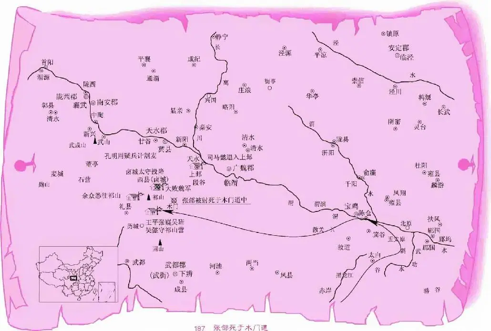

#   
第一百零一回　出隴上諸葛妝神  
　　　　　　　奔劍閣張郃中計  
  

卻說孔明用減兵添灶之法，退兵到漢中。司馬懿恐有埋伏，不敢追趕，亦收兵回長安去了，因此蜀兵不曾折了一人。孔明大賞三軍已畢，回到成都，入見後主，奏曰：「老臣出了祁山，欲取長安，忽承陛下降詔召回，不知有何大事？」後主無言可對。良久，乃曰：「朕久不見丞相之面，心甚思慕，故特詔回，一無他事。」孔明曰：「此非陛下本心，必有奸臣讒譖，言臣有異志也。」後主聞言，默然無語。孔明曰：「老臣受先帝厚恩，誓以死報。今若內有奸邪，臣安能討賊乎？」後主曰：「朕因過聽<a id="note-ref-c-1-1" href="#footnote-a-1-1">注释1</a>宦官之言，一時召回丞相。今日茅塞方開，悔之不及矣！」孔明遂喚眾宦官究問，方知是苟安流言。急令人捕之，已投魏國去了。孔明將妄奏的宦官誅戮，餘皆廢出宮外；又深責蔣琬、費禕等不能覺察奸邪，規諫天子。二人唯唯服罪。孔明拜辭後主，復到漢中，一面發檄，令李嚴應付糧草，仍運赴軍前；一面再議出師。楊儀曰：「前數興兵，軍力罷敝，糧又不繼；今不如分兵兩班，以三個月為期：且如二十萬之兵，只領十萬出祁山，住了三個月，卻教這十萬替回，迴圈相轉。若此則兵力不乏，然後徐徐而進，中原可圖矣。」孔明曰：「此言正合我意。吾伐中原，非一朝一夕之事，正當為此長久之計。」遂下令，分兵兩班，限一百日為期，迴圈相轉，違限者按軍法處治。

建興九年春二月，孔明覆出師伐魏。時魏太和五年也。魏主曹睿知孔明又伐中原，急召司馬懿商議。懿曰：「今子丹已亡，臣願竭一人之力，剿除寇賊，以報陛下。」睿大喜，設宴待之。次日，人報蜀兵寇急。睿即命司馬懿出師禦敵，親排鑾駕送出城外。懿辭了魏主，徑到長安，大會諸路人馬，計議破蜀兵之策。張郃曰：「吾願引一軍去守雍、郿，以拒蜀兵。」懿曰：「吾前軍不能獨當孔明之眾，而又分兵為前後，非勝算也。不如留兵守上邽，餘眾悉往祁山。公肯為先鋒否？」郃大喜曰：「吾素懷忠義，欲盡心報國，惜未遇知己；今都督肯委重任，雖萬死不辭！」於是司馬懿令張郃為先鋒，總督大軍。又令郭淮守隴西諸郡，其餘眾將各分道而進。前軍哨馬報說：「孔明率大軍望祁山進發，前部先鋒王平、張嶷，徑出陳倉，過劍閣，由散關望斜谷而來。」司馬懿謂張郃曰：「今孔明長驅大進，必將割隴西小麥，以資軍糧。汝可結營守祁山，吾與郭淮巡略天水諸郡，以防蜀兵割麥。」郃領諾，遂引四萬兵守祁山。懿引大軍望隴西而去。

卻說孔明兵至祁山，安營已畢，見渭濱有魏軍提備，乃謂諸將曰：「此必是司馬懿也。即今營中乏糧，屢遣人催併李嚴運米應付，卻只是不到。吾料隴上麥熟，可密引兵割之。」於是留王平、張嶷、吳班、吳懿四將守祁山營，孔明自引姜維、魏延等諸將，前到滷城<a id="note-ref-c-1-2" href="#footnote-a-1-2">注释2</a>。滷城太守素知孔明，慌忙開城出降。孔明撫慰畢，問曰：「此時何處麥熟？」太守告曰：「隴上麥已熟。」孔明乃留張翼、馬忠守滷城，自引諸將並三軍望隴上而來。前軍回報說：「司馬懿引兵在此。」孔明驚曰：「此人預知吾來割麥也！」即沐浴更衣，推過一般三輛四輪車來，車上皆要一樣妝飾。此車乃孔明在蜀中預先造下的。當下令姜維引一千軍護車，五百軍擂鼓，伏在上邽之後；馬岱在左，魏延在右，亦各引一千軍護車，五百軍擂鼓。每一輛車，用二十四人，皁衣跣足，披髮仗劍，手執七星皁幡，在左右推車。三人各受計，引兵推車而去。孔明又令三萬軍皆執鐮刀、馱繩，伺候割麥。卻選二十四個精壯之士，各穿皁衣，披髮跣足，仗劍簇擁四輪車，為推車使者。令關興結束做天蓬<a id="note-ref-c-1-3" href="#footnote-a-1-3">注释3</a>模樣，手執七星皁幡，步行於車前，孔明端坐於上，望魏營而來。

哨探軍見之大驚，不知是人是鬼，火速報知司馬懿。懿自出營視之，只見孔明簪冠鶴氅，手搖羽扇，端坐於四輪車上；左右二十四人，披髮仗劍；前面一人，手執皁幡，隱隱似天神一般。懿曰：「這個又是孔明作怪也！」遂撥二千人馬吩咐曰：「汝等疾去，連車帶人，盡情<a id="note-ref-c-1-4" href="#footnote-a-1-4">注释4</a>都捉來！」魏兵領命，一齊追趕。孔明見魏兵趕來，便教回車，遙望蜀營緩緩而行。魏兵皆驟馬追趕，但見陰風習習，冷霧漫漫。盡力趕了一程，追之不上。各人大驚，都勒住馬言曰：「奇怪！我等急急趕了三十里，只見在前，追之不上，如之奈何？」孔明見兵不來，又令推車過來，朝著魏兵歇下。魏兵猶豫良久，又放馬趕來。孔明覆回車慢慢而行。魏兵又趕了二十里，只見在前，不曾趕上，盡皆痴呆。孔明教回過車，朝著魏軍，推車倒行。魏兵又欲追趕。後面司馬懿自引一軍到，傳令曰：「孔明善會八門遁甲，能驅六丁六甲<a id="note-ref-c-1-5" href="#footnote-a-1-5">注释5</a>之神。此乃六甲天書內‘縮地<a id="note-ref-c-1-6" href="#footnote-a-1-6">注释6</a>’之法也。眾軍不可追之。」眾軍方勒馬回時，左勢下戰鼓大震，一彪軍殺來。懿急令兵拒之，只見蜀兵隊裡二十四人，披髮仗劍，皁衣跣足，擁出一輛四輪車。車上端坐孔明，簪冠鶴氅，手搖羽扇。懿大驚曰：「方才那個車上坐著孔明，趕了五十里，追之不上；如何這裡又有孔明？怪哉！怪哉！」言未畢，右勢下戰鼓又鳴，一彪軍殺來，四輪車上亦坐著一個孔明，左右亦有二十四人，皁衣跣足，披髮仗劍，擁車而來。懿心中大疑，回顧諸將曰：「此必神兵也！」眾軍心下大亂，不敢交戰，各自奔走。正行之際，忽然鼓聲大震，又一彪軍殺來：當先一輛四輪車，孔明端坐於上，左右前後推車使者，同前一般。魏兵無不駭然。司馬懿不知是人是鬼，又不知多少蜀兵，十分驚懼，急急引兵奔入上邽，閉門不出。此時孔明早令三萬精兵將隴上小麥割盡，運赴滷城打晒去了。

司馬懿在上邽城中，三日不敢出城。後見蜀兵退去，方敢令軍出哨；於路捉得一蜀兵，來見司馬懿。懿問之，其人告曰：「某乃割麥之人，因走失馬匹，被捉前來。」懿曰：「前者是何神兵？」答曰：「三路伏兵，皆不是孔明，乃姜維、馬岱、魏延也。每一路只有一千軍護車，五百軍擂鼓。只是先來誘陣的車上乃孔明也。」懿仰天長嘆曰：「孔明有神出鬼沒之機！」忽報副都督郭淮入見。懿接入，禮畢，淮曰：「吾聞蜀兵不多，現在滷城打麥，可以擊之。」懿細言前事。淮笑曰：「只瞞過一時；今已識破，何足道哉！吾引一軍攻其後，公引一軍攻其前，滷城可破，孔明可擒類。」懿從之，遂分兵兩路而來。

卻說孔明引軍在滷城打晒小麥，忽喚諸將聽令曰：「今夜敵人必來攻城。吾料滷城東西麥田之內，足可伏兵；誰敢為我一往？」姜維、魏延、馬忠、馬岱四將出曰：「某等願往。」孔明大喜，乃命姜維、魏延各引二千兵，伏在東南、西北兩處；馬岱、馬忠各引二千兵，伏在西南、東北兩處：「只聽炮響，四角一齊殺來。」四將受計，引兵去了。孔明自引百餘人，各帶火炮出城，伏在麥田之內等候。

卻說司馬懿引兵徑到滷城下，日已昏黑，乃謂諸將曰：「若白日進兵，城中必有準備，今可乘夜晚攻之。此處城低壕淺，可便打破。」遂屯兵城外。一更時分，郭淮亦引兵到。兩下合兵，一聲鼓響，把滷城圍得鐵桶相似。城上萬弩齊發，矢石如雨，魏兵不敢前進。忽然魏軍中信炮連聲，三軍大驚，又不知何處兵來。淮令人去麥田搜時，四角上火光沖天，喊聲大震，四路蜀兵，一齊殺至；滷城四門大開，城內兵殺出：裡應外合，大殺了一陣，魏兵死者無數。司馬懿引敗兵奮死突出重圍，佔住了山頭；郭淮亦引敗兵奔到山後扎住。孔明入城，令四將於四角下安營。郭淮告司馬懿曰：「今與蜀兵相持許久，無策可退；目下又被殺了一陣，折傷三千餘人；若不早圖，日後難退矣。」懿曰：「當復如何？」淮曰：「可發檄文調雍、涼人馬併力剿殺。吾願引軍襲劍閣，截其歸路，使彼糧草不通，三軍慌亂：那時乘勢擊之，敵可滅矣。」懿從之，即發檄文星夜往雍、涼調撥人馬。不一日，大將孫禮引雍、涼諸郡人馬到。懿即令孫禮約會郭淮去襲劍閣。

卻說孔明在滷城相拒日久，不見魏兵出戰，乃喚姜維、馬岱入城聽令曰：「今魏兵守住山險，不與我戰：一者料吾麥盡無糧；二者令兵去襲劍閣，斷吾糧道也。汝二人各引一萬軍先去守住險要，魏兵見有準備，自然退去。」二人引兵去了。長史楊儀入帳告曰：「曏者丞相令大兵一百日一換，今已限足，漢中兵已出川口，前路公文已到，只待會兵交換：現存八萬軍，內四萬該與換班。」孔明曰：「既有令，便教速行。」眾軍聞知，各各收拾起程。忽報孫禮引雍、涼人馬二十萬來助戰，去襲劍閣，司馬懿自引兵來攻滷城了。蜀兵無不驚駭。楊儀入告孔明曰：「魏兵來得甚急，丞相可將換班軍且留下退敵，待新來兵到，然後換之。」孔明曰：「不可。吾用兵命將，以信為本。既有令在先，豈可失信？且蜀兵應去者，皆準備歸計，其父母妻子倚扉而望；吾今便有大難，決不留他。」即傳令教應去之兵，當日便行。眾軍聞之，皆大呼曰：「丞相如此施恩於眾，我等願且不回，各舍一命，大殺魏兵，以報丞相！」孔明曰：「爾等該還家，豈可復留於此？」眾軍皆要出戰，不願回家。孔明曰：「汝等既要與我出戰，可出城安營，待魏兵到，莫待他息喘，便急攻之：此以逸待勞之法也。」眾兵領命，各執兵器，歡喜出城，列陣而待。

卻說西涼人馬倍道而來，走的人馬睏乏，方欲下營歇息，被蜀兵一擁而進，人人奮勇，將銳兵驍，雍、涼兵抵敵不住，望後便退。蜀兵奮力追殺，殺得那雍、涼兵屍橫遍野，血流成渠。孔明出城，收聚得勝之兵，入城賞勞。忽報永安李嚴有書告急。孔明大驚，拆封視之。書雲：

> 近聞東吳令人入洛陽，與魏連和；魏令吳取蜀，幸吳尚未起兵。今嚴探知訊息，伏望丞相，早作良圖。

孔明覽畢，甚是驚疑，乃聚諸將曰：「若東吳興兵寇蜀，吾須索<a id="note-ref-c-1-7" href="#footnote-a-1-7">注释7</a>速回也。」即傳令，教祁山大寨人馬，且退回西川：「司馬懿知吾屯軍在此，必不敢追趕。」於是王平、張嶷、吳班、吳懿，分兵兩駱，徐徐退入西川去了。

張郃見蜀兵退去，恐有計策，不敢來追，乃引兵往見司馬懿曰：「今蜀兵退去，不知何意？」懿曰：「孔明詭計極多，不可輕動。不如堅守，待他糧盡，自然退去。」大將魏平出曰：「蜀兵拔祁山之營而退，正可乘勢追之，都督按兵不動，畏蜀如虎，奈天下笑何？」懿堅執不從。

卻說孔明知祁山兵已回，遂令楊儀、馬忠入帳，授以密計，令先引一萬弓弩手，去劍閣木門道，兩下埋伏；若魏兵追到，聽吾炮響，急滾下木石，先截其去路，兩頭一齊射之。二人引兵去了。又喚魏延、關興引兵斷後，城上四面遍插旌旗，城內亂堆柴草，虛放煙火。大兵盡望木門道而去。

魏營巡哨軍來報司馬懿曰：「蜀兵大隊已退，但不知城中還有多少兵。」懿自往視之，見城上插旗，城中煙起，笑曰：「此乃空城也。」令人探之，果是空城，懿大喜曰：「孔明已退，誰敢追之？」先鋒張郃曰：「吾願往。」懿阻曰：「公性急躁，不可去。」郃曰：「都督出關之時，命吾為先鋒；今日正是立功之際，卻不用吾，何也？」懿曰：「蜀兵退去，險阻處必有埋伏，須十分仔細，方可追之。」郃曰：「吾已知得，不必掛慮。」懿曰：「公自欲去，莫要追悔。」郃曰：「大丈夫捨身報國，雖萬死無恨。」懿曰：「公既堅執要去，可引五千兵先行；卻教魏平引二萬馬步兵後行，以防埋伏。吾卻引三千兵隨後策應。」

張郃領命，引兵火速望前追趕。行到三十餘里，忽然背後一聲喊起，樹林內閃出一彪軍，為首大將，橫刀勒馬大叫曰：「賊將引兵哪裡去！」郃回頭視之，乃魏延也。郃大怒，回馬交鋒。不十合，延詐敗而走。郃又追趕三十餘里，勒馬回顧，全無伏兵，又策馬前追。方轉過山坡，忽喊聲大起，一彪軍閃出，為首大將，乃關興也，橫刀勒馬大叫曰：「張郃休趕！有吾在此！」郃就拍馬交鋒。不十合，興撥馬便走。郃隨後追之。趕到一密林內，郃心疑，令人四下哨探，並無伏兵，於是放心又趕。不想魏延卻抄在前面，郃又與戰十餘合，延又敗走。郃奮怒追來，又被關興抄在前面，截住去路。郃大怒，拍馬交鋒，戰有十合，蜀兵盡棄衣甲什物等件，塞滿道路，魏軍皆下馬爭取。延、興二將，輪流交戰，張郃奮勇追趕。看看天晚，趕到木門道口，魏延撥回馬，高聲大罵曰：「張郃逆賊！吾不與汝相拒，汝只顧趕來，吾今與汝決一死戰！」郃十分忿怒，挺槍驟馬，直取魏延。延揮刀來迎。戰不十合，延大敗，盡棄衣甲、頭盔，匹馬引敗兵望木門道中而走。張郃殺得性起，又見魏延大敗而逃，乃驟馬趕來。此時天色昏黑，一聲炮響，山上火光沖天，大石亂柴滾將下來，阻截去路。郃大驚曰：「我中計矣！」急回馬時，背後已被木石塞滿了歸路，中間只有一段空地，兩邊皆是峭壁，郃進退無路。忽一聲梆子響，兩下萬弩齊發，將張郃並百餘個部將，皆射死於木門道中。後人有詩曰：

> 伏弩齊飛萬點星，木門道上射雄兵。
> 
> 至今劍閣行人過，猶說軍師舊日名。

卻說張郃已死，隨後魏兵追到，見塞了道路，已知張郃中計。眾軍勒回馬急退。忽聽得山頭上大叫曰：「諸葛丞相在此！」眾軍仰視，只見孔明立於火光之中，指眾軍而言曰：「吾今日圍獵，欲射一‘馬’，誤中一‘獐’<a id="note-ref-c-1-8" href="#footnote-a-1-8">注释8</a>。汝各人安心而去；上覆仲達：早晚必為吾所擒矣。」魏兵回見司馬懿，細告前事。懿悲傷不已，仰天嘆曰：「張雋乂身死，吾之過也！」乃收兵回洛陽。魏主聞張郃死，揮淚嘆息，令人收其屍，厚葬之。

卻說孔明入漢中，欲歸成都見後主。都護李嚴妄奏後主曰：「臣已辦備軍糧，行將運赴丞相軍前，不知丞相何故忽然班師。」後主聞奏，即命尚書費禕入漢中見孔明，問班師之故。禕至漢中，宣後主之意。孔明大驚曰：「李嚴發書告急，說東吳將興兵寇川，因此回師。」費禕曰：「李嚴奏稱軍糧已辦，丞相無故回師，天子因此命某來問耳。」孔明大怒，令人訪察：乃是李嚴因軍糧不濟，怕丞相見罪，故發書取回，卻又妄奏天子，遮飾己過。孔明大怒曰：「匹夫為一己之故，廢國家大事！」令人召至，欲斬之。費禕勸曰：「丞相念先帝託孤之意，姑且寬恕。」孔明從之。費禕即具表啟奏後主。後主覽表，勃然大怒，叱武士推李嚴出斬之。參軍蔣琬出班奏曰：「李嚴乃先帝託孤之臣，乞望恩寬恕。」後主從之，即謫為庶人，徙於梓潼郡閒住。

孔明回到成都，用李嚴子李豐為長史；積草屯糧，講陣論武，整治軍器，存恤<a id="note-ref-c-1-9" href="#footnote-a-1-9">注释9</a>將士，三年然後出征。兩川人民軍士，皆仰其恩德。光陰荏苒，不覺三年：時建興十二年春二月。孔明入朝奏曰：「臣今存恤軍士，已經三年。糧草豐足，軍器完備，人馬雄壯，可以伐魏。今番若不掃清奸黨，恢復中原，誓不見陛下也！」後主曰：「方今已成鼎足之勢，吳、魏不曾入寇，相父何不安享太平？」孔明曰：「臣受先帝知遇之恩，夢寐之間，未嘗不設伐魏之策。竭力盡忠，為陛下克復中原，重興漢室：臣之願也。」言未畢，班部中一人出曰：「丞相不可興兵。」眾視之，乃譙周也。正是：

> 武侯盡瘁惟憂國，太史知機又論天。

未知譙周有何議論，且看下文分解。

<ol class="footnotes">
<li id="footnote-a-1-1">注释1 ［過聽］誤聽。 <a href="#note-ref-c-1-1" aria-label="返回正文">↩</a></li>
<li id="footnote-a-1-2">注释2 ［滷城］即西縣。故城址在今甘肅天水西南。 <a href="#note-ref-c-1-2" aria-label="返回正文">↩</a></li>
<li id="footnote-a-1-3">注释3 ［天蓬］天蓬元帥，古代神話傳說中的天神。 <a href="#note-ref-c-1-3" aria-label="返回正文">↩</a></li>
<li id="footnote-a-1-4">注释4 ［盡情］盡數，全部。 <a href="#note-ref-c-1-4" aria-label="返回正文">↩</a></li>
<li id="footnote-a-1-5">注释5 ［六丁六甲］道教神名。六丁：丁卯、丁巳、丁未、丁酉、丁亥、丁丑，為陰神；六甲：甲子、甲戌、甲申、甲午、甲辰、甲寅，為陽神。 <a href="#note-ref-c-1-5" aria-label="返回正文">↩</a></li>
<li id="footnote-a-1-6">注释6 ［縮地］古代神仙傳說：東漢人費長房，有仙術，一天之內，能與千里以外幾個地方的人見面，稱之為「縮地術」。 <a href="#note-ref-c-1-6" aria-label="返回正文">↩</a></li>
<li id="footnote-a-1-7">注释7 ［須索］定要、必須的意思。 <a href="#note-ref-c-1-7" aria-label="返回正文">↩</a></li>
<li id="footnote-a-1-8">注释8 ［欲射一「馬」，誤中一「獐」］「馬」系「司馬」的省語，「獐」是「張」的諧音。全句意思是：本想射死司馬懿，卻射中了張郃。 <a href="#note-ref-c-1-8" aria-label="返回正文">↩</a></li>
<li id="footnote-a-1-9">注释9 ［存恤］慰問、撫卹。 <a href="#note-ref-c-1-9" aria-label="返回正文">↩</a></li>
</ol>